# Strata – A workspace that connects work with evidence for software projects

**Strata** is a workspace that helps software teams keep **one profile for each feature**: requirements, work items, commits/PRs, test results and decisions, updated automatically from **GitHub** and **CI**. Evidence is stored as **immutable snapshots**, so the question "is this feature ready to be marked complete?" can be checked and reproduced. The MVP serves software projects only; research projects, scientific paper writing, AI/ML projects and AI agents are part of the long-term plan on the same data core.

> Scope labels used in this document: **[MVP]** = within the software MVP (Must/Should/Could priorities are in the [PRD](docs/product/PRD_Strata_MVP.md) section 5), **[LATER]** = a later phase, see the [Plan](docs/product/PLAN_Strata.md).

**Table of contents**

1. [Problem analysis (Research)](#1-problem-analysis-research)
2. [Requirements – Use Case, INVEST User Stories, Acceptance Criteria](#2-requirements--use-case-invest-user-stories-acceptance-criteria)
3. [Information Architecture](#3-information-architecture)
4. [UI/UX design and front-end interaction](#4-uiux-design-and-front-end-interaction)
5. [C4 architecture](#5-c4-architecture)
6. [Database and API contract](#6-database-and-api-contract)
7. [Planned repository structure](#7-planned-repository-structure)
8. [Detailed class and sequence design](#8-detailed-class-and-sequence-design)

See also: [Current UI prototype](#49-current-ui-prototype) · [Documents](#documents) · [Project progress](#project-progress)

---

## 1. Problem analysis (Research)

### 1.1. Context and problem

Evidence labels used: **Sourced (directional)** = survey or article, mostly from tool vendors; **Assumption** = inferred from brainstorming, not yet validated by interviews.

| Current problem | Consequence | Capability Strata needs |
|---|---|---|
| Information about a feature is scattered across the work tool, Git, CI and documents (Sourced, directional) | Manual synthesis; answering "where are we?" requires asking developers | Feature profile + automatically updated timeline |
| Heavy processes; leadership does not understand developers' difficulties (Atlassian 2025: 63% of developers; Sourced, directional) | Time lost to paperwork, lower motivation | Simple defaults, fixed workflow in the MVP |
| Status is updated by hand even though the data already exists in Git/CI (Assumption) | Stale data; teams stop using the tool | GitHub + JUnit ingestion, immutable snapshots |
| BA/QA/PO cannot see whether requirements have been verified (Assumption) | Release happens before the AC is verified | Traceability AC ↔ test ↔ result; role-based views |
| History of why a requirement changed is lost (Assumption) | Repeated debates, hard to audit | Immutable events, marking of Decisions |
| "Good enough quality" is judged by feel and is hard to reproduce (Assumption) | Release risk, disputes | Gate that evaluates a snapshot together with the rule version |

### 1.2. Goals and success metrics

The goals are proposals; no baseline exists yet.

| Goal | Metric (suggested for the MVP) |
|---|---|
| One single place for one feature | BA/QA can answer "where is feature X?" within 1 minute |
| Evidence arrives automatically | ≥ 80% of commit/PR–item links are `auto` |
| Completion decisions are reproducible | Re-running the gate on the same snapshot and rules gives the same result (100%) |
| Tenant data isolation | 0 cross-tenant leaks in the RLS test suite |
| Actually used | ≥ 3 teams; ≥ 60% of members active weekly after 4 weeks |

### 1.3. Top-down problem decomposition

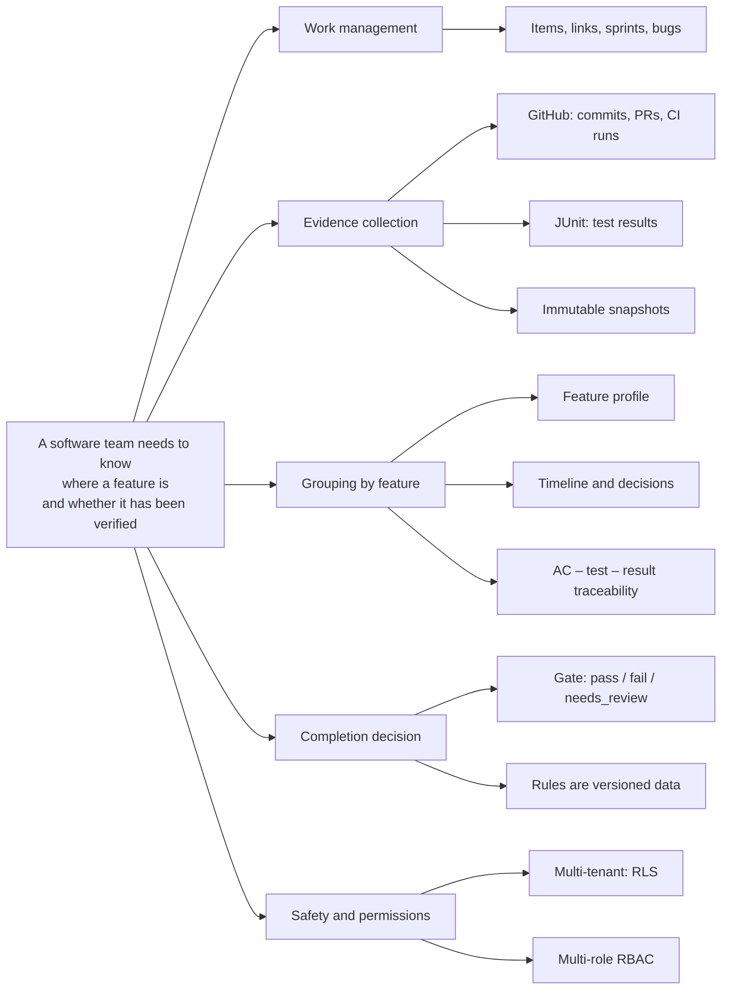

### 1.4. Stakeholders

| Group | Examples | Main needs | Role in the system |
|---|---|---|---|
| Workspace administration | Tech lead, team lead | Quick setup, connect GitHub, manage members | Workspace Admin |
| Product owner | Product Owner | Prioritization, accepting features, knowing real progress | PO |
| Project management | Project Manager | Sprints, progress, blockers, gate configuration | PM |
| Business analysis | Business Analyst | Requirements with AC, traceability, change history | BA |
| Testing | QA/Tester | Test results per AC, bugs, gate approval | QA |
| Software development | Developer | Little process, automatic commit/PR linking | Dev |
| Read-only users | Senior management, clients | View profiles and progress | Viewer |

### 1.5. Permitted data sources

| Source code | Source system | Main data | Objects | Ingestion method | Frequency | Highest sensitivity |
|---|---|---|---|---|---|---|
| SRC-GH | GitHub (GitHub App) | Commits, pull requests, check/workflow runs (metadata) | `commit`, `pull_request`, `ci_run` | Webhook + reconciliation polling | Real time; reconciliation every 15 minutes | Medium (file contents are not read) |
| SRC-JUNIT | CI via API or GitHub Action | JUnit XML | `source_snapshot`, `test_result` | Upload with CI token | Each CI run | Low |
| SRC-USER | Users | Items, comments, AC, decisions | `item`, `comment`, `acceptance_criterion` | Entered on the web | Continuous | Medium |
| SRC-LATER | GitLab, Jenkins, SonarQube, Figma, Confluence, MLflow, W&B, Zotero [LATER] | Depends on the source | Depends on the adapter | Normalizing adapter | — | — |

> Strata does not store or display source code in the MVP. The GitHub App only requests read permissions for metadata, PRs, checks and workflow runs.

### 1.6. Conceptual architecture

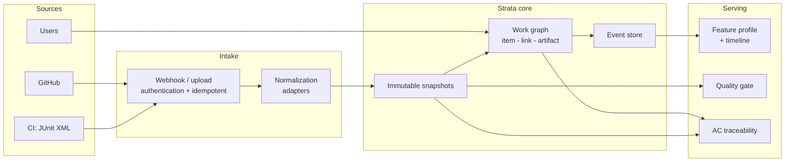

| Component | Choice | Rationale |
|---|---|---|
| Architecture | Modular monolith | Small team; clear module boundaries so they can be split later |
| Database | PostgreSQL | RLS, JSONB, full-text; pgvector when needed ([LATER]) |
| Queue | Job table in PostgreSQL | Move to NATS/Kafka when needed |
| Object storage | S3-compatible | Original JUnit files, logs |
| Integration | GitHub App | Minimum permissions; webhook + polling |
| Authentication | OIDC | GitHub, Google |

The full set of decisions is in [5.4](#54-architecture-decisions).

### 1.7. Conceptual data model

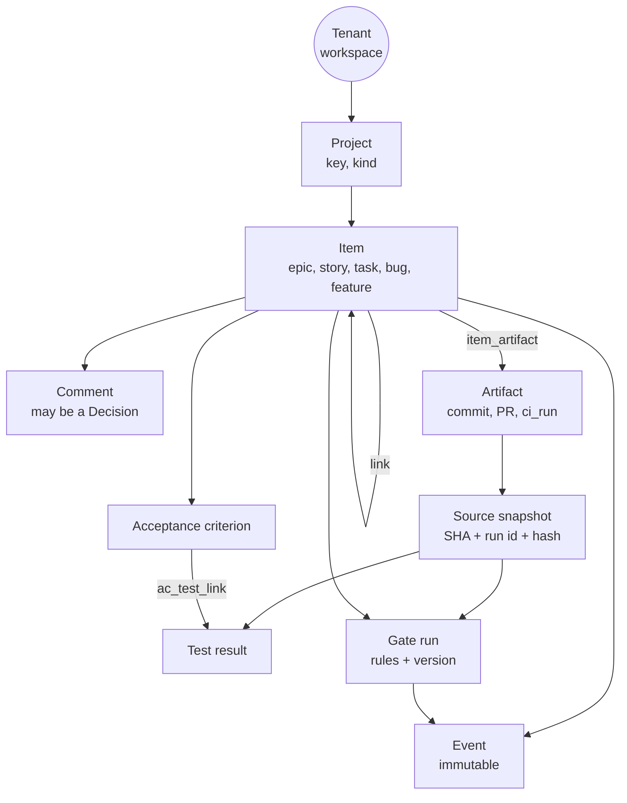

### 1.8. Scope

| Item | MVP (software) | LATER (later phases) | Out of scope |
|---|---|---|---|
| Work | Items, links, sprints, bugs, board, backlog | Workflow designer, version tree | Free-form custom fields like Jira |
| Integrations | GitHub, JUnit | GitLab, CI, SonarQube, Figma, Confluence, MLflow, W&B, Zotero | Storing source code |
| Quality | Basic gate, AC traceability | Gate in a full workflow, stale propagation | — |
| AI | None | Agent levels 0–1, then 2–3 | Agents writing directly to core data |
| Spaces | Projects | Personal/public private spaces, projects, organizations | — |
| Project types | `software` | `research`, `ai` | — |
| Analytics | Timeline | Estimate ranges, risks, bottlenecks, coaching | Individual leaderboards |
| Scale | Pooled + RLS | Per-tenant DB, data regions | — |

### 1.9. Assumptions, constraints and risks

| Type | Content |
|---|---|
| Assumptions | Target group of 3–10 GitHub users; CI generates JUnit XML; teams accept an item-code convention in commits/PRs; build team of 3–4 people. |
| Technical constraints | Idempotent handling of duplicate or out-of-order webhooks; every table has `tenant_id` + RLS; snapshots are never modified or deleted. |
| Privacy constraints | No individual rankings; BA/QA do not need to see code; export and deletion of workspace data on request. |
| Risks | Scope spreads into research/AI too early; data does not arrive automatically (missing item codes); competition with Jira/Linear/GitHub Projects; becoming a "second Jira". *Mitigation:* the P1 exit criteria are a mandatory gate, a branch-naming convention is suggested, defaults stay simple ([PRD section 12](docs/product/PRD_Strata_MVP.md)). |

---

## 2. Requirements – Use Case, INVEST User Stories, Acceptance Criteria

**US** (User Story) describes value from the user's point of view; **AC** (Acceptance Criteria) are testable conditions of acceptance, detailed in [PRD section 6](docs/product/PRD_Strata_MVP.md); **UC** (Use Case) describes the interaction between an actor and the system.

### 2.1. Product Mind Map

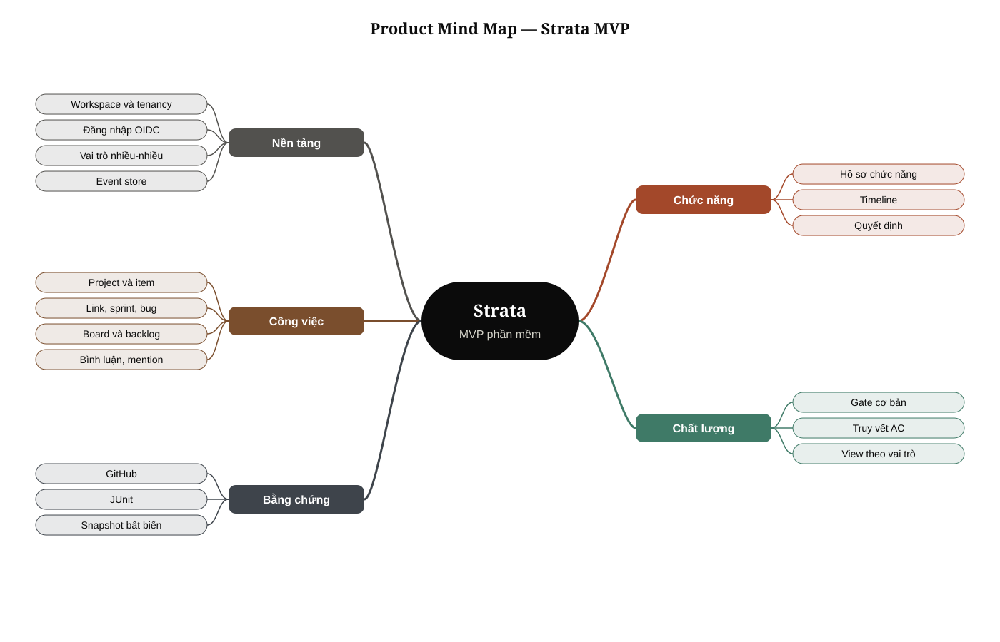

| Business group | Description |
|---|---|
| Foundation | Tenant, users, roles, events, audit |
| Work | Item management, backlog, sprints, bugs |
| Collaboration | Comments, mentions, notifications, decisions |
| Evidence | GitHub connection, JUnit intake, snapshots |
| Features | Feature profiles and timelines |
| Quality | Gate, AC traceability, role-based pages |

### 2.2. Actors

| Actor | Responsibilities |
|---|---|
| **Workspace Admin** | Creates the workspace, invites members, assigns roles, connects GitHub, creates CI tokens |
| **PO** | Prioritizes the backlog, writes/approves AC, accepts features |
| **PM** | Manages projects and sprints, configures gates, tracks blockers |
| **BA** | Writes requirements and AC, traces them, marks decisions |
| **QA** | Manages bugs, reviews test results, approves gates |
| **Dev** | Works on items, links commits/PRs, views CI |
| **Viewer** | Read-only |
| **GitHub / CI** | External systems that send webhooks and JUnit |

> One person may hold several roles; effective permissions are the union of the roles.

### 2.3. Requirements by INVEST principle

#### 2.3.1. INVEST principles

| Criterion | Meaning |
|---|---|
| **I – Independent** | A story can be built and released on its own; dependencies are stated explicitly |
| **N – Negotiable** | Implementation details can be adjusted |
| **V – Valuable** | Delivers value to a specific actor |
| **E – Estimable** | Clear enough to estimate |
| **S – Small** | Can be completed within one sprint |
| **T – Testable** | Has verifiable AC |

#### 2.3.2. User Stories list

| ID | Scope | Actor | User Story |
|---|:---:|---|---|
| **US01** | MVP | User | As a user, I want to sign in with GitHub or Google so I do not have to remember a password. |
| **US02** | MVP | Admin | As an admin, I want to create a workspace and invite members by email or link so the team can start working. |
| **US03** | MVP | Admin | As an admin, I want to assign multiple roles to one person per project so that a person doing several jobs is represented correctly. |
| **US04** | MVP | PM | As a PM, I want to create a project with a key so items get stable `KEY-n` codes. |
| **US05** | MVP | PO/BA/Dev | As a PO/BA/Dev, I want to create and edit typed items (epic, story, task, bug, feature) to describe work. |
| **US06** | MVP | PO/BA/Dev | As a PO/BA/Dev, I want to link items (blocks, implements, tests…) to express relationships. |
| **US07** | MVP | PO | As a PO, I want to rank the backlog by drag-and-drop to express priority. |
| **US08** | MVP | Dev | As a developer, I want to view and update items on a Kanban board to track flow. |
| **US09** | MVP | PM | As a PM, I want to create sprints and assign items to plan iterations. |
| **US10** | MVP | QA | As a QA, I want to log bugs with severity S1–S4 to prioritize them. |
| **US11** | MVP | Member | As a member, I want to comment and `@mention` people to communicate with the right person. |
| **US12** | MVP | BA/PO | As a BA/PO, I want to mark a comment as a Decision so we can later see why something was decided. |
| **US13** | MVP | Member | As a member, I want to receive in-app notifications and summary emails that I can configure. |
| **US14** | MVP | Admin | As an admin, I want to install the GitHub App on repos so Strata receives events. |
| **US15** | MVP | Dev | As a developer, I want commits/PRs to link to items automatically via the `KEY-n` code so I do not enter them by hand. |
| **US16** | MVP | Dev/QA | As a developer/QA, I want to link or unlink manually when automatic linking is wrong or missing. |
| **US17** | MVP | Dev/PM | As a developer/PM, I want to see PR and CI status on an item to know build progress. |
| **US18** | MVP | Dev/CI | As a developer/CI, I want to upload JUnit XML through the API so Strata has test results. |
| **US19** | MVP | QA/BA | As a QA/BA, I want to see test results per feature to know current quality. |
| **US20** | MVP | BA/PO/QA | As a BA/PO/QA, I want to open a feature profile that gathers requirements, work items, PRs, tests and decisions to get the full context. |
| **US21** | MVP | BA/PO | As a BA/PO, I want a timeline filtered by event type to understand what happened. |
| **US22** | MVP | PM/QA | As a PM/QA, I want to configure gate rules as versioned data to standardize completion conditions. |
| **US23** | MVP | Dev | As a developer, I want the gate to evaluate the latest snapshot when moving to `done` so I know whether I am eligible. |
| **US24** | MVP | QA | As a QA, I want to approve a `needs_review` gate and record a reason so someone is accountable. |
| **US25** | MVP | BA | As a BA, I want AC with stable IDs attached to a feature so they can be verified. |
| **US26** | MVP | QA | As a QA, I want to map tests ↔ AC by tag or manually so I can trace them. |
| **US27** | MVP | BA/PO/QA | As a BA/PO/QA, I want to see the matrix of AC × tests × results and AC coverage to know which AC are not yet verified. |
| **US28** | MVP | Member | As a member, I want a home page based on my role so I can see what needs doing now. |
| **US29** | MVP | Admin | As an admin, I want to view the log of permission and activity changes for auditing. |
| **US30** | LATER | PM | As a PM, I want to design workflows with approval gates for my team's process. |
| **US31** | LATER | BA/QA | As a BA/QA, I want to assign a node to an agent that drafts AC or generates test cases, and control its input/output. |
| **US32** | LATER | Researcher | As a researcher, I want to trace figures in a manuscript back to the original experiment. |
| **US33** | LATER | AI team | As an AI team, I want to link MLflow/W&B runs to hypotheses and tasks. |

#### 2.3.3. INVEST review of story groups

| User Story group | I – Necessary dependencies | N – Changeable parts | V – Value | E/S – Estimation boundary and size | T – How to test |
|---|---|---|---|---|---|
| **US01–US03** Accounts, roles | Needed before every other story | OIDC provider | Secure access | Each story ≤ 1 sprint | AC-F1, AC-F2 |
| **US04–US10** Work | Needs tenant and roles | Set of item types, lifecycle | Basic work management | Split board, backlog, sprint | AC-F3 |
| **US11–US13** Collaboration | Needs items | Notification channels | Communication and keeping decisions | Small | AC-F4 |
| **US14–US17** GitHub | Needs items | Item-code convention | Automatic evidence | Split App installation, webhooks, linking | AC-F5 |
| **US18–US19** Tests | Needs artifacts and storage | Report format | Test results with snapshots | Small | AC-F6 |
| **US20–US21** Profiles | Needs F3, F5, F6 | Profile layout | Main destination of the product | Split profile and timeline | AC-F7 |
| **US22–US24** Gate | Needs snapshots | Set of rule conditions | Decisions backed by evidence | Split rules, execution, review | AC-F8 |
| **US25–US27** Traceability | Needs tests and AC | Tag syntax | Know which AC are verified | Split tags, matrix | AC-F9 |
| **US28–US29** Roles, audit | Needs events and roles | Widget content | Fast start | Small | AC-F10 |

#### 2.3.4. Business Rules (BR)

| Code | Design rule |
|---|---|
| **BR01** | Every record belongs to exactly one tenant; queries are always filtered by tenant through RLS. |
| **BR02** | Item code = `project.key` + `seq` incremented atomically; not reused after deletion. |
| **BR03** | Deletion is soft; `event` is append-only: never updated, never deleted. |
| **BR04** | Roles are assigned many-to-many per project; effective permissions are the union of roles. |
| **BR05** | Webhooks and uploads are processed idempotently by `external_ref` (delivery id, SHA, run id, hash). |
| **BR06** | Snapshots carry immutable identifiers (commit SHA, run id); the gate evaluates a snapshot, not the current branch. |
| **BR07** | Commit/PR ↔ item links are based on the item code in the branch name, commit and PR title; each link records its origin (`auto` / `manual`). |
| **BR08** | The person requesting a status change may not approve their own gate. |
| **BR09** | Gate rules are versioned data; editing a rule creates a new version, and old `gate_run` records keep the old version. |
| **BR10** | Strata does not store or display source code/diffs; BA/QA see deliverables and AC, not code. |
| **BR11** | Only process metrics are measured; no individual ranking or scoring. |
| **BR12** | Integration tokens are stored encrypted with minimum permissions (read-only). |
| **BR13** | Every permission change writes an event with actor, before and after. |
| **BR14** | Changing AC content marks its test links as `stale` until QA confirms. |

#### 2.3.5. Acceptance Criteria (AC)

The full AC (Given/When/Then) are in [PRD section 6](docs/product/PRD_Strata_MVP.md#6-feature-requirements). The table below is the index.

| AC group | Story | Representative criteria |
|---|---|---|
| AC-F1 | US01, US02 | First sign-in creates a user; calling the item API of another workspace returns 404; a query missing tenant returns 0 rows |
| AC-F2 | US03, US29 | Valid roles; Viewer is refused writes; changing roles writes an event; the last Admin cannot be removed |
| AC-F3 | US04–US10 | Item codes are not duplicated under concurrency; invalid state changes are blocked; bugs require severity |
| AC-F4 | US11–US13 | Mentions notify within 10 seconds; Decisions appear on the profile and timeline |
| AC-F5 | US14–US17 | Duplicate webhooks produce only one artifact; wrong signature returns 401; polling compensates for lost webhooks within 15 minutes |
| AC-F6 | US18–US19 | Snapshot totals match pass/fail/skip; repeated uploads are idempotent; broken XML returns 422 |
| AC-F7 | US20–US21 | A profile with 500 events loads in ≤ 2 seconds (p95); BA cannot see diffs or source code |
| AC-F8 | US22–US24 | Failure lists the failing tests; re-running the same snapshot gives the same result; no self-approval |
| AC-F9 | US25–US27 | AC with a passing test is "verified"; editing an AC makes its test links `stale` |
| AC-F10 | US28 | QA sees pending gates at the top of the page; Dev sees assigned work with PR/CI status |

### 2.4. Use Cases

#### 2.4.1. Overview Use Case diagram

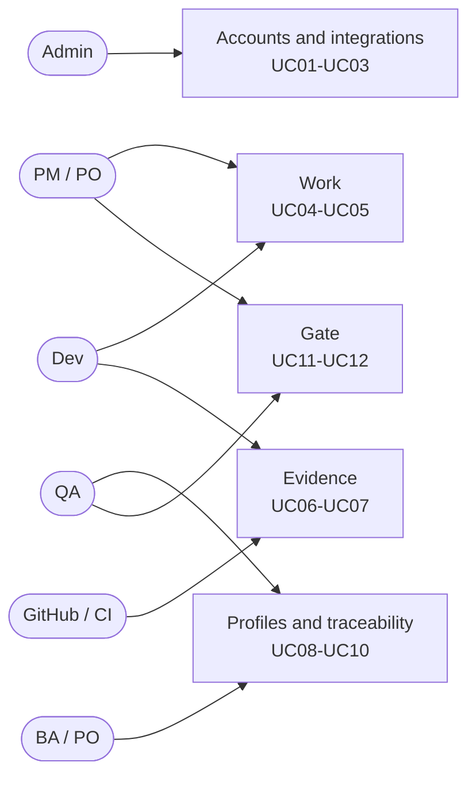

#### 2.4.2. List of Use Cases

| Use Case | Name | Main actor | Related US | Scope |
|---|---|---|---|---|
| UC01 | Sign in and create a workspace | User | US01, US02 | MVP |
| UC02 | Invite members and assign roles | Admin | US02, US03 | MVP |
| UC03 | Connect GitHub to a project | Admin | US14 | MVP |
| UC04 | Manage backlog and sprints | PO, PM | US04, US07, US09 | MVP |
| UC05 | Work on the board | Dev | US05, US08, US10 | MVP |
| UC06 | Receive GitHub webhooks and link | GitHub | US15–US17 | MVP |
| UC07 | Receive JUnit and create snapshot | CI | US18, US19 | MVP |
| UC08 | View feature profile and timeline | BA, PO, QA | US20, US21 | MVP |
| UC09 | Attach AC and trace tests | BA, QA | US25–US27 | MVP |
| UC10 | Mark a decision | BA, PO | US12 | MVP |
| UC11 | Configure gate rules | PM, QA | US22 | MVP |
| UC12 | Evaluate gate and approve | Dev, QA | US23, US24 | MVP |
| UC13 | Design workflows | PM | US30 | LATER |
| UC14 | Assign a node to an agent | BA, QA | US31 | LATER |

#### 2.4.3. Detailed specification of key Use Cases

**UC06 – Receive GitHub webhook and link (US15, US17)**

- **Actor:** GitHub (external system).
- **Preconditions:** The GitHub App is installed on the repo; the repo is attached to one project.
- **Main flow:** (1) GitHub sends a webhook; (2) the system verifies the HMAC signature; (3) it checks whether the delivery id has already been processed; (4) it normalizes the payload into an artifact; (5) it looks for the item code in the branch name, commit and PR title; (6) it creates an `auto` link; (7) it writes an event; (8) the timeline updates.
- **Alternative flow:** no item code found → the artifact is stored unlinked and appears in the "unlinked" list for manual linking.
- **Exceptions:** wrong signature → 401; delivery already processed → skipped, returns 200; processing error → limited retries, then placed in an error queue.
- **Postconditions:** at most one artifact and one event per delivery; polling compensates if a webhook is lost.

**UC08 – View feature profile and timeline (US20, US21)**

- **Actor:** BA, PO, QA.
- **Preconditions:** the user has permission to view the project.
- **Main flow:** (1) open the feature list; (2) select a feature; (3) view the summary, AC, child items, PR/CI, latest test results, decisions; (4) switch to the Timeline tab; (5) filter by event type.
- **Alternative flow:** feature has no tests → the test section shows "no results yet".
- **Exceptions:** no permission → a 403 page states which role is required.
- **Postconditions:** no data changed.

**UC12 – Evaluate gate and approve (US23, US24)**

- **Actor:** Dev (requests), QA (approves).
- **Preconditions:** the feature is in `review`; the latest test snapshot exists; a gate rule exists.
- **Main flow:** (1) Dev moves the feature to `done`; (2) the system selects the latest snapshot and the current rule version; (3) it evaluates each condition; (4) it stores a `gate_run`; (5) if any condition needs a human → `needs_review`; (6) QA reviews the reasons and evidence; (7) QA accepts or rejects with feedback; (8) the feature moves to `done` or back to `in_progress`.
- **Alternative flow:** a condition is `fail` → the feature returns to `in_progress` with the reason.
- **Exceptions:** the requester approves their own gate → refused (BR08); no snapshot → gate `fail` with reason "missing evidence".
- **Postconditions:** the `gate_run` is immutable and records the snapshot, rule version and approver.

### 2.5. Roles and Permissions

#### 2.5.1. Permission matrix

| Function | Admin | PO | PM | BA | QA | Dev | Viewer |
|---|:---:|:---:|:---:|:---:|:---:|:---:|:---:|
| Manage workspace, members, roles | ✓ | — | — | — | — | — | — |
| Connect GitHub, create CI tokens | ✓ | — | ✓ | — | — | — | — |
| Create/edit projects, sprints | ✓ | — | ✓ | — | — | — | — |
| Create/edit items, comment | ✓ | ✓ | ✓ | ✓ | ✓ | ✓ | — |
| Rank the backlog | ✓ | ✓ | ✓ | — | — | — | — |
| Write/edit AC | ✓ | ✓ | — | ✓ | — | — | — |
| Delete/restore items | ✓ | — | ✓ | — | — | — | — |
| Configure gate rules | ✓ | — | ✓ | — | ✓ | — | — |
| Approve `needs_review` gate | ✓ | per rule | — | — | ✓ | — | — |
| Confirm `stale` test links | ✓ | — | — | — | ✓ | — | — |
| View profiles, timeline, test results | ✓ | ✓ | ✓ | ✓ | ✓ | ✓ | ✓ |
| View activity log (audit) | ✓ | — | ✓ | — | — | — | — |

> JUnit upload uses a CI token per project, not a personal account. Strata does not display source code, so there is no row for permission to view code.

#### 2.5.2. Business states to manage

| Object | Expected states | Meaning |
|---|---|---|
| Item | `backlog`, `in_progress`, `review`, `done`, `cancelled` | Default lifecycle of work |
| Invitation | `pending`, `accepted`, `expired`, `revoked` | Member invitation status |
| GitHub integration | `connected`, `degraded`, `revoked` | `degraded` when webhooks fail; waits for polling to compensate |
| Snapshot | `received`, `parsed`, `failed` | Processing of the test file |
| Gate run | `pass`, `fail`, `needs_review` | Evaluation result |
| AC–test link | `active`, `stale` | `stale` when the AC changes after linking |

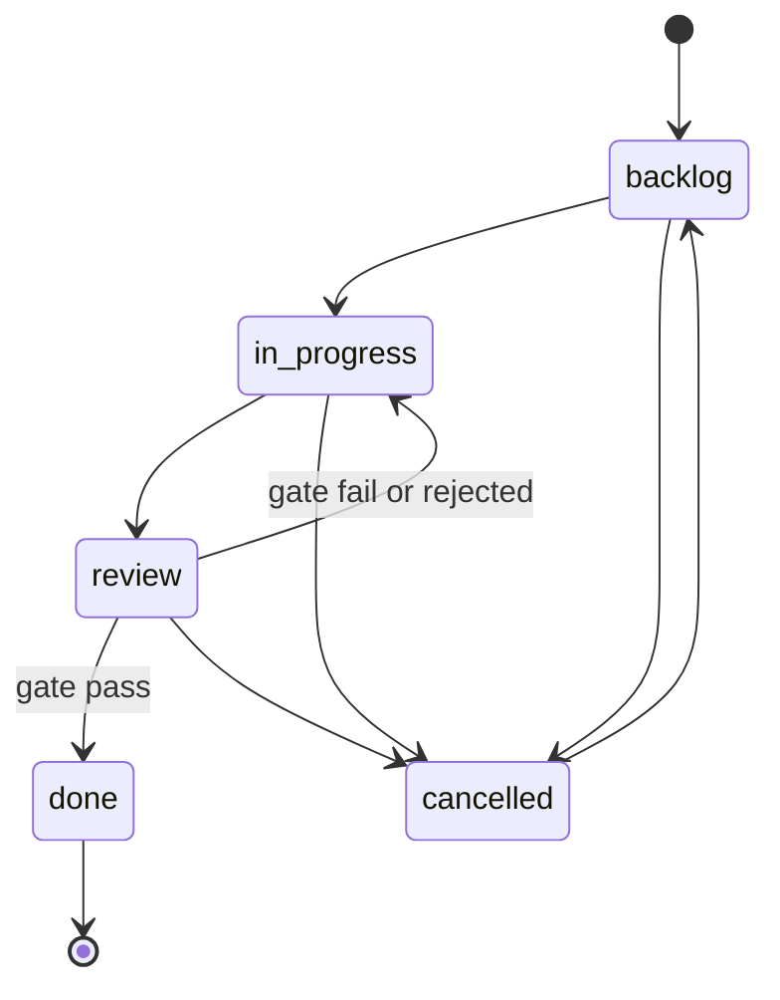

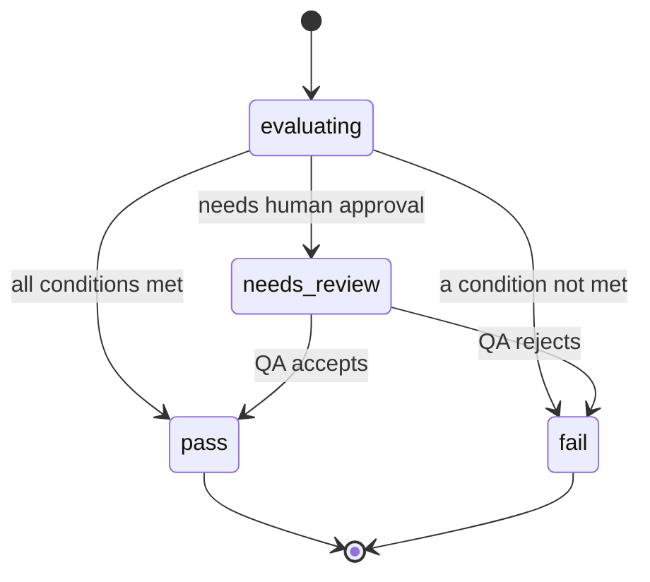

---

## 3. Information Architecture

The MVP has 5 areas: General system, Work, Features, Quality, and Integrations and Administration. Pages are numbered `P01`…`P18`.

### 3.1. Page tree (Sitemap)

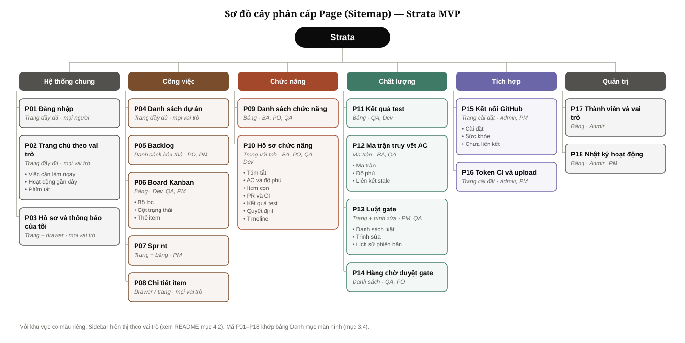

### 3.2. Information hierarchy within a page (Page → Section → Component)

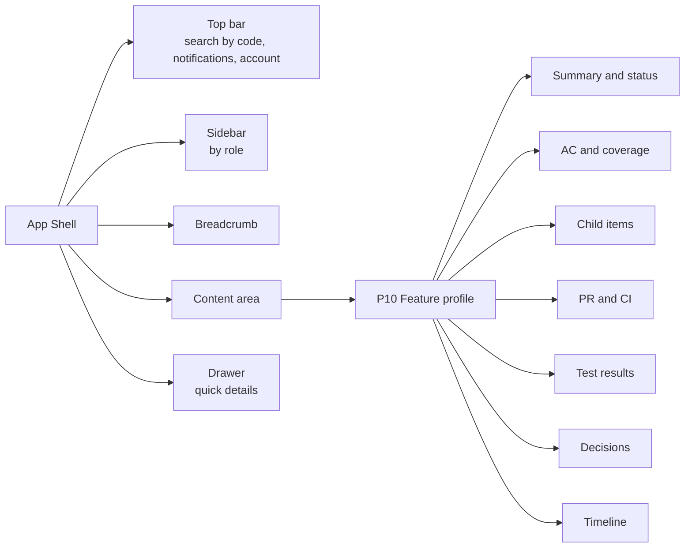

### 3.3. Content of each page by section

#### General system area

##### P02 – Role-based home page

| Section | Content and function |
|---|---|
| **Needs action now** | PO: features waiting for acceptance; PM: blocked items; BA: requirements missing AC; QA: gates waiting for review, open bugs; Dev: my work + PR/CI status. |
| **Recent activity** | Condensed timeline of features I follow. |
| **Shortcuts** | Search by item code; create item; switch project. |

#### Work area

##### P06 – Kanban board

| Section | Content and function |
|---|---|
| **Filters** | By sprint, assignee, item type, feature. |
| **Status columns** | `backlog`, `in_progress`, `review`, `done`; drag-and-drop changes status; violations of the lifecycle are refused with a reason. |
| **Item cards** | Code, title, assignee, PR/CI icons, severity if a bug. |

#### Features area

##### P10 – Feature profile

| Section | Content and function |
|---|---|
| **Summary** | Code, title, status, owner, latest gate status. |
| **AC and coverage** | List of AC with IDs; each AC shows "verified / uncovered / stale" with a snapshot reference. |
| **Child items** | Stories, tasks, bugs belonging to the feature. |
| **PR and CI** | Title, status, author, GitHub link; no diff, no source code. |
| **Test results** | Pass/fail/skip totals for the latest snapshot; list of failing tests. |
| **Decisions** | Comments marked as Decisions. |
| **Timeline** | Events in chronological order; filter by status, code, test, comments, decisions. |

#### Quality area

##### P12 – AC traceability matrix

| Section | Content and function |
|---|---|
| **Matrix** | Rows are AC; columns are tests and the latest snapshot results. |
| **Coverage** | Share of AC with tests; uncovered AC highlighted. |
| **Stale links** | List of links QA must confirm after an AC changes. |

##### P13 – Gate rules

| Section | Content and function |
|---|---|
| **Rule list** | Conditions as data, current version. |
| **Editor** | Choose conditions from a catalog (tests, bugs, AC, approver); preview results on the current snapshot. |
| **Version history** | Rule versions and the `gate_run` records that used each version. |

#### Integrations area

##### P15 – GitHub connection

| Section | Content and function |
|---|---|
| **Setup** | Button to install the GitHub App; choose the repo attached to the project. |
| **Health** | `connected` / `degraded`; time of the latest webhook and polling. |
| **Unlinked** | Commits/PRs not attached to an item, for manual linking. |

### 3.4. Screen inventory

| Code | Screen / Page | Display format | Role | Related US |
|---|---|---|---|---|
| P01 | Sign in | Full page | Everyone | US01 |
| P02 | Role-based home page | Full page | All roles | US28 |
| P03 | My profile and notifications | Page + drawer | All roles | US13 |
| P04 | Project list | Full page | All roles | US04 |
| P05 | Backlog | Drag-and-drop list | PO, PM | US07 |
| P06 | Kanban board | Board | Dev, QA, PM | US08 |
| P07 | Sprints | Page + table | PM | US09 |
| P08 | Item details | Drawer / page | All roles | US05, US06, US10, US11, US12 |
| P09 | Feature list | Table | BA, PO, QA | US20 |
| P10 | Feature profile | Page with tabs | BA, PO, QA, Dev | US20, US21 |
| P11 | Test results | Table | QA, Dev | US18, US19 |
| P12 | AC traceability matrix | Matrix | BA, QA | US25–US27 |
| P13 | Gate rules | Page + editor | PM, QA | US22 |
| P14 | Gate review queue | List | QA, PO | US23, US24 |
| P15 | GitHub connection | Settings page | Admin, PM | US14–US16 |
| P16 | CI tokens and upload | Settings page | Admin, PM | US18 |
| P17 | Members and roles | Table | Admin | US02, US03 |
| P18 | Activity log | Table | Admin, PM | US29 |

### 3.5. Main navigation flows

**Flow A – Start a workspace**

```text
P01 Sign in → create workspace → P17 invite members → P15 install GitHub App
→ P04 create project (key) → P16 create CI token → P05 create first item
```

**Flow B – Work on a feature**

```text
P09 Feature list → "Create feature" → add AC → create child items
→ P06 board: move card → commit with code KEY-n → P10 profile shows PR/CI
```

**Flow C – Verify and complete**

```text
CI uploads JUnit → P11 test results → P12 AC matrix
→ Dev moves to done → gate runs → P14 QA approves → P10 status done
```

---

## 4. UI/UX design and front-end interaction

### 4.1. Design principles

| Principle | How it appears in the interface |
|---|---|
| **Visible evidence** | Every "verified" status links to its snapshot or source |
| **Simple by default** | Fixed workflow, little configuration; can start using it in ≤ 30 minutes |
| **Features are central** | From any item/PR/test you can jump back to the feature profile |
| **No individual monitoring** | Shown by action and role; no individual leaderboards |
| **Explainable** | The gate shows why it passed/failed/needs review and which conditions |

### 4.2. Application shell (App Shell)

The shell has a top bar (brand, workspace switcher, search by item key, language EN · VI, notifications, account) and a sidebar that shows only the groups allowed for the role. Example: P02 Home for the QA role.

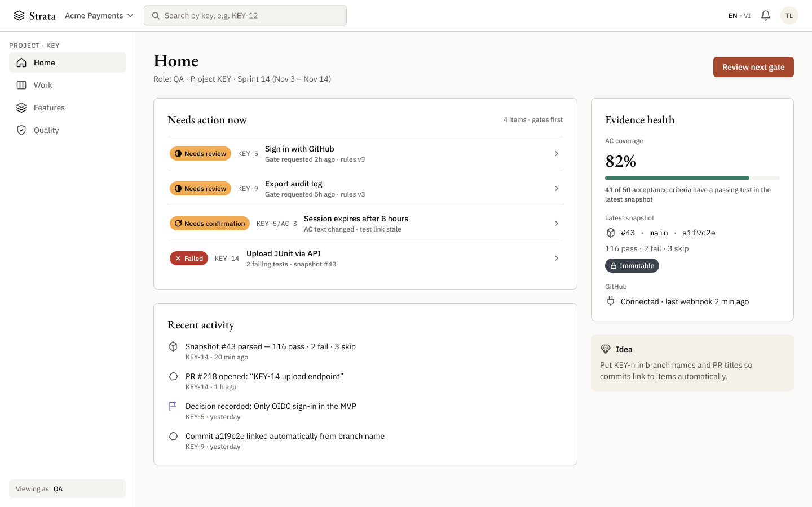

| Sidebar group | Admin | PO | PM | BA | QA | Dev |
|---|:---:|:---:|:---:|:---:|:---:|:---:|
| Home | ✓ | ✓ | ✓ | ✓ | ✓ | ✓ |
| Work (backlog, board, sprints) | ✓ | ✓ | ✓ | ✓ | ✓ | ✓ |
| Features | ✓ | ✓ | ✓ | ✓ | ✓ | ✓ |
| Quality (tests, matrix, gate) | ✓ | ✓ | ✓ | ✓ | ✓ | ✓ |
| Integrations | ✓ | — | ✓ | — | — | — |
| Administration | ✓ | — | audit | — | — | — |

### 4.3. Front-end interaction mind map by area

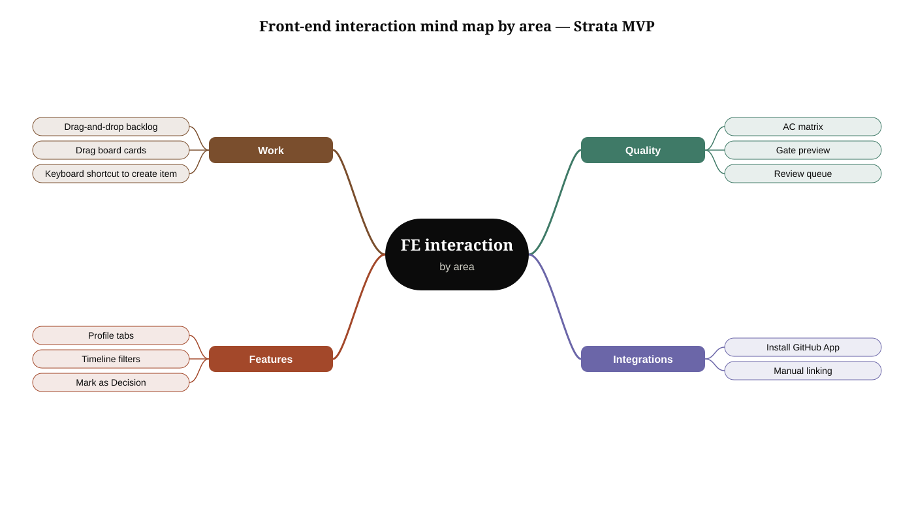

### 4.4. Interaction patterns catalog

| Interaction pattern | Used in | Detailed behavior |
|---|---|---|
| **Drag-and-drop with undo** | P05, P06 | Dropping changes order/status; "Undo" toast for 5 seconds; lifecycle violations are refused with a reason |
| **Quick detail drawer** | P05, P06, P09 | Open item details without leaving the list; `Esc` closes |
| **Profile tabs + deep link** | P10 | Each tab has its own URL; shareable |
| **Search by code** | Top bar | Typing `KEY-12` jumps directly; typing text searches titles |
| **Inline evidence** | P10, P12 | Selecting a test result or AC opens the source snapshot |
| **Explainable gate** | P10, P14 | Expand to see each condition, measured value, threshold, result |

### 4.5. Key screens (Figma design)

Screens from the [current UI prototype](#49-current-ui-prototype). They replace the earlier text wireframes.

**P10 – Feature profile**

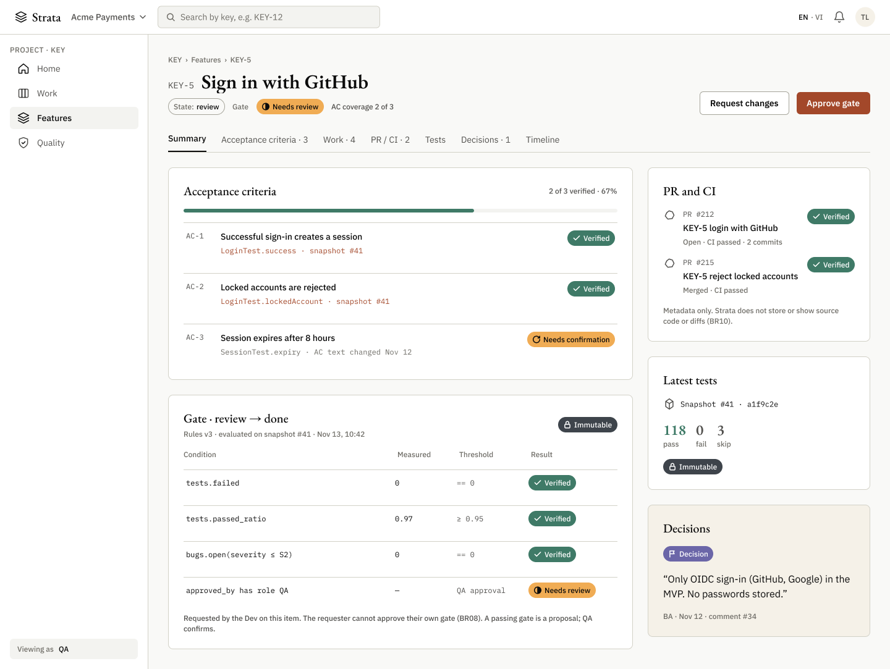

**P12 – AC traceability matrix**

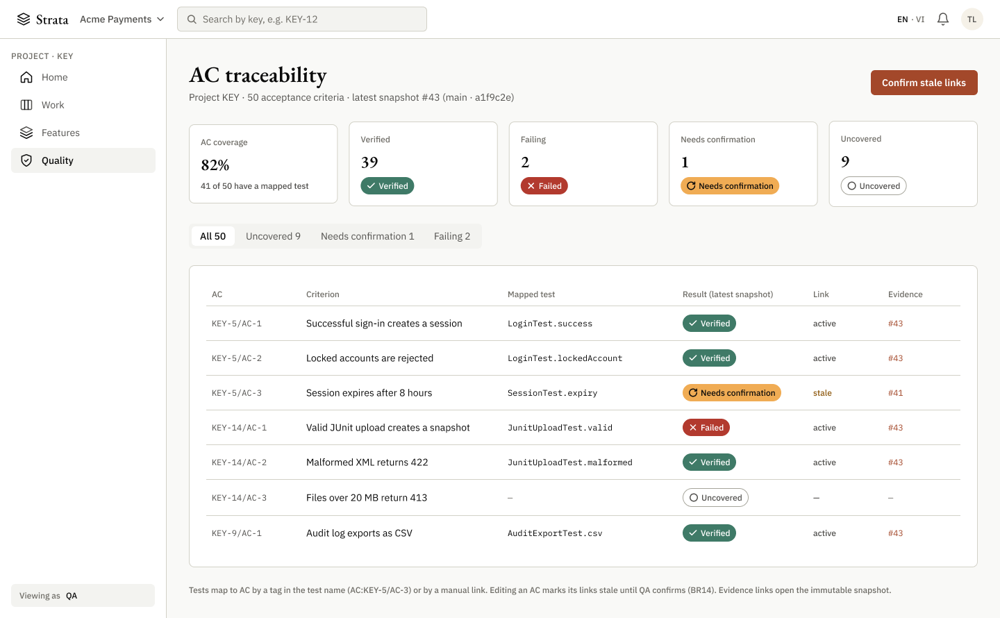

### 4.6. Detailed front-end interaction flows

**Manually linking a commit/PR not yet attached to an item**

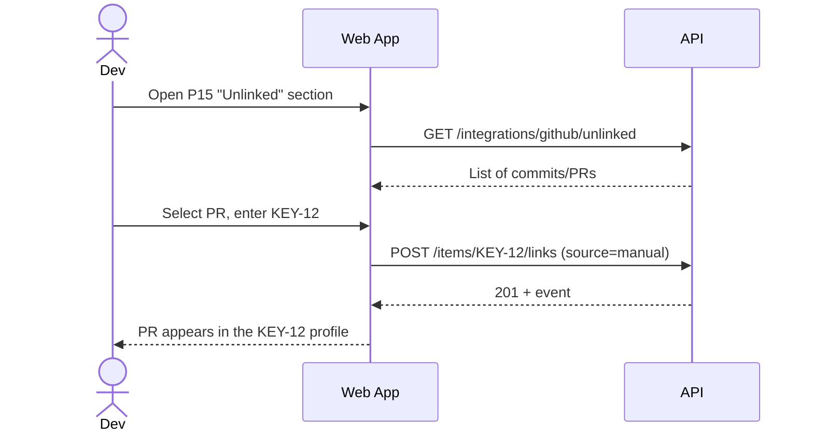

**Gate approval**

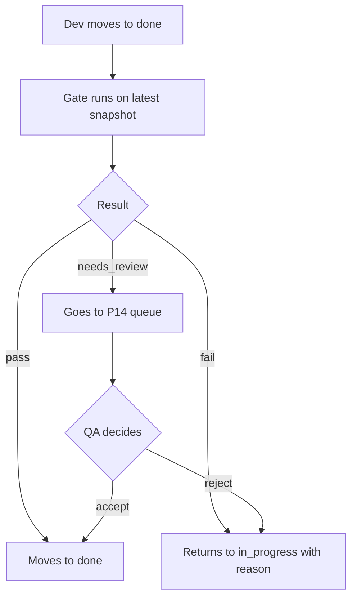

### 4.7. Standard interface states

| State | Appearance | User action |
|---|---|---|
| Loading | Skeleton with the same layout | None needed |
| Empty | Illustration + explanation | Button to create/connect (for example "Connect GitHub") |
| Error | Message with an error code | Retry; contact Admin if it is a permission issue |
| No permission | 403 page stating the required role | Request permission from Admin |
| Degraded integration | `degraded` banner | Check health; wait for polling to compensate |
| Stale evidence | `stale` label | QA confirms or updates |

### 4.8. Visual language

Canonical source: [Strata_UI_UX_Guidelines.md](docs/design/Strata_UI_UX_Guidelines.md) (token table, contrast, components). The table below is a summary.

| Component | Convention |
|---|---|
| Colors | Earth and neutral palette based on geological layers: bedrock `#3E444B`, brown soil `#7A4E2D`, fired clay `#A3482A`, weathered soil `#F0AC54`, mineral green `#3F7A67`; light background `#F9F9F7`, dark background `#0B0B0B` |
| Typography | Headings EB Garamond, body IBM Plex Sans, code and figures IBM Plex Mono |
| Meaning of status colors | Mineral green: verified; weathered soil: needs review/stale; rock red: failed; grey: uncovered. Always accompanied by an icon and a text label |
| Language | English by default, with a switch to Vietnamese |
| Modes | Light and dark |
| Mobile | Read-only viewing; actions on desktop |

### 4.9. Current UI prototype

The screens below are exported from the Figma file **[Strata](https://www.figma.com/design/C7cT7HCgPXUpKqZZC5yYPC/Strata)** and show what the main MVP screens look like with the [UI/UX guidelines](docs/design/Strata_UI_UX_Guidelines.md). Sample data uses project `KEY`; desktop screens are shown for the **QA** role. Notes for each screen are in [Strata_UI_Prototype.md](docs/design/Strata_UI_Prototype.md).

| Screen | What it shows |
|---|---|
| P02 Home (QA) | Gates waiting for review first, recent activity, project-level evidence health |
| P10 Feature profile | AC with evidence links, explainable gate, PR/CI metadata, tests, decisions (see [4.5](#45-key-screens-figma-design)) |
| P06 Board | Fixed lifecycle columns with item cards, linked PR and CI status |
| P12 AC traceability | Coverage tiles and the AC × test × result matrix (see [4.5](#45-key-screens-figma-design)) |
| P14 Gate reviews | Review queue with condition summary, rule version and immutable snapshot |
| Mobile (read-only) | Home and Feature profile at 375 px, view only |

**P02 – Role-based Home (QA)**


**P06 – Board**

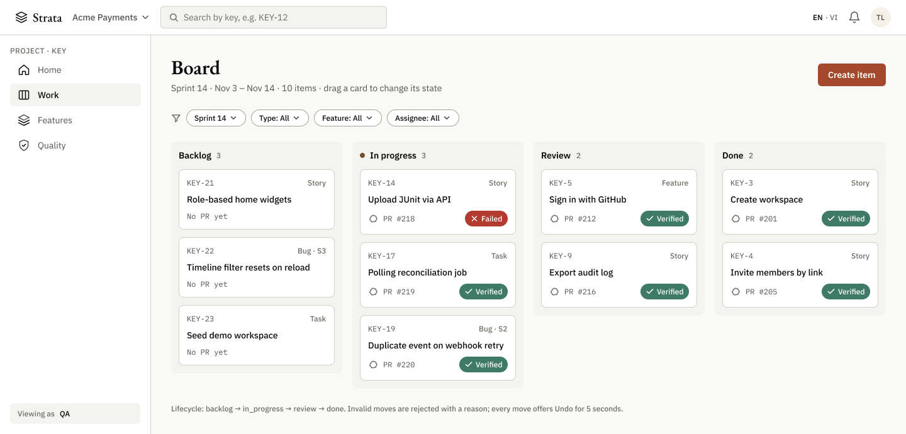

**P14 – Gate reviews**

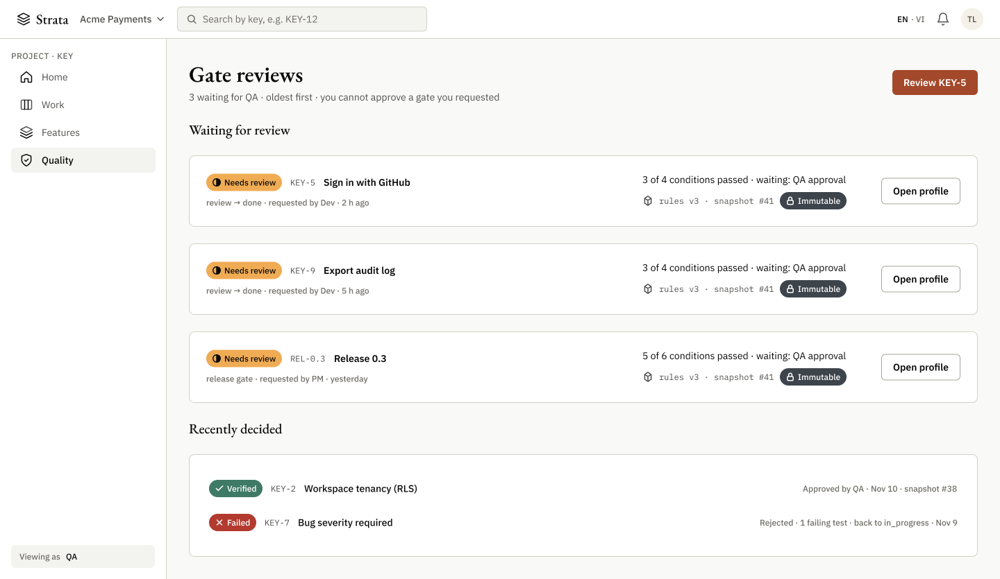

**Mobile – read-only**

| Home (QA) | Feature profile (KEY-5) |
|---|---|
| 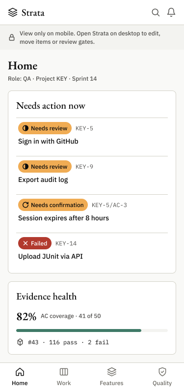 | 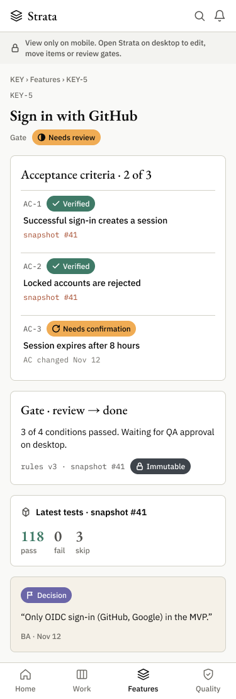 |

---

## 5. C4 architecture

C1–C3 describe the system at increasing levels of detail. Detailed class and sequence design is in [section 8](#8-detailed-class-and-sequence-design). Components from later phases are drawn with dashed lines.

### 5.1. C1 — System Context

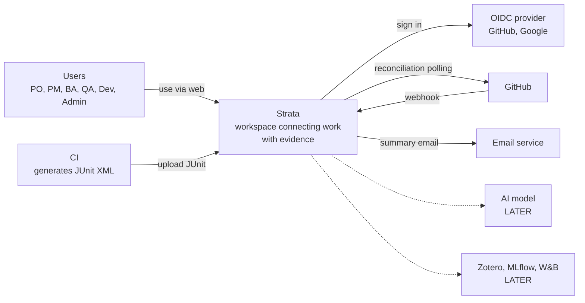

### 5.2. C2 — Container

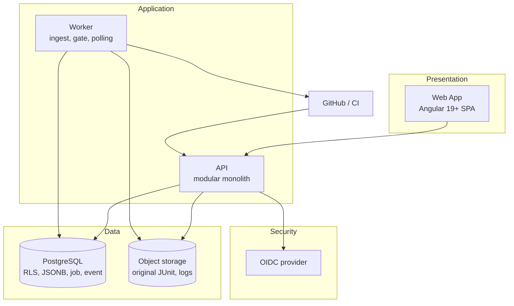

### 5.3. C3 — Component

#### 5.3.1. API

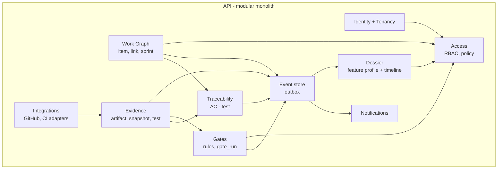

#### 5.3.2. Worker

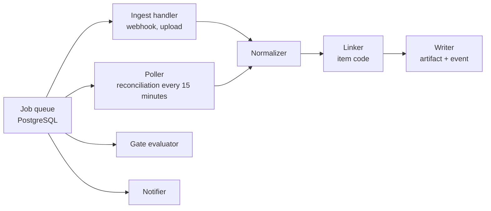

### 5.4. Architecture Decisions

| # | Decision | Rationale | Trade-off |
|---|---|---|---|
| AD01 | **Modular monolith** | Small team; many assumptions not yet validated | Module boundaries must be disciplined so they can be split later |
| AD02 | **Single PostgreSQL** (RLS, JSONB, full-text) | Fewer operational components | Large vector/queue workloads may need separating later |
| AD03 | **Common columns + `attrs` JSONB with registered schema** (ADR-01) | Adding a kind requires no migration | Schema checks happen in the application layer |
| AD04 | **Outbox + queue in PostgreSQL** | Consistent events and state | Move to NATS/Kafka when load grows |
| AD05 | **GitHub App, webhook + reconciliation polling** | Minimum permissions; tolerates lost webhooks | Extra reconciliation work |
| AD06 | **Immutable snapshots, gate evaluates snapshots** | Reproducible | Storage cost |
| AD07 | **Gate rules are versioned data** | Auditable, does not run arbitrary code | Less expressive than code |
| AD08 | **RBAC first, ABAC later** | Simple for the MVP; leaves room for a policy decision point | No artifact-level permissions yet |
| AD09 | **No source code storage** | Lower risk and fewer permissions to request | No diff viewing in Strata |
| AD10 | **ASP.NET 9+ backend, Angular 19+ frontend** | Strong module boundaries; matches team skills (PRD ADR-03) | Two languages (C# and TypeScript); API contracts shared through OpenAPI |

---

## 6. Database and API contract

### 6.1. Database diagram

Preliminary design; every table has `tenant_id` + RLS (not repeated for each table).

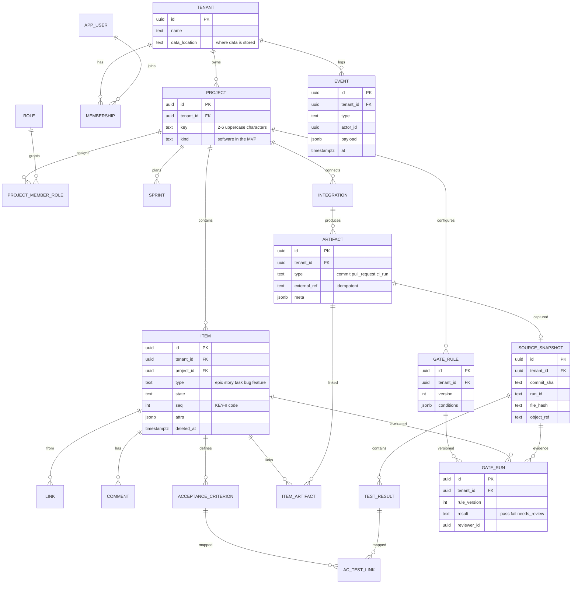

Rules guaranteed by the schema:

- `item.seq` is unique per `project_id`; generated atomically (BR02).
- `artifact.external_ref` is unique per `integration_id` for idempotency (BR05).
- `source_snapshot` and `event` have no UPDATE/DELETE operations for the application role (BR03, BR06).
- `gate_run` stores `rule_version` and a reference to `source_snapshot` (BR09).
- The detailed schema is planned for `src/database/` (not yet written).

### 6.2. OpenAPI 3.0 API documentation

The OpenAPI specification is at `docs/api/openapi.yaml` (draft). The table below lists the endpoint groups.

```text
Planned: about 50 operations, REST + JSON, OIDC authentication (session cookie) and CI tokens for uploads.
```

| Group | Main endpoints | Page |
|---|---|---|
| Authentication | `GET /auth/login`, `GET /auth/callback`, `POST /auth/logout` | P01 |
| Workspace and members | `POST /workspaces`, `POST /workspaces/{id}/invitations`, `PUT /projects/{id}/members` | P17 |
| Projects and items | `GET/POST /projects`, `GET/POST /projects/{key}/items`, `PATCH /items/{id}`, `POST /items/{id}/transitions` | P04–P08 |
| Links and comments | `POST /items/{id}/links`, `DELETE /links/{id}`, `POST /items/{id}/comments` | P08 |
| Notifications | `GET /notifications`, `PATCH /notifications/{id}` | P03 |
| GitHub integration | `POST /integrations/github/installations`, `GET /integrations/github/unlinked`, `POST /webhooks/github` | P15 |
| Tests and snapshots | `POST /projects/{key}/test-reports`, `GET /snapshots/{id}` | P11, P16 |
| Feature profile | `GET /features/{id}/dossier`, `GET /features/{id}/timeline` | P09, P10 |
| AC and traceability | `POST /features/{id}/acs`, `PUT /acs/{id}/test-links`, `GET /features/{id}/traceability` | P12 |
| Gate | `GET/PUT /projects/{key}/gate-rules`, `POST /features/{id}/gate-runs`, `POST /gate-runs/{id}/decision` | P13, P14 |
| Audit log | `GET /events` | P18 |

---

## 7. Planned repository structure

### 7.1. Repository layout

The tree below is **planned**; no source code exists yet. `[planned]` = to be created in the MVP, `[later]` = placeholder for later phases.

```text
strata/
├── README.md
├── CLAUDE.md
├── LICENSE
├── .gitignore
├── assets/                          # SVG diagrams (exist)
├── docs/
│   ├── product/                     # PRD_Strata_MVP.md, PLAN_Strata.md (exist)
│   ├── design/                      # Strata_UI_UX_Guidelines.md (exist)
│   ├── background/                  # brainstorm, architecture, research report (exist)
│   ├── api/openapi.yaml             # draft (exists)
│   └── adr/                         # [planned] architecture decision records
├── src/
│   ├── backend/                     # [planned] ASP.NET 9 solution (see 7.2)
│   ├── frontend/                    # [planned] Angular 19 workspace, standalone (see 7.3)
│   └── database/                    # [planned] migrations, RLS policies
├── compose.yaml                     # [planned] local PostgreSQL, object storage, mail catcher
└── scripts/                         # [planned] seed data, utilities
```

### 7.2. Backend (ASP.NET 9)

The backend is a hybrid of a modular monolith, clean architecture, vertical slices and a shared kernel. The rationale, the request flow and the consequences are in [ADR-04](docs/adr/ADR-04-backend-architecture.md). The project tree below shows where each style is applied. Each business module is split into five projects, and dependencies point inward.

```text
src/backend/
├── Strata.sln
├── Host/
│   ├── Strata.Api/                  # [planned] composition root: ASP.NET host, DI wiring, auth, middleware, module registration
│   └── Strata.Worker/               # [planned] background host: ingest, poller, gate evaluator, notifier
├── Shared/
│   ├── Strata.SharedKernel/         # [planned] DDD shared kernel: TenantId, Result, Entity/AggregateRoot base types, DomainEvent, Clock
│   └── Strata.Platform.Abstractions/# [planned] ports for infrastructure constraints: IEmailSender, IMessageQueue, IOutbox, IClock, IFileStorage
├── Platform/
│   └── Strata.Platform.Infrastructure/ # [planned] adapters: PostgreSQL (EF Core + RLS), job queue, SMTP, object storage, logging (Serilog)
├── Modules/
│   ├── IdentityTenancy/             # [planned] tenant, user, membership, OIDC
│   │   ├── Strata.IdentityTenancy.Domain/
│   │   ├── Strata.IdentityTenancy.Application/   # Features/<UseCase>/ slices: command, handler, validator, response
│   │   ├── Strata.IdentityTenancy.Infrastructure/# EF Core mappings, repositories, port implementations
│   │   ├── Strata.IdentityTenancy.Api/           # endpoint definitions for this module's slices
│   │   └── Strata.IdentityTenancy.Contracts/     # public interfaces and integration events used by other modules
│   ├── Access/                      # [planned] RBAC, policy decision point
│   ├── WorkGraph/                   # [planned] project, item, link, sprint, comment
│   ├── Integrations/                # [planned] github/, ci/ adapters
│   ├── Evidence/                    # [planned] artifact, snapshot, test result
│   ├── Dossier/                     # [planned] feature profile, timeline
│   ├── Gates/                       # [planned] gate rules, gate_run, review queue
│   ├── Traceability/                # [planned] AC ↔ test links, matrix
│   ├── Notifications/               # [planned] in-app notifications, email digests
│   ├── Events/                      # [planned] event store, outbox
│   ├── Workflow/                    # [later] workflow engine
│   ├── Agents/                      # [later] tool gateway, agent_run
│   ├── Research/                    # [later] research kind
│   └── Ml/                          # [later] AI kind
└── Tests/
    ├── Strata.UnitTests/            # [planned] domain and application tests
    ├── Strata.IntegrationTests/     # [planned] API and database tests, including RLS tenant isolation
    └── Strata.ArchitectureTests/    # [planned] enforces module, layer and dependency rules (e.g. NetArchTest)
```

Rules:

- Modules communicate only through their `Contracts` project or through integration events delivered via the outbox (AD04). A module never references another module's Domain, Application or Infrastructure project.
- `Strata.SharedKernel` holds only generic building blocks. Business logic does not go into the shared kernel.
- Infrastructure constraints (database, message queue, email, logging) are defined as ports in `Platform.Abstractions` and implemented in `Platform.Infrastructure`. Application code depends on the ports, never on the adapters.
- Each feature is a folder under `Application/Features/`, so one use case can be read, changed and tested on its own (vertical slice).
- Every data access goes through an authorized service in the Application layer, with no shortcut to the database (preparing for the agent phase).

### 7.2.1. Anatomy of a vertical slice (example: WorkGraph, "Create item")

A vertical slice is one use case, and it contains every file that use case needs, from the HTTP endpoint down to the persistence call. Slices share only the ports defined in `Platform.Abstractions` and the public `Contracts` of other modules. The example below extends the `WorkGraph` module with the slice that creates an item (US05, AC-F3-01, AC-F3-03).

```text
src/backend/Modules/WorkGraph/
├── Strata.WorkGraph.Domain/                     # no dependencies on other layers
│   ├── Item.cs                                  # aggregate root: state, lifecycle rules, Item.Create factory
│   ├── ItemKey.cs                               # value object KEY-n, built from project key and sequence
│   ├── ItemType.cs                              # enum: epic, story, task, bug, feature
│   ├── Severity.cs                              # enum: S1–S4
│   └── Events/ItemCreated.cs                    # domain event raised by Item.Create
├── Strata.WorkGraph.Application/
│   ├── Ports/                                   # interfaces this module needs from outside
│   │   ├── IItemRepository.cs                   # persistence, implemented in Infrastructure
│   │   ├── IProjectSequence.cs                  # atomic KEY-n sequence (BR02)
│   │   └── IPermissionChecker.cs                # implemented by the Access module through its Contracts
│   └── Features/
│       └── CreateItem/                          # ONE slice = one use case
│           ├── CreateItemCommand.cs             # input: project key, type, title, severity, feature id
│           ├── CreateItemValidator.cs           # rules: title length, severity required when type is bug
│           ├── CreateItemHandler.cs             # use case: check permission, create aggregate, save, write outbox event
│           └── CreateItemResponse.cs            # output returned to the caller: item id and KEY-n
├── Strata.WorkGraph.Infrastructure/             # adapters for the ports above
│   ├── Persistence/
│   │   ├── ItemConfiguration.cs                 # EF Core mapping for Item (tenant_id + RLS column)
│   │   └── ItemRepository.cs                    # implements IItemRepository
│   └── Sequences/ProjectSequence.cs             # implements IProjectSequence with an atomic UPDATE … RETURNING
├── Strata.WorkGraph.Api/
│   └── Endpoints/CreateItemEndpoint.cs          # POST /projects/{projectKey}/items: maps HTTP to the command, returns 201
└── Strata.WorkGraph.Contracts/                  # what other modules may see
    └── Events/ItemCreatedIntegrationEvent.cs    # published through the outbox to Dossier and Notifications

src/backend/Tests/
├── Strata.UnitTests/WorkGraph/CreateItemHandlerTests.cs            # handler logic with fake ports
├── Strata.IntegrationTests/WorkGraph/CreateItemEndpointTests.cs    # HTTP, database, RLS; Viewer gets 403 (AC-F2-02)
└── Strata.ArchitectureTests/WorkGraph/SliceRulesTests.cs           # slice files do not reference other slices
```

Rules for a slice:

- **One command, one handler, one validator, one response.** A slice never calls another slice's handler; if two use cases need the same logic, it moves into the Domain or behind a Port.
- **The endpoint contains no business logic.** It maps HTTP to the command and maps the response to an HTTP status code.
- **The handler depends only on ports and the Domain.** It never references EF Core, HTTP types or another module's Infrastructure.
- **Permission and tenant checks run in the handler** through `IPermissionChecker`, so the same rule applies to every entry point (HTTP, worker, agent tool).
- **Side effects go through the outbox.** The handler saves the aggregate and the integration event in one transaction; a background dispatcher delivers the event to other modules (AD04).
- **Each slice has its own tests.** Unit tests cover the handler, integration tests cover the endpoint and database, and architecture tests keep slices isolated.

### 7.3. Frontend (Angular 19+, standalone components)

```text
src/frontend/
├── angular.json
├── package.json
└── src/
    ├── main.ts                      # bootstrapApplication
    ├── styles/                      # design tokens as CSS variables (UI/UX guidelines section 2.3), global styles
    ├── environments/            # environment.ts and environment.prod.ts (build-time values)
    └── app/
        ├── app.config.ts            # providers: router, HTTP client with interceptors, i18n
        ├── app.routes.ts            # root routes, lazy-loaded feature routes
        ├── config/                  # app-wide configuration; maps environment values into typed constants
        │   ├── api.config.ts        # API base URL and endpoint paths
        │   ├── i18n.config.ts       # supported languages (en, vi) and default language
        │   ├── feature-flags.config.ts # toggles for features under rollout
        │   ├── roles.config.ts      # role-to-navigation mapping, mirrors README section 4.2
        │   └── status.config.ts     # status-to-label and icon mapping, mirrors UI guidelines section 2.4
        ├── shared/                  # reusable, module-agnostic building blocks (no feature imports)
        │   ├── components/          # UI components (status chip, KEY-n badge, drawer, toast, empty state)
        │   ├── directives/          # e.g. focus trap, click outside, tabular-nums helper
        │   ├── guards/              # functional route guards (auth, role-based access)
        │   ├── interceptors/        # functional HTTP interceptors (auth, tenant header, error mapping)
        │   ├── pipes/               # formatting pipes (dates, item keys, relative time)
        │   ├── validators/          # reusable form validators (project key, item key, severity)
        │   └── services/            # stateless or app-wide services (API client, i18n, notifications)
        ├── layout/                  # application shell
        │   ├── header/              # top bar: search by code, notifications, account
        │   ├── footer/
        │   ├── navbar/              # primary navigation
        │   ├── sidebar/             # navigation filtered by role
        │   └── shell/               # composes header, sidebar, breadcrumb and content outlet
        └── features/                # one folder per feature slice, lazy-loaded
            ├── home/                # role-based home page (P02)
            ├── work/                # backlog, board, sprint, item drawer (P04–P08)
            ├── dossier/             # feature profile and timeline (P09, P10)
            ├── quality/             # test results, AC matrix, gate rules, gate queue (P11–P14)
            ├── integrations/        # GitHub connection, CI tokens (P15, P16)
            └── admin/               # members, activity log (P17, P18)
```

Rules:

- `features/*` may import from `shared/` and `layout/`, but never from another feature. Cross-feature navigation uses routes, not imports.
- `shared/` never imports from `features/` or `layout/`.
- Guards and interceptors are written as functions (Angular 19 functional style), not classes.
- `app/config/` holds configuration values that differ by environment or change per release. Environment values (for example the API base URL) are read once from `src/environments/`, and `config/` exposes them as typed constants. No component reads environment files directly.
- Colors, fonts and spacing come only from the tokens in `styles/`, which follow the UI/UX guidelines. Components do not hard-code colors.

## 8. Detailed class and sequence design

### 8.1. C4 Level 4 — Collaboration at code level

#### L4.1. Ingest pipeline (GitHub webhook)

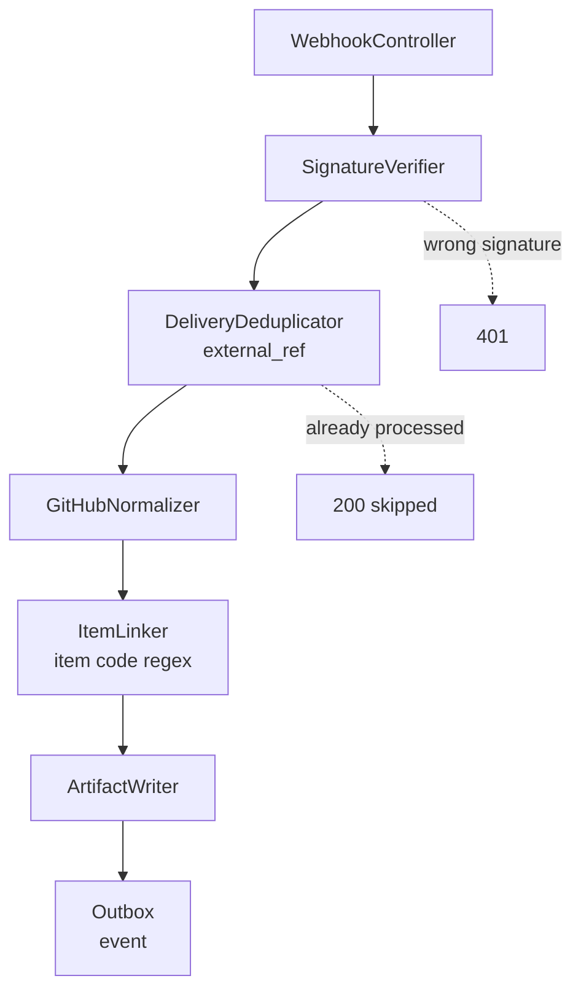

#### L4.2. Gate evaluation

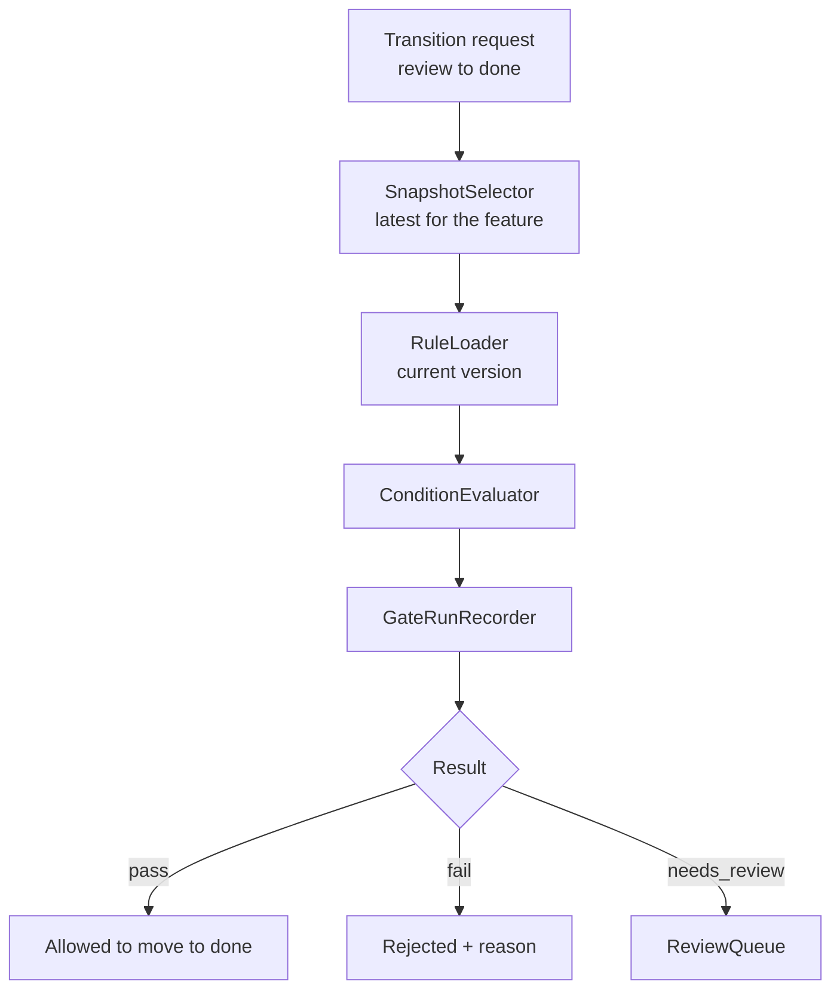

### 8.2. Core class diagrams

#### 1. Work graph and events

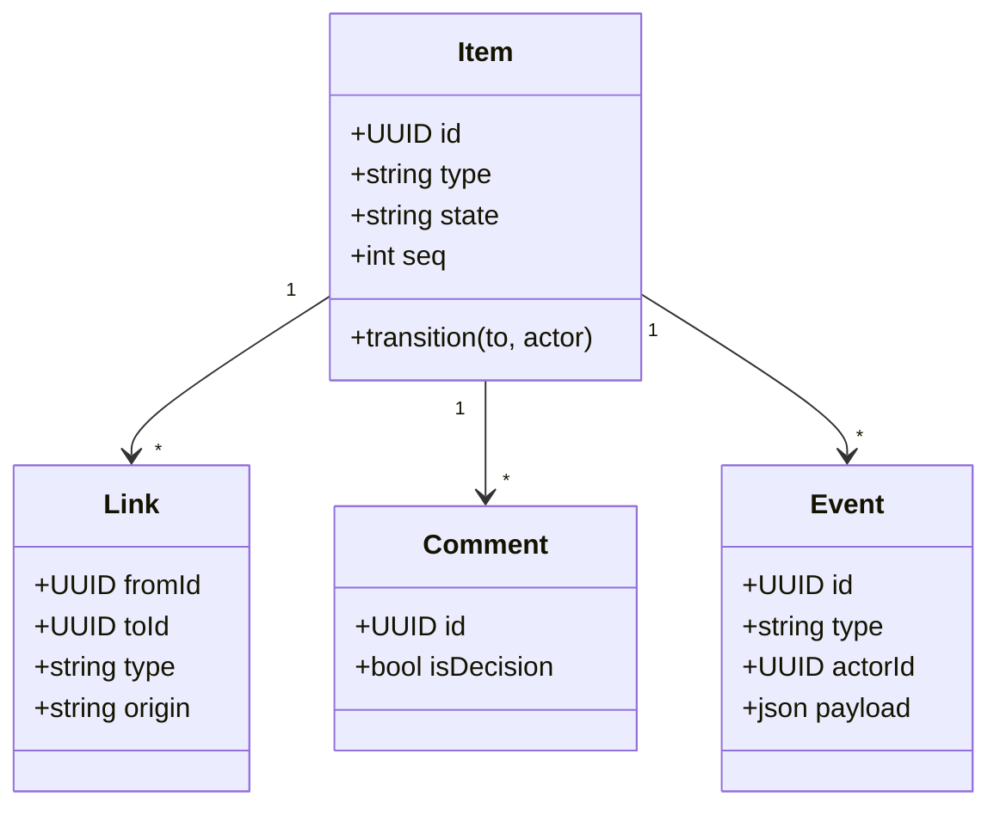

#### 2. Evidence and gate

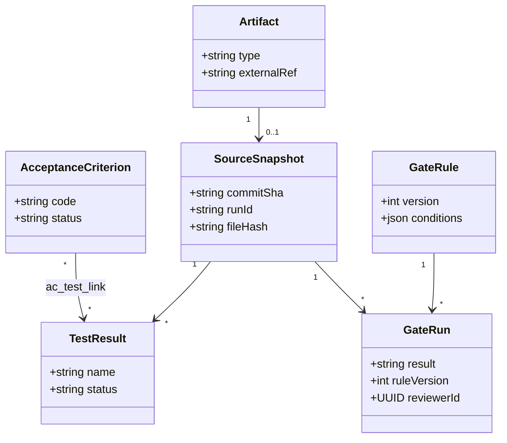

### 8.3. Sequence diagrams

#### GitHub webhook, linking and timeline (US15, US17 — `POST /webhooks/github`)

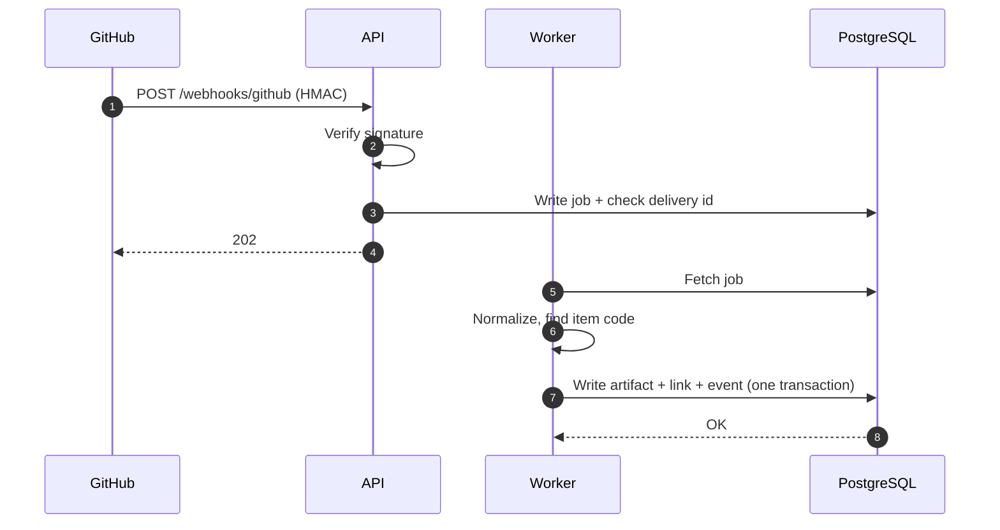

#### JUnit upload and snapshot creation (US18 — `POST /projects/{key}/test-reports`)

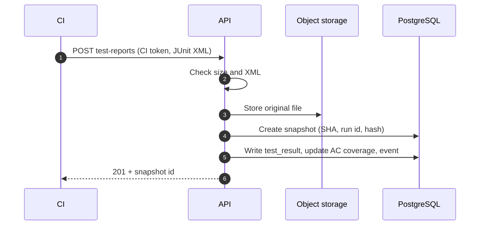

#### Gate and approval (US23, US24 — `POST /features/{id}/gate-runs`, `POST /gate-runs/{id}/decision`)

```mermaid
sequenceDiagram
    autonumber
    actor D as Dev
    actor Q as QA
    participant API as API
    participant DB as PostgreSQL
    D->>API: Move feature to done
    API->>DB: Select latest snapshot + current rule
    API->>API: Evaluate conditions
    API->>DB: Store gate_run (needs_review)
    API-->>D: Waiting for QA approval
    Q->>API: POST decision (accept, reason)
    API->>DB: Update gate_run, move to done, write event
    API-->>Q: 200
```

---

## Documents

- **Product**
  - [PRD – Strata MVP](docs/product/PRD_Strata_MVP.md): requirements, acceptance criteria, MVP release plan.
  - [Plan – Strata](docs/product/PLAN_Strata.md): phases after the MVP (workflow, agents, research, AI/ML…), entry/exit criteria, decisions to be made.
- **Design**
  - [UI/UX guidelines](docs/design/Strata_UI_UX_Guidelines.md): colors, typography, components, states, locked UX decisions.
  - [Current UI prototype](docs/design/Strata_UI_Prototype.md): screens exported from Figma with notes.
- **Foundations and research**
  - [Brainstorm summary](docs/background/brainstorm-summary.md): vision, pain points, core model, complete feature list.
  - [System architecture proposal](docs/background/system-architecture.md): modular monolith, tenancy, security, validation spikes.
  - [Overview research report](docs/background/research-landscape-report.md): background for the research phase.
- **Planned (not yet written)**
  - `src/database/`, `docs/RUNNING.md`.

## Project progress

- [x] Brainstorming and idea synthesis ([brainstorm-summary](docs/background/brainstorm-summary.md))
- [x] Project name chosen: Strata
- [x] Context research (scientific research, pain points, tools)
- [x] System architecture proposal
- [x] Project introduction slides (9 sections, C4)
- [x] MVP scope narrowed to software projects
- [x] Draft PRD, Plan, README (this document)
- [ ] User interviews to confirm pain points (P0)
- [ ] Confirm team size and first pilot team (D-01, D-02)
- [ ] Spikes: RLS, idempotent webhooks, reproducible gates (S-01 to S-03)
- [ ] Specify `docs/api/openapi.yaml` and the `src/database/` schema
- [ ] M1 – Core, tenancy, roles, events
- [ ] M2 – Work, collaboration
- [ ] M3 – GitHub connection
- [ ] M4 – JUnit, snapshots, feature profile, timeline
- [ ] M5 – Gate, AC traceability, dogfooding
- [ ] [LATER] Phases 2–7: workflow, agents, research, AI/ML, coaching (see Plan)
