# Strata – Workspace nối công việc với bằng chứng cho dự án phần mềm

**Strata** là workspace giúp nhóm phát triển phần mềm có **một hồ sơ cho mỗi chức năng**: yêu cầu, công việc, commit/PR, kết quả test và quyết định, được cập nhật tự động từ **GitHub** và **CI**. Bằng chứng được lưu thành **snapshot bất biến**, nên việc "chức năng này đủ điều kiện hoàn thành chưa" có thể kiểm tra và tái lập. MVP chỉ phục vụ dự án phần mềm; dự án nghiên cứu, viết báo khoa học, dự án AI/ML và AI agent nằm trong kế hoạch dài hạn trên cùng một lõi dữ liệu.

> Ký hiệu phạm vi dùng trong tài liệu: **[MVP]** = nằm trong MVP phần mềm (mức Must/Should/Could xem [PRD](docs/product/PRD_Strata_MVP.md) mục 5), **[LATER]** = phase sau, xem [Plan](docs/product/PLAN_Strata.md).

**Mục lục**

1. [Phân tích đề bài (Research)](#1-phân-tích-đề-bài-research)
2. [Requirements – Use Case, User Stories INVEST, Acceptance Criteria](#2-requirements--use-case-user-stories-invest-acceptance-criteria)
3. [Kiến trúc thông tin (Information Architecture)](#3-kiến-trúc-thông-tin-information-architecture)
4. [Thiết kế UI/UX và tương tác Front-end](#4-thiết-kế-uiux-và-tương-tác-front-end)
5. [Kiến trúc C4](#5-kiến-trúc-c4)
6. [Cơ sở dữ liệu và hợp đồng API](#6-cơ-sở-dữ-liệu-và-hợp-đồng-api)
7. [Cấu trúc thư mục dự kiến](#7-cấu-trúc-thư-mục-dự-kiến)
8. [Thiết kế chi tiết lớp và tuần tự](#8-thiết-kế-chi-tiết-lớp-và-tuần-tự)

Xem thêm: [Tài liệu](#tài-liệu) · [Tiến độ dự án](#tiến-độ-dự-án)

---

## 1. Phân tích đề bài (Research)

### 1.1. Bối cảnh và vấn đề

Nhãn bằng chứng: **Có nguồn (định hướng)** = khảo sát hoặc bài viết, phần lớn từ nhà cung cấp công cụ; **Giả định** = suy luận từ brainstorm, chưa phỏng vấn.

| Vấn đề hiện trạng | Hậu quả | Năng lực Strata cần có |
|---|---|---|
| Thông tin một chức năng rải rác ở công cụ công việc, Git, CI, tài liệu (Có nguồn, định hướng) | Tổng hợp thủ công, trả lời "đang ở đâu" phải hỏi dev | Hồ sơ chức năng + timeline tự cập nhật |
| Quy trình nặng nề, lãnh đạo không hiểu khó khăn của developer (Atlassian 2025: 63% developer; Có nguồn, định hướng) | Mất thời gian vào thủ tục, giảm động lực | Mặc định đơn giản, workflow cố định trong MVP |
| Cập nhật trạng thái bằng tay dù dữ liệu đã có ở Git/CI (Giả định) | Dữ liệu trễ, nhóm bỏ không dùng | Ingest GitHub + JUnit tự động, snapshot bất biến |
| BA/QA/PO không thấy tình trạng kiểm chứng của yêu cầu (Giả định) | Phát hành khi chưa rõ AC đã được kiểm chứng | Truy vết AC ↔ test ↔ kết quả; view theo vai trò |
| Mất lịch sử vì sao yêu cầu đổi (Giả định) | Tranh luận lặp lại, khó kiểm toán | Event bất biến, đánh dấu Quyết định |
| Kiểm tra "đủ chất lượng" bằng cảm tính, khó tái lập (Giả định) | Phát hành rủi ro, tranh cãi | Gate đánh giá snapshot kèm phiên bản luật |

### 1.2. Mục tiêu và chỉ số thành công

Các mục tiêu là đề xuất, chưa có baseline.

| Mục tiêu | Chỉ số đo (gợi ý cho MVP) |
|---|---|
| Một nơi duy nhất cho một chức năng | BA/QA trả lời "chức năng X đang ở đâu" ≤ 1 phút |
| Bằng chứng đến tự động | ≥ 80% liên kết commit/PR–item là `auto` |
| Quyết định hoàn thành tái lập được | Chạy lại gate trên cùng snapshot và luật cho cùng kết quả (100%) |
| Cô lập dữ liệu tenant | 0 rò rỉ chéo tenant trong bộ test RLS |
| Được dùng thật | ≥ 3 nhóm, ≥ 60% thành viên hoạt động hằng tuần sau 4 tuần |

### 1.3. Phân rã bài toán top-down

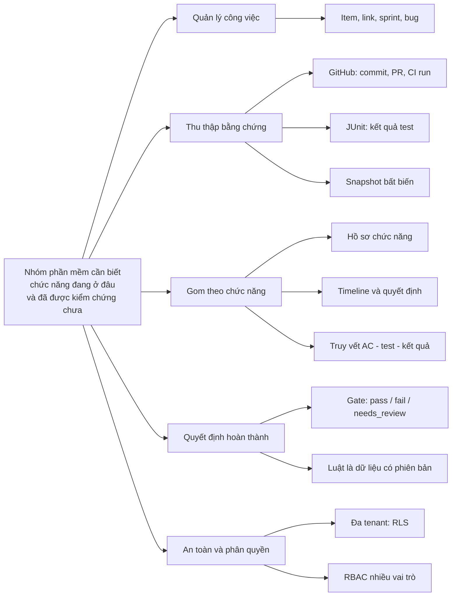

### 1.4. Các bên liên quan (Stakeholders)

| Nhóm | Ví dụ | Nhu cầu chính | Vai trò trong hệ thống |
|---|---|---|---|
| Quản trị workspace | Tech lead, trưởng nhóm | Cài đặt nhanh, kết nối GitHub, quản lý thành viên | Workspace Admin |
| Chủ sản phẩm | Product Owner | Ưu tiên, chấp nhận chức năng, biết tiến độ thật | PO |
| Quản lý dự án | Project Manager | Sprint, tiến độ, chặn, cấu hình gate | PM |
| Phân tích nghiệp vụ | Business Analyst | Yêu cầu có AC, truy vết, lịch sử thay đổi | BA |
| Kiểm thử | QA/Tester | Kết quả test theo AC, bug, duyệt gate | QA |
| Lập trình viên | Developer | Ít thủ tục, liên kết commit/PR tự động | Dev |
| Người chỉ xem | Quản lý cấp cao, khách | Xem hồ sơ và tiến độ | Viewer |

### 1.5. Nguồn dữ liệu được phép

| Mã nguồn | Hệ thống nguồn | Dữ liệu chính | Đối tượng | Hình thức ingest | Tần suất | Mức nhạy cảm cao nhất |
|---|---|---|---|---|---|---|
| SRC-GH | GitHub (GitHub App) | Commit, pull request, check/workflow run (metadata) | `commit`, `pull_request`, `ci_run` | Webhook + polling đối soát | Thời gian thực; đối soát 15 phút | Trung bình (không đọc nội dung file) |
| SRC-JUNIT | CI qua API hoặc GitHub Action | JUnit XML | `source_snapshot`, `test_result` | Upload có token CI | Mỗi lần chạy CI | Thấp |
| SRC-USER | Người dùng | Item, bình luận, AC, quyết định | `item`, `comment`, `acceptance_criterion` | Nhập trên web | Liên tục | Trung bình |
| SRC-LATER | GitLab, Jenkins, SonarQube, Figma, Confluence, MLflow, W&B, Zotero [LATER] | Theo từng nguồn | Theo adapter | Adapter chuẩn hóa | — | — |

> Strata không lưu và không hiển thị mã nguồn trong MVP. GitHub App chỉ dùng quyền đọc metadata, PR, checks và workflow runs.

### 1.6. Kiến trúc khái niệm

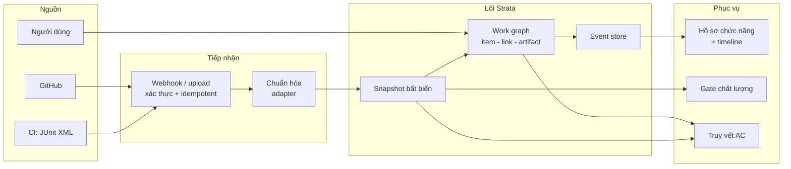

| Thành phần | Lựa chọn | Ghi chú lựa chọn |
|---|---|---|
| Kiến trúc | Modular monolith | Đội nhỏ; ranh giới module rõ để tách sau |
| CSDL | PostgreSQL | RLS, JSONB, full-text; pgvector khi cần ([LATER]) |
| Hàng đợi | Bảng job trong PostgreSQL | Chuyển NATS/Kafka khi cần |
| Object storage | S3-compatible | File JUnit gốc, log |
| Tích hợp | GitHub App | Quyền tối thiểu; webhook + polling |
| Xác thực | OIDC | GitHub, Google |

Các quyết định đầy đủ ở [5.4](#54-quyết-định-kiến-trúc).

### 1.7. Mô hình dữ liệu khái niệm

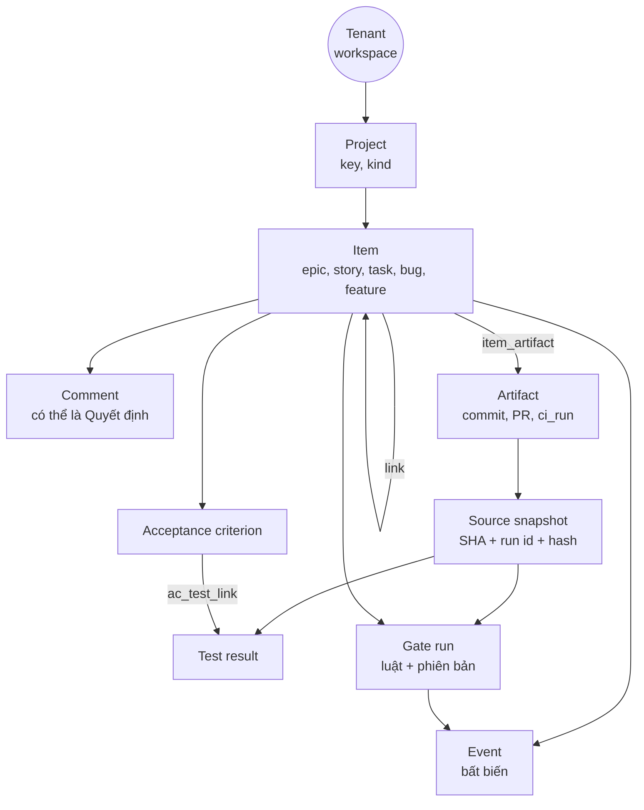

### 1.8. Phạm vi

| Hạng mục | MVP (phần mềm) | LATER (phase sau) | Ngoài phạm vi |
|---|---|---|---|
| Công việc | Item, link, sprint, bug, board, backlog | Workflow designer, version tree | Tùy biến trường tự do kiểu Jira |
| Tích hợp | GitHub, JUnit | GitLab, CI, SonarQube, Figma, Confluence, MLflow, W&B, Zotero | Lưu mã nguồn |
| Chất lượng | Gate cơ bản, truy vết AC | Gate trong workflow đầy đủ, lan truyền stale | — |
| AI | Không có | Agent mức 0–1, rồi 2–3 | Agent ghi thẳng dữ liệu chính |
| Không gian | Dự án | Private/public cá nhân, dự án, tổ chức | — |
| Loại dự án | `software` | `research`, `ai` | — |
| Phân tích | Timeline | Ước lượng khoảng, rủi ro, nghẽn, coaching | Bảng xếp hạng cá nhân |
| Quy mô | Pooled + RLS | DB riêng theo tenant, vùng dữ liệu | — |

### 1.9. Giả định, ràng buộc và rủi ro

| Loại | Nội dung |
|---|---|
| Giả định | Nhóm mục tiêu 3–10 người dùng GitHub; có CI sinh JUnit XML; chấp nhận quy ước mã item trong commit/PR; đội build 3–4 người. |
| Ràng buộc kỹ thuật | Idempotent với webhook trùng/lệch thứ tự; mọi bảng có `tenant_id` + RLS; snapshot không sửa/xóa. |
| Ràng buộc quyền riêng tư | Không xếp hạng cá nhân; BA/QA không cần thấy code; xuất và xóa dữ liệu workspace theo yêu cầu. |
| Rủi ro | Phạm vi lan sang nghiên cứu/AI sớm; dữ liệu không tự đến (thiếu mã item); cạnh tranh Jira/Linear/GitHub Projects; thành "Jira thứ hai". *Giảm thiểu:* tiêu chí thoát P1 là cổng bắt buộc, gợi ý quy ước nhánh, mặc định đơn giản ([PRD mục 12](docs/product/PRD_Strata_MVP.md)). |

---

## 2. Requirements – Use Case, User Stories INVEST, Acceptance Criteria

**US** (User Story) mô tả giá trị từ góc nhìn người dùng; **AC** (Acceptance Criteria) là điều kiện chấp nhận kiểm thử được, chi tiết ở [PRD mục 6](docs/product/PRD_Strata_MVP.md); **UC** (Use Case) mô tả tương tác giữa tác nhân và hệ thống.

### 2.1. Product Mind Map


| Nhóm nghiệp vụ | Mô tả |
|---|---|
| Nền tảng | Tenant, người dùng, vai trò, sự kiện, audit |
| Công việc | Quản lý item, backlog, sprint, bug |
| Cộng tác | Bình luận, mention, thông báo, quyết định |
| Bằng chứng | Kết nối GitHub, nhận JUnit, snapshot |
| Chức năng | Hồ sơ và timeline theo chức năng |
| Chất lượng | Gate, truy vết AC, trang theo vai trò |

### 2.2. Các tác nhân (Actors)

| Tác nhân | Trách nhiệm |
|---|---|
| **Workspace Admin** | Tạo workspace, mời thành viên, gán vai trò, kết nối GitHub, tạo token CI |
| **PO** | Ưu tiên backlog, viết/duyệt AC, chấp nhận chức năng |
| **PM** | Quản lý dự án và sprint, cấu hình gate, theo dõi chặn |
| **BA** | Viết yêu cầu và AC, truy vết, đánh dấu quyết định |
| **QA** | Quản lý bug, xem kết quả test, duyệt gate |
| **Dev** | Làm việc theo item, liên kết commit/PR, xem CI |
| **Viewer** | Chỉ xem |
| **GitHub / CI** | Hệ thống ngoài gửi webhook và JUnit |

> Một người có thể giữ nhiều vai trò; quyền hiệu lực là hợp của các vai trò.

### 2.3. Yêu cầu theo nguyên tắc INVEST

#### 2.3.1. Nguyên tắc INVEST

| Tiêu chí | Ý nghĩa |
|---|---|
| **I – Independent (Độc lập)** | Story có thể làm và phát hành riêng; phụ thuộc được nêu rõ |
| **N – Negotiable (Thương lượng được)** | Chi tiết cách làm có thể điều chỉnh |
| **V – Valuable (Có giá trị)** | Mang lại giá trị cho một tác nhân cụ thể |
| **E – Estimable (Ước lượng được)** | Đủ rõ để ước lượng |
| **S – Small (Nhỏ)** | Làm xong trong một sprint |
| **T – Testable (Kiểm thử được)** | Có AC kiểm chứng được |

#### 2.3.2. Danh sách User Stories

| ID | Phạm vi | Tác nhân | User Story |
|---|:---:|---|---|
| **US01** | MVP | Người dùng | Tôi muốn đăng nhập bằng GitHub hoặc Google để không phải nhớ mật khẩu. |
| **US02** | MVP | Admin | Tôi muốn tạo workspace và mời thành viên bằng email hoặc link để nhóm bắt đầu làm việc. |
| **US03** | MVP | Admin | Tôi muốn gán nhiều vai trò cho một người theo dự án để phản ánh việc một người đảm nhiều việc. |
| **US04** | MVP | PM | Tôi muốn tạo dự án với mã key để item có mã `KEY-n` ổn định. |
| **US05** | MVP | PO/BA/Dev | Tôi muốn tạo và sửa item có kiểu (epic, story, task, bug, feature) để mô tả công việc. |
| **US06** | MVP | PO/BA/Dev | Tôi muốn liên kết item (blocks, implements, tests…) để thể hiện quan hệ. |
| **US07** | MVP | PO | Tôi muốn xếp hạng backlog bằng kéo-thả để thể hiện ưu tiên. |
| **US08** | MVP | Dev | Tôi muốn xem và cập nhật item trên board Kanban để theo dõi luồng việc. |
| **US09** | MVP | PM | Tôi muốn tạo sprint và gán item để lập kế hoạch lặp. |
| **US10** | MVP | QA | Tôi muốn ghi bug kèm severity S1–S4 để ưu tiên xử lý. |
| **US11** | MVP | Thành viên | Tôi muốn bình luận và `@mention` để trao đổi đúng người. |
| **US12** | MVP | BA/PO | Tôi muốn đánh dấu một bình luận là Quyết định để sau này biết vì sao. |
| **US13** | MVP | Thành viên | Tôi muốn nhận thông báo trong app và email tóm tắt, cấu hình theo ý mình. |
| **US14** | MVP | Admin | Tôi muốn cài GitHub App cho repo để Strata nhận sự kiện. |
| **US15** | MVP | Dev | Tôi muốn commit/PR tự liên kết với item qua mã `KEY-n` để khỏi nhập tay. |
| **US16** | MVP | Dev/QA | Tôi muốn liên kết hoặc gỡ liên kết thủ công khi tự động sai hoặc thiếu. |
| **US17** | MVP | Dev/PM | Tôi muốn xem trạng thái PR và CI trên item để biết tiến độ build. |
| **US18** | MVP | Dev/CI | Tôi muốn upload JUnit XML qua API để Strata có kết quả test. |
| **US19** | MVP | QA/BA | Tôi muốn xem kết quả test theo chức năng để biết chất lượng hiện tại. |
| **US20** | MVP | BA/PO/QA | Tôi muốn mở hồ sơ chức năng gom yêu cầu, công việc, PR, test và quyết định để nắm đủ bối cảnh. |
| **US21** | MVP | BA/PO | Tôi muốn xem timeline lọc theo loại sự kiện để hiểu diễn biến. |
| **US22** | MVP | PM/QA | Tôi muốn cấu hình luật gate dạng dữ liệu có phiên bản để chuẩn hóa điều kiện hoàn thành. |
| **US23** | MVP | Dev | Tôi muốn gate đánh giá snapshot mới nhất khi chuyển `done` để biết có đủ điều kiện. |
| **US24** | MVP | QA | Tôi muốn duyệt gate `needs_review` và ghi lý do để có người chịu trách nhiệm. |
| **US25** | MVP | BA | Tôi muốn gắn AC có ID ổn định cho chức năng để kiểm chứng được. |
| **US26** | MVP | QA | Tôi muốn ánh xạ test ↔ AC bằng tag hoặc thủ công để truy vết. |
| **US27** | MVP | BA/PO/QA | Tôi muốn xem ma trận AC × test × kết quả và độ phủ AC để biết AC nào chưa được kiểm chứng. |
| **US28** | MVP | Thành viên | Tôi muốn trang chủ theo vai trò để thấy việc cần làm ngay. |
| **US29** | MVP | Admin | Tôi muốn xem nhật ký thay đổi quyền và hoạt động để kiểm toán. |
| **US30** | LATER | PM | Tôi muốn thiết kế workflow có cổng kiểm định cho quy trình của nhóm. |
| **US31** | LATER | BA/QA | Tôi muốn giao một node cho agent soạn AC hoặc sinh test case, và kiểm soát input/output. |
| **US32** | LATER | Nhà nghiên cứu | Tôi muốn truy vết số liệu trong bản thảo về thí nghiệm gốc. |
| **US33** | LATER | Nhóm AI | Tôi muốn gắn run MLflow/W&B với giả thuyết và task. |

#### 2.3.3. Rà soát tính INVEST của các nhóm Story

| Nhóm User Story | I – Phụ thuộc cần thiết | N – Phần có thể thay đổi | V – Giá trị | E/S – Ranh giới ước lượng và độ nhỏ | T – Cách kiểm thử |
|---|---|---|---|---|---|
| **US01–US03** Tài khoản, vai trò | Làm trước mọi story khác | Nhà cung cấp OIDC | Truy cập an toàn | Mỗi story ≤ 1 sprint | AC-F1, AC-F2 |
| **US04–US10** Công việc | Cần tenant và vai trò | Tập loại item, vòng đời | Quản lý công việc cơ bản | Tách board, backlog, sprint | AC-F3 |
| **US11–US13** Cộng tác | Cần item | Kênh thông báo | Trao đổi và giữ quyết định | Nhỏ | AC-F4 |
| **US14–US17** GitHub | Cần item | Quy ước mã item | Bằng chứng tự động | Tách cài App, webhook, liên kết | AC-F5 |
| **US18–US19** Test | Cần artifact và storage | Định dạng báo cáo | Kết quả test có snapshot | Nhỏ | AC-F6 |
| **US20–US21** Hồ sơ | Cần F3, F5, F6 | Bố cục hồ sơ | Điểm đến chính của sản phẩm | Tách hồ sơ và timeline | AC-F7 |
| **US22–US24** Gate | Cần snapshot | Bộ điều kiện luật | Quyết định có bằng chứng | Tách luật, chạy, duyệt | AC-F8 |
| **US25–US27** Truy vết | Cần test và AC | Cú pháp tag | Biết AC đã kiểm chứng | Tách tag, ma trận | AC-F9 |
| **US28–US29** Vai trò, audit | Cần event và vai trò | Nội dung widget | Bắt đầu làm việc nhanh | Nhỏ | AC-F10 |

#### 2.3.4. Quy tắc nghiệp vụ (Business Rules)

| Mã | Quy tắc thiết kế |
|---|---|
| **BR01** | Mọi bản ghi thuộc đúng một tenant; truy vấn luôn bị RLS lọc theo tenant. |
| **BR02** | Mã item = `project.key` + `seq` tăng nguyên tử; không tái sử dụng sau khi xóa. |
| **BR03** | Xóa là xóa mềm; `event` chỉ thêm, không sửa, không xóa. |
| **BR04** | Vai trò gán nhiều-nhiều theo dự án; quyền hiệu lực là hợp các vai trò. |
| **BR05** | Webhook và upload xử lý idempotent theo `external_ref` (delivery id, SHA, run id, hash). |
| **BR06** | Snapshot gắn định danh bất biến (commit SHA, run id); gate đánh giá snapshot, không đánh giá nhánh hiện tại. |
| **BR07** | Liên kết commit/PR ↔ item theo mã item trong tên nhánh, commit, tiêu đề PR; mỗi liên kết ghi nguồn gốc (`auto` / `manual`). |
| **BR08** | Người đề nghị chuyển trạng thái không được tự duyệt gate của chính mình. |
| **BR09** | Luật gate là dữ liệu có phiên bản; sửa luật tạo phiên bản mới, `gate_run` cũ giữ phiên bản cũ. |
| **BR10** | Strata không lưu hay hiển thị mã nguồn/diff; BA/QA thấy deliverable và AC, không thấy code. |
| **BR11** | Chỉ số đo quy trình, không xếp hạng hay chấm điểm cá nhân. |
| **BR12** | Token tích hợp lưu mã hóa, tối thiểu quyền (chỉ đọc). |
| **BR13** | Mọi thay đổi quyền ghi event kèm actor, trước, sau. |
| **BR14** | Đổi nội dung AC đánh dấu liên kết test của AC đó là `stale` cho đến khi QA xác nhận. |

#### 2.3.5. Acceptance Criteria (AC – Tiêu chí chấp nhận)

AC đầy đủ (Given/When/Then) nằm ở [PRD mục 6](docs/product/PRD_Strata_MVP.md#6-yêu-cầu-tính-năng). Bảng dưới là đầu mối.

| Nhóm AC | Story | Một số tiêu chí tiêu biểu |
|---|---|---|
| AC-F1 | US01, US02 | Đăng nhập lần đầu tạo user; gọi API item của workspace khác trả 404; truy vấn thiếu tenant trả 0 dòng |
| AC-F2 | US03, US29 | Vai trò hợp; Viewer bị từ chối ghi; đổi vai trò ghi event; không gỡ Admin cuối |
| AC-F3 | US04–US10 | Mã item không trùng khi đồng thời; chuyển trạng thái sai bị chặn; bug cần severity |
| AC-F4 | US11–US13 | Mention gửi thông báo ≤ 10 giây; Quyết định hiện trên hồ sơ và timeline |
| AC-F5 | US14–US17 | Webhook trùng chỉ một artifact; chữ ký sai trả 401; polling bù webhook mất ≤ 15 phút |
| AC-F6 | US18–US19 | Snapshot khớp tổng pass/fail/skip; upload lặp idempotent; XML hỏng trả 422 |
| AC-F7 | US20–US21 | Hồ sơ 500 event tải ≤ 2 giây (p95); BA không thấy diff hay mã nguồn |
| AC-F8 | US22–US24 | Fail liệt kê test lỗi; chạy lại cùng snapshot cho cùng kết quả; không tự duyệt |
| AC-F9 | US25–US27 | AC có test pass là "đã kiểm chứng"; sửa AC làm liên kết test `stale` |
| AC-F10 | US28 | QA thấy gate chờ duyệt đầu trang; Dev thấy việc kèm trạng thái PR/CI |

### 2.4. Các ca sử dụng (Use Cases)

#### 2.4.1. Sơ đồ Use Case tổng quan

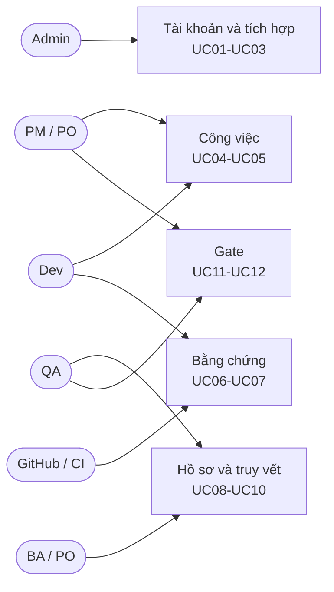

#### 2.4.2. Danh sách Use Cases

| Use Case | Tên ca sử dụng | Actor chính | US liên quan | Phạm vi |
|---|---|---|---|---|
| UC01 | Đăng nhập và tạo workspace | Người dùng | US01, US02 | MVP |
| UC02 | Mời thành viên và gán vai trò | Admin | US02, US03 | MVP |
| UC03 | Kết nối GitHub cho dự án | Admin | US14 | MVP |
| UC04 | Quản lý backlog và sprint | PO, PM | US04, US07, US09 | MVP |
| UC05 | Làm việc trên board | Dev | US05, US08, US10 | MVP |
| UC06 | Nhận webhook GitHub và liên kết | GitHub | US15–US17 | MVP |
| UC07 | Nhận JUnit và tạo snapshot | CI | US18, US19 | MVP |
| UC08 | Xem hồ sơ chức năng và timeline | BA, PO, QA | US20, US21 | MVP |
| UC09 | Gắn AC và truy vết test | BA, QA | US25–US27 | MVP |
| UC10 | Đánh dấu quyết định | BA, PO | US12 | MVP |
| UC11 | Cấu hình luật gate | PM, QA | US22 | MVP |
| UC12 | Đánh giá gate và duyệt | Dev, QA | US23, US24 | MVP |
| UC13 | Thiết kế workflow | PM | US30 | LATER |
| UC14 | Giao node cho agent | BA, QA | US31 | LATER |

#### 2.4.3. Đặc tả một số Use Case trọng tâm

**UC06 – Nhận webhook GitHub và liên kết (US15, US17)**

- **Actor:** GitHub (hệ thống ngoài).
- **Tiền điều kiện:** GitHub App đã cài cho repo; repo gắn với một dự án.
- **Luồng chính:** (1) GitHub gửi webhook; (2) hệ thống xác thực chữ ký HMAC; (3) kiểm tra delivery id đã xử lý chưa; (4) chuẩn hóa thành artifact; (5) tìm mã item trong tên nhánh, commit, tiêu đề PR; (6) tạo liên kết `auto`; (7) ghi event; (8) timeline cập nhật.
- **Luồng thay thế:** không tìm thấy mã item → lưu artifact chưa liên kết, hiện ở danh sách "chưa liên kết" để liên kết thủ công.
- **Ngoại lệ:** chữ ký sai → 401; delivery đã xử lý → bỏ qua, trả 200; lỗi xử lý → thử lại có giới hạn, rồi đưa vào hàng chờ lỗi.
- **Hậu điều kiện:** có tối đa một artifact và một event cho mỗi delivery; polling sẽ bù nếu webhook bị mất.

**UC08 – Xem hồ sơ chức năng và timeline (US20, US21)**

- **Actor:** BA, PO, QA.
- **Tiền điều kiện:** người dùng có quyền xem dự án.
- **Luồng chính:** (1) mở danh sách chức năng; (2) chọn một chức năng; (3) xem tóm tắt, AC, item con, PR/CI, kết quả test mới nhất, quyết định; (4) chuyển sang tab Timeline; (5) lọc theo loại sự kiện.
- **Luồng thay thế:** chức năng chưa có test → mục kiểm thử hiện "chưa có kết quả".
- **Ngoại lệ:** không có quyền → trang 403 nêu rõ vai trò cần có.
- **Hậu điều kiện:** không thay đổi dữ liệu.

**UC12 – Đánh giá gate và duyệt (US23, US24)**

- **Actor:** Dev (đề nghị), QA (duyệt).
- **Tiền điều kiện:** chức năng ở `review`; có snapshot test mới nhất; có luật gate.
- **Luồng chính:** (1) Dev chuyển `done`; (2) hệ thống chọn snapshot mới nhất và phiên bản luật hiện hành; (3) đánh giá từng điều kiện; (4) lưu `gate_run`; (5) nếu có điều kiện cần người duyệt → `needs_review`; (6) QA xem lý do và bằng chứng; (7) QA chấp nhận hoặc từ chối kèm phản hồi; (8) chức năng sang `done` hoặc quay lại `in_progress`.
- **Luồng thay thế:** có điều kiện `fail` → quay lại `in_progress` kèm lý do.
- **Ngoại lệ:** người đề nghị tự duyệt → bị từ chối (BR08); không có snapshot → gate `fail` với lý do "thiếu bằng chứng".
- **Hậu điều kiện:** `gate_run` bất biến kèm snapshot, phiên bản luật, người duyệt.

### 2.5. Vai trò và phân quyền (Roles and Permissions)

#### 2.5.1. Ma trận phân quyền

| Chức năng | Admin | PO | PM | BA | QA | Dev | Viewer |
|---|:---:|:---:|:---:|:---:|:---:|:---:|:---:|
| Quản lý workspace, thành viên, vai trò | ✓ | — | — | — | — | — | — |
| Kết nối GitHub, tạo token CI | ✓ | — | ✓ | — | — | — | — |
| Tạo/sửa dự án, sprint | ✓ | — | ✓ | — | — | — | — |
| Tạo/sửa item, bình luận | ✓ | ✓ | ✓ | ✓ | ✓ | ✓ | — |
| Xếp hạng backlog | ✓ | ✓ | ✓ | — | — | — | — |
| Viết/sửa AC | ✓ | ✓ | — | ✓ | — | — | — |
| Xóa/khôi phục item | ✓ | — | ✓ | — | — | — | — |
| Cấu hình luật gate | ✓ | — | ✓ | — | ✓ | — | — |
| Duyệt gate `needs_review` | ✓ | theo luật | — | — | ✓ | — | — |
| Xác nhận liên kết test `stale` | ✓ | — | — | — | ✓ | — | — |
| Xem hồ sơ, timeline, kết quả test | ✓ | ✓ | ✓ | ✓ | ✓ | ✓ | ✓ |
| Xem nhật ký hoạt động (audit) | ✓ | — | ✓ | — | — | — | — |

> Upload JUnit dùng token CI theo dự án, không dùng tài khoản người. Strata không hiển thị mã nguồn nên không có dòng quyền xem code.

#### 2.5.2. Các trạng thái nghiệp vụ cần quản lý

| Đối tượng | Trạng thái dự kiến | Ý nghĩa |
|---|---|---|
| Item | `backlog`, `in_progress`, `review`, `done`, `cancelled` | Vòng đời mặc định của công việc |
| Lời mời | `pending`, `accepted`, `expired`, `revoked` | Trạng thái mời thành viên |
| Tích hợp GitHub | `connected`, `degraded`, `revoked` | `degraded` khi webhook lỗi, chờ polling bù |
| Snapshot | `received`, `parsed`, `failed` | Quá trình xử lý file test |
| Gate run | `pass`, `fail`, `needs_review` | Kết quả đánh giá |
| Liên kết AC–test | `active`, `stale` | `stale` khi AC đổi sau khi liên kết |

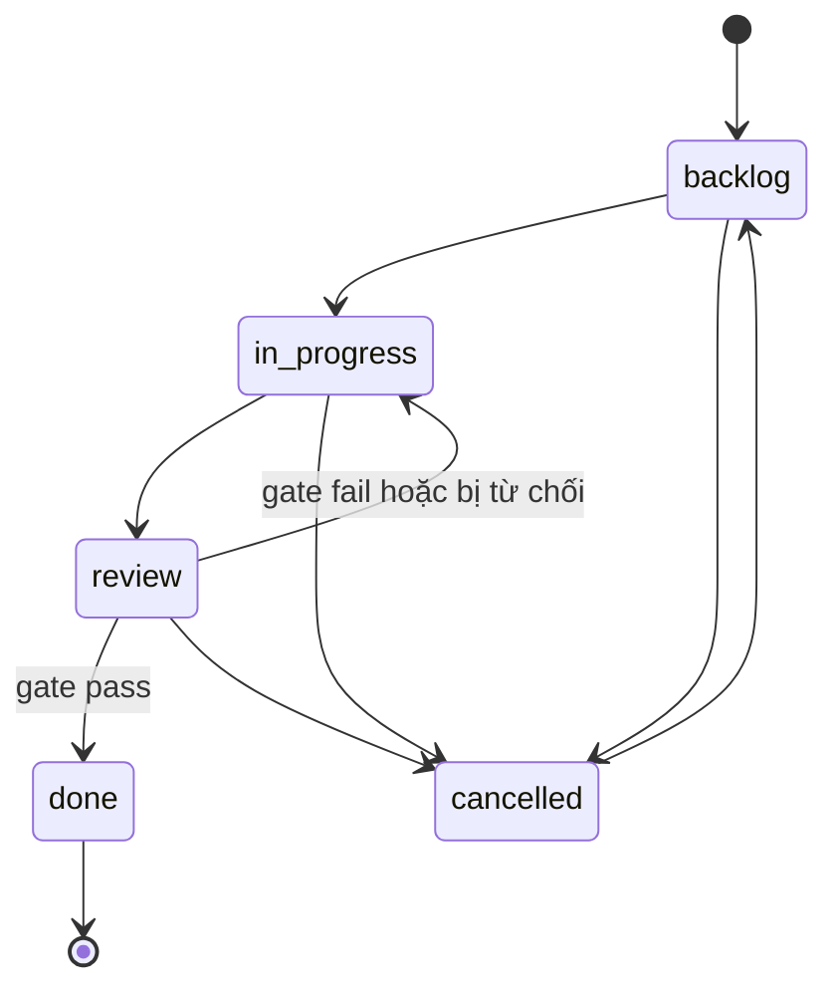

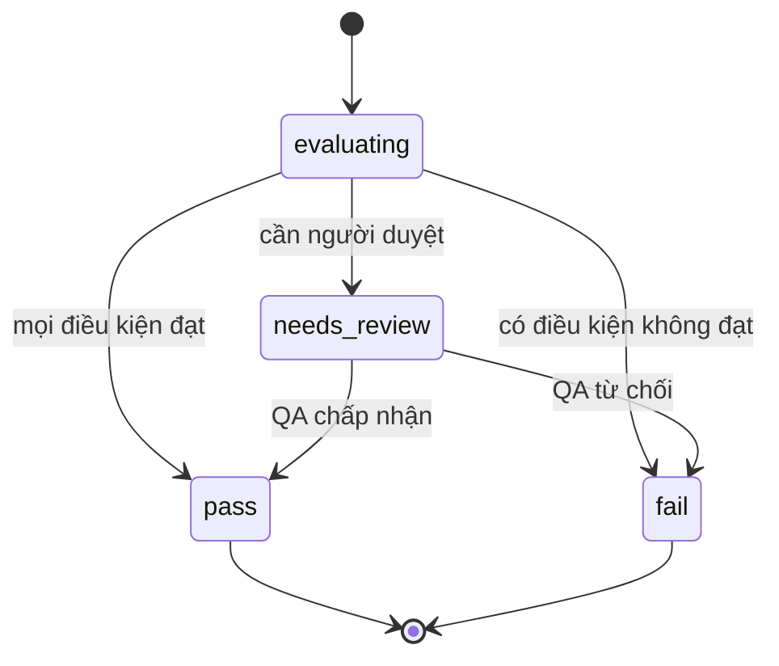

---

## 3. Kiến trúc thông tin (Information Architecture)

MVP gồm 5 khu vực: Hệ thống chung, Công việc, Chức năng, Chất lượng, Tích hợp và Quản trị. Các page đánh số `P01`…`P18`.

### 3.1. Cây phân cấp Page (Sitemap)


### 3.2. Phân cấp thông tin trong Page (Page → Section → Thành phần)

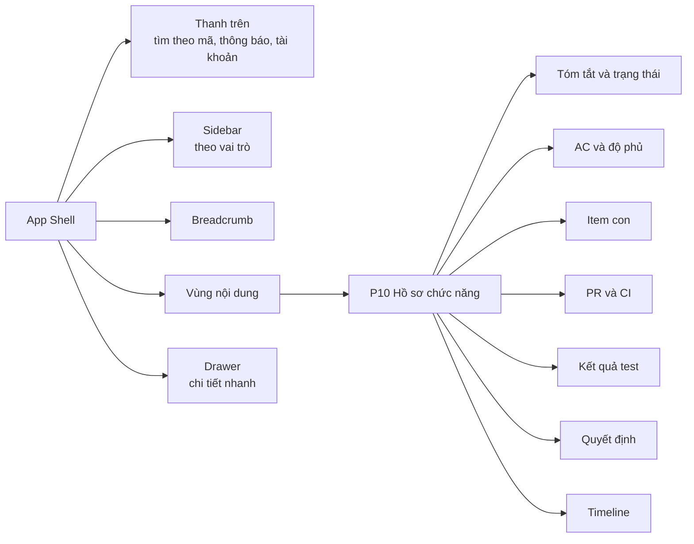

### 3.3. Nội dung từng Page theo Section

#### Khu vực Hệ thống & chung

##### P02 – Trang chủ theo vai trò

| Section | Mô tả nội dung và chức năng |
|---|---|
| **Việc cần làm ngay** | PO: chức năng chờ chấp nhận; PM: item bị chặn; BA: yêu cầu thiếu AC; QA: gate chờ duyệt, bug mở; Dev: việc của tôi + trạng thái PR/CI. |
| **Hoạt động gần đây** | Timeline rút gọn các chức năng tôi theo dõi. |
| **Phím tắt** | Tìm theo mã item; tạo item; chuyển dự án. |

#### Khu vực Công việc

##### P06 – Board Kanban

| Section | Mô tả nội dung và chức năng |
|---|---|
| **Bộ lọc** | Theo sprint, người được giao, loại item, chức năng. |
| **Cột trạng thái** | `backlog`, `in_progress`, `review`, `done`; kéo-thả chuyển trạng thái, vi phạm vòng đời bị từ chối kèm lý do. |
| **Thẻ item** | Mã, tiêu đề, người được giao, biểu tượng PR/CI, severity nếu là bug. |

#### Khu vực Chức năng

##### P10 – Hồ sơ chức năng

| Section | Mô tả nội dung và chức năng |
|---|---|
| **Tóm tắt** | Mã, tiêu đề, trạng thái, người phụ trách, trạng thái gate gần nhất. |
| **AC và độ phủ** | Danh sách AC có ID; mỗi AC hiện "đã kiểm chứng / chưa phủ / stale" kèm tham chiếu snapshot. |
| **Item con** | Story, task, bug thuộc chức năng. |
| **PR và CI** | Tiêu đề, trạng thái, tác giả, link GitHub; không diff, không mã nguồn. |
| **Kết quả test** | Tổng pass/fail/skip của snapshot mới nhất; danh sách test lỗi. |
| **Quyết định** | Các bình luận được đánh dấu Quyết định. |
| **Timeline** | Sự kiện theo thời gian; lọc theo trạng thái, code, test, bình luận, quyết định. |

#### Khu vực Chất lượng

##### P12 – Ma trận truy vết AC

| Section | Mô tả nội dung và chức năng |
|---|---|
| **Ma trận** | Hàng là AC, cột là test và kết quả snapshot mới nhất. |
| **Độ phủ** | Tỷ lệ AC có test; AC chưa phủ được làm nổi. |
| **Liên kết stale** | Danh sách liên kết cần QA xác nhận sau khi AC đổi. |

##### P13 – Luật gate

| Section | Mô tả nội dung và chức năng |
|---|---|
| **Danh sách luật** | Điều kiện dạng dữ liệu, phiên bản hiện hành. |
| **Trình sửa** | Chọn điều kiện từ danh mục (test, bug, AC, người duyệt); xem trước kết quả trên snapshot hiện tại. |
| **Lịch sử phiên bản** | Các phiên bản luật và `gate_run` dùng từng phiên bản. |

#### Khu vực Tích hợp

##### P15 – Kết nối GitHub

| Section | Mô tả nội dung và chức năng |
|---|---|
| **Cài đặt** | Nút cài GitHub App, chọn repo gắn với dự án. |
| **Sức khỏe** | `connected` / `degraded`; thời điểm webhook và polling gần nhất. |
| **Chưa liên kết** | Commit/PR chưa gắn item để liên kết thủ công. |

### 3.4. Danh mục màn hình (Screen Inventory)

| Mã | Màn hình / Page | Hình thức hiển thị | Vai trò | US liên quan |
|---|---|---|---|---|
| P01 | Đăng nhập | Trang đầy đủ | Mọi người | US01 |
| P02 | Trang chủ theo vai trò | Trang đầy đủ | Mọi vai trò | US28 |
| P03 | Hồ sơ và thông báo của tôi | Trang + drawer | Mọi vai trò | US13 |
| P04 | Danh sách dự án | Trang đầy đủ | Mọi vai trò | US04 |
| P05 | Backlog | Danh sách kéo-thả | PO, PM | US07 |
| P06 | Board Kanban | Bảng | Dev, QA, PM | US08 |
| P07 | Sprint | Trang + bảng | PM | US09 |
| P08 | Chi tiết item | Drawer / trang | Mọi vai trò | US05, US06, US10, US11, US12 |
| P09 | Danh sách chức năng | Bảng | BA, PO, QA | US20 |
| P10 | Hồ sơ chức năng | Trang với tab | BA, PO, QA, Dev | US20, US21 |
| P11 | Kết quả test | Bảng | QA, Dev | US18, US19 |
| P12 | Ma trận truy vết AC | Ma trận | BA, QA | US25–US27 |
| P13 | Luật gate | Trang + trình sửa | PM, QA | US22 |
| P14 | Hàng chờ duyệt gate | Danh sách | QA, PO | US23, US24 |
| P15 | Kết nối GitHub | Trang cài đặt | Admin, PM | US14–US16 |
| P16 | Token CI và upload | Trang cài đặt | Admin, PM | US18 |
| P17 | Thành viên và vai trò | Bảng | Admin | US02, US03 |
| P18 | Nhật ký hoạt động | Bảng | Admin, PM | US29 |

### 3.5. Luồng điều hướng chính (Navigation Flow)

**Luồng A – Bắt đầu một workspace**

```text
P01 Đăng nhập → tạo workspace → P17 mời thành viên → P15 cài GitHub App
→ P04 tạo dự án (key) → P16 tạo token CI → P05 tạo item đầu tiên
```

**Luồng B – Làm một chức năng**

```text
P09 Danh sách chức năng → "Tạo chức năng" → thêm AC → tạo item con
→ P06 Board kéo thẻ → commit có mã KEY-n → P10 Hồ sơ thấy PR/CI
```

**Luồng C – Kiểm chứng và hoàn thành**

```text
CI upload JUnit → P11 Kết quả test → P12 Ma trận AC
→ Dev chuyển done → gate chạy → P14 QA duyệt → P10 trạng thái done
```

---

## 4. Thiết kế UI/UX và tương tác Front-end

### 4.1. Nguyên tắc thiết kế

| Nguyên tắc | Cách thể hiện trên giao diện |
|---|---|
| **Bằng chứng nhìn thấy được** | Mọi trạng thái "đã kiểm chứng" kèm link tới snapshot hoặc nguồn |
| **Mặc định đơn giản** | Workflow cố định, ít cấu hình; bắt đầu dùng ≤ 30 phút |
| **Chức năng là trung tâm** | Từ bất kỳ item/PR/test nào cũng nhảy được về hồ sơ chức năng |
| **Không giám sát cá nhân** | Hiển thị theo hành động và vai trò; không bảng xếp hạng người |
| **Giải thích được** | Gate hiển thị lý do pass/fail/needs_review và điều kiện nào |

### 4.2. Bố cục khung ứng dụng (App Shell)

```text
┌──────────────────────────────────────────────────────────────┐
│ Strata ▾ Workspace   [ Tìm theo mã KEY-n…  ]    🔔  Tài khoản │
├───────────────┬──────────────────────────────────────────────┤
│ Sidebar       │ Breadcrumb: Dự án KEY › Chức năng › KEY-5    │
│  Trang chủ    ├──────────────────────────────────────────────┤
│  Công việc    │                                              │
│  Chức năng    │              Vùng nội dung                   │
│  Chất lượng   │                                              │
│  Tích hợp     │                                   ┌────────┐ │
│  Quản trị     │                                   │ Drawer │ │
│               │                                   └────────┘ │
└───────────────┴──────────────────────────────────────────────┘
```

| Nhóm sidebar | Admin | PO | PM | BA | QA | Dev |
|---|:---:|:---:|:---:|:---:|:---:|:---:|
| Trang chủ | ✓ | ✓ | ✓ | ✓ | ✓ | ✓ |
| Công việc (backlog, board, sprint) | ✓ | ✓ | ✓ | ✓ | ✓ | ✓ |
| Chức năng | ✓ | ✓ | ✓ | ✓ | ✓ | ✓ |
| Chất lượng (test, ma trận, gate) | ✓ | ✓ | ✓ | ✓ | ✓ | ✓ |
| Tích hợp | ✓ | — | ✓ | — | — | — |
| Quản trị | ✓ | — | audit | — | — | — |

### 4.3. Mindmap tương tác Front-end theo khu vực


### 4.4. Danh mục mẫu tương tác (Interaction Patterns)

| Mẫu tương tác | Dùng ở | Hành vi chi tiết |
|---|---|---|
| **Kéo-thả có hoàn tác** | P05, P06 | Thả đổi thứ tự/trạng thái; toast "Hoàn tác" 5 giây; vi phạm vòng đời bị từ chối kèm lý do |
| **Drawer chi tiết nhanh** | P05, P06, P09 | Mở chi tiết item không rời danh sách; phím `Esc` đóng |
| **Tab hồ sơ + deep link** | P10 | Mỗi tab có URL riêng; chia sẻ được |
| **Tìm theo mã** | Thanh trên | Gõ `KEY-12` nhảy thẳng; gõ chữ tìm theo tiêu đề |
| **Bằng chứng nội tuyến** | P10, P12 | Nhấn một kết quả test/AC mở snapshot nguồn |
| **Gate giải thích** | P10, P14 | Mở rộng thấy từng điều kiện, giá trị đo, ngưỡng, kết quả |

### 4.5. Wireframe các màn hình trọng tâm

**P10 – Hồ sơ chức năng**

```text
┌───────────────────────────────────────────────────────────────┐
│ KEY-5  Đăng nhập bằng GitHub          [review]  Gate: ◐ cần duyệt │
├───────────────────────────────────────────────────────────────┤
│ [Tóm tắt] [AC] [Công việc] [PR/CI] [Test] [Quyết định] [Timeline] │
├───────────────────────────────────────────────────────────────┤
│ AC (độ phủ 2/3)                                               │
│  AC-1 Đăng nhập thành công tạo phiên      ✓ đã kiểm chứng (snap #41) │
│  AC-2 Từ chối tài khoản bị khóa           ✓ đã kiểm chứng (snap #41) │
│  AC-3 Hết hạn phiên sau 8 giờ             ○ chưa phủ                │
├───────────────────────────────────────────────────────────────┤
│ PR #212  "KEY-5 login"   open   CI: passed    @linh             │
│ Test mới nhất (snap #41): 118 pass · 0 fail · 3 skip            │
├───────────────────────────────────────────────────────────────┤
│ Quyết định: "Chỉ hỗ trợ OIDC trong MVP" — BA, 12/11             │
└───────────────────────────────────────────────────────────────┘
```

**P12 – Ma trận truy vết AC**

```text
┌────────┬───────────────────────────┬──────────┬────────────┐
│ AC     │ Test ánh xạ               │ Kết quả  │ Liên kết   │
├────────┼───────────────────────────┼──────────┼────────────┤
│ AC-1   │ LoginTest.success         │ pass     │ active     │
│ AC-2   │ LoginTest.lockedAccount   │ pass     │ active     │
│ AC-3   │ —                         │ chưa phủ │ —          │
└────────┴───────────────────────────┴──────────┴────────────┘
```

### 4.6. Luồng tương tác FE chi tiết

**Liên kết thủ công commit/PR chưa gắn item**

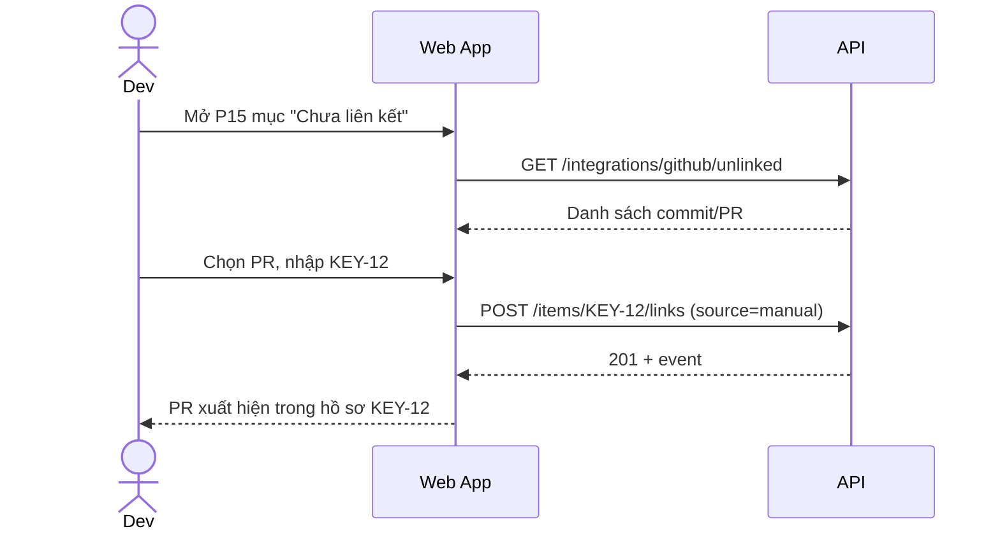

**Duyệt gate**

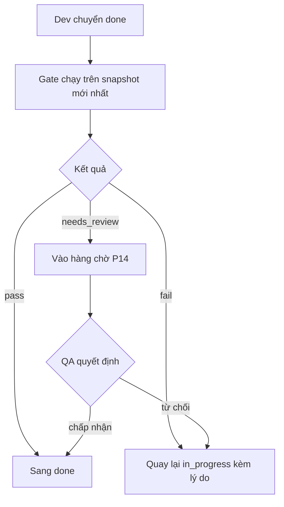

### 4.7. Trạng thái giao diện chuẩn

| Trạng thái | Biểu hiện | Hành động cho người dùng |
|---|---|---|
| Đang tải | Skeleton đúng bố cục | Không cần |
| Rỗng | Minh họa + giải thích | Nút tạo/kết nối (ví dụ "Kết nối GitHub") |
| Lỗi | Thông báo kèm mã lỗi | Thử lại; liên hệ Admin nếu là quyền |
| Không có quyền | Trang 403 nêu rõ vai trò cần có | Yêu cầu quyền từ Admin |
| Tích hợp suy giảm | Banner `degraded` | Xem sức khỏe; chờ polling bù |
| Bằng chứng cũ | Nhãn `stale` | QA xác nhận hoặc cập nhật |

### 4.8. Ngôn ngữ thị giác

Nguồn chuẩn: [Strata_UI_UX_Guidelines.md](docs/design/Strata_UI_UX_Guidelines.md) (bảng token, tương phản, thành phần). Bảng dưới là tóm tắt.

| Thành phần | Quy ước |
|---|---|
| Màu | Bảng màu đất và trung tính theo tầng địa chất: đá gốc `#3E444B`, đất nâu `#7A4E2D`, đất sét nung `#A3482A`, đất phong hóa `#F0AC54`, khoáng xanh `#3F7A67`; nền sáng `#F9F9F7`, nền tối `#0B0B0B` |
| Phông | Tiêu đề EB Garamond, nội dung IBM Plex Sans, mã và số liệu IBM Plex Mono |
| Ý nghĩa màu trạng thái | Khoáng xanh: đã kiểm chứng; đất phong hóa: cần duyệt/stale; đỏ đá: không đạt; xám: chưa phủ. Luôn kèm icon và nhãn chữ |
| Ngôn ngữ | Tiếng Anh mặc định, có chuyển sang tiếng Việt |
| Chế độ | Sáng và tối |
| Mobile | Chỉ đọc và xem; thao tác trên desktop |

---

## 5. Kiến trúc C4

C1–C3 mô tả hệ thống ở các mức chi tiết tăng dần. Thiết kế chi tiết lớp và tuần tự ở [mục 8](#8-thiết-kế-chi-tiết-lớp-và-tuần-tự). Các thành phần phase sau vẽ nét đứt.

### 5.1. C1 — System Context

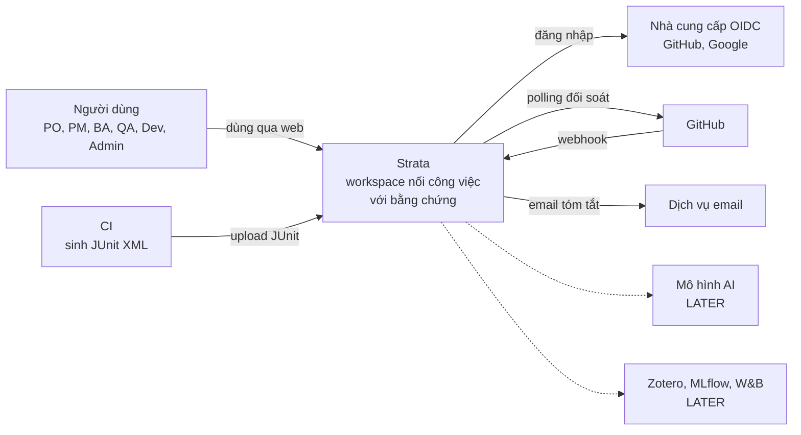

### 5.2. C2 — Container

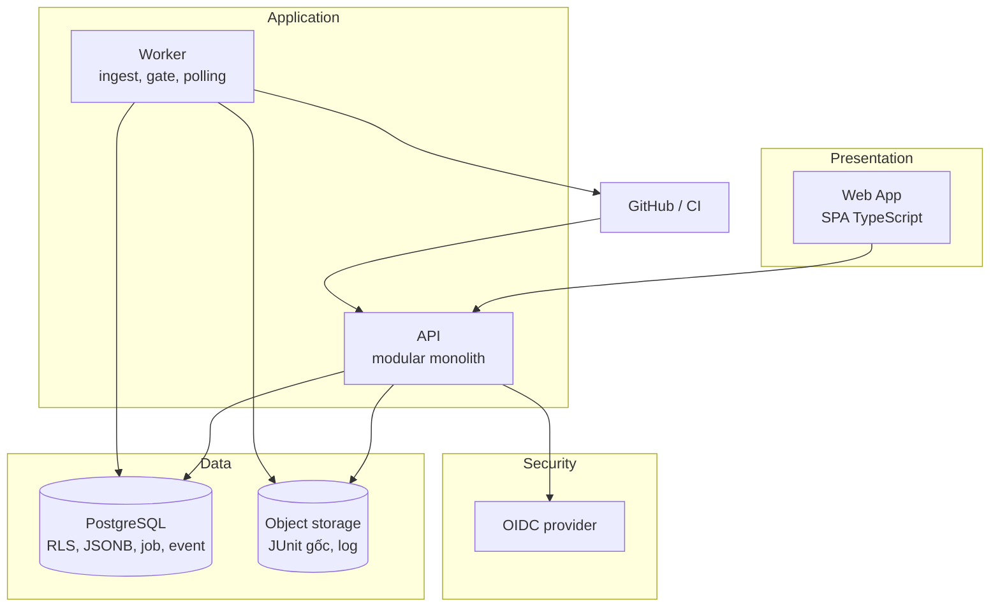

### 5.3. C3 — Component

#### 5.3.1. API

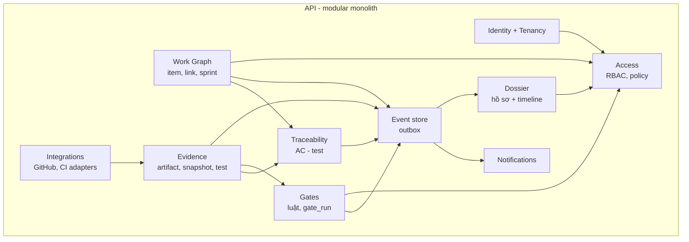

#### 5.3.2. Worker

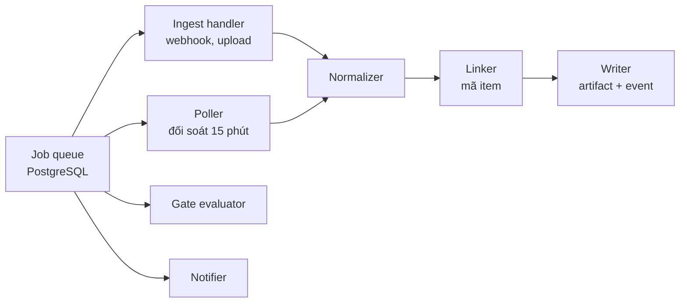

### 5.4. Quyết định kiến trúc

| # | Quyết định | Lý do | Đánh đổi |
|---|---|---|---|
| AD01 | **Modular monolith** | Đội nhỏ; nhiều giả định chưa kiểm chứng | Phải giữ kỷ luật ranh giới module để tách sau |
| AD02 | **PostgreSQL duy nhất** (RLS, JSONB, full-text) | Ít thành phần vận hành | Vector/queue lớn có thể cần tách sau |
| AD03 | **Cột chung + `attrs` JSONB có schema đăng ký** (ADR-01) | Thêm kind không cần migration | Kiểm schema ở tầng ứng dụng |
| AD04 | **Outbox + hàng đợi trong PostgreSQL** | Event và trạng thái nhất quán | Chuyển NATS/Kafka khi tải tăng |
| AD05 | **GitHub App, webhook + polling đối soát** | Quyền tối thiểu; chịu được mất webhook | Thêm công việc đối soát |
| AD06 | **Snapshot bất biến, gate đánh giá snapshot** | Tái lập được | Tốn lưu trữ |
| AD07 | **Luật gate là dữ liệu có phiên bản** | Kiểm toán, không chạy code tùy ý | Biểu đạt hạn chế hơn code |
| AD08 | **RBAC trước, ABAC sau** | Đơn giản cho MVP; chừa policy decision point | Chưa phân quyền cấp artifact |
| AD09 | **Không lưu mã nguồn** | Giảm rủi ro và quyền cần xin | Không có xem diff trong Strata |
| AD10 | **TypeScript mặc định** | Một ngôn ngữ cho web và API | Chốt theo kỹ năng nhóm (PQ-05) |

---

## 6. Cơ sở dữ liệu và hợp đồng API

### 6.1. Sơ đồ cơ sở dữ liệu

Thiết kế sơ bộ, mọi bảng có `tenant_id` + RLS (không vẽ lặp lại ở từng bảng).

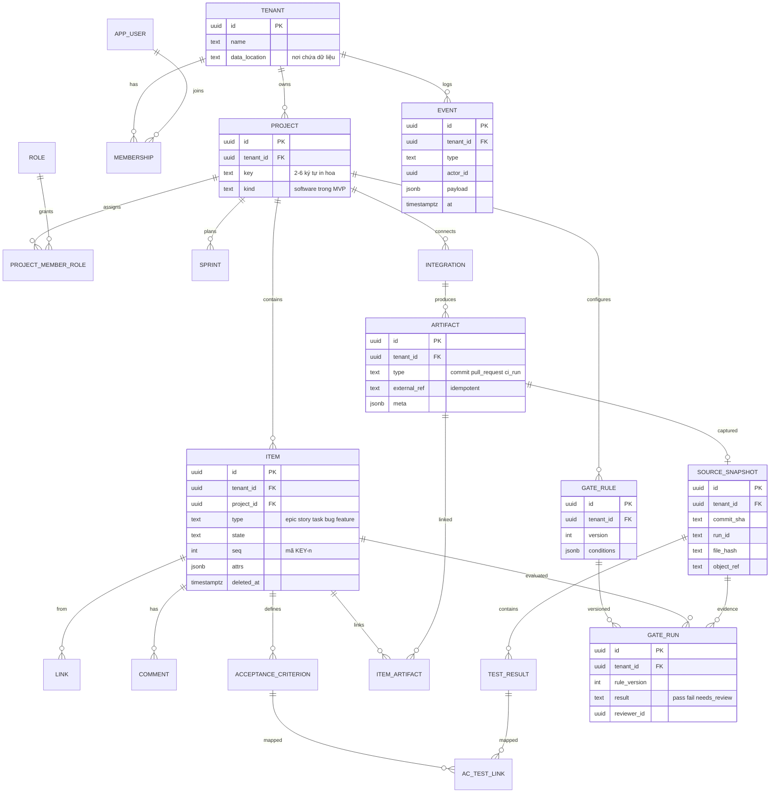

Quy tắc được lược đồ đảm bảo:

- `item.seq` duy nhất theo `project_id`; sinh nguyên tử (BR02).
- `artifact.external_ref` duy nhất theo `integration_id` để idempotent (BR05).
- `source_snapshot` và `event` không có thao tác UPDATE/DELETE cho role ứng dụng (BR03, BR06).
- `gate_run` lưu `rule_version` và tham chiếu `source_snapshot` (BR09).
- Lược đồ chi tiết dự kiến tại `src/database/` (chưa viết).

### 6.2. Tài liệu API OpenAPI 3.0

Đặc tả OpenAPI dự kiến đặt tại `docs/api/openapi.yaml` (chưa viết). Bảng dưới là nhóm endpoint dự kiến.

```text
Dự kiến: ~50 operation, REST + JSON, xác thực OIDC (cookie phiên) và token CI cho upload.
```

| Nhóm | Endpoint chính | Trang |
|---|---|---|
| Xác thực | `GET /auth/login`, `GET /auth/callback`, `POST /auth/logout` | P01 |
| Workspace và thành viên | `POST /workspaces`, `POST /workspaces/{id}/invitations`, `PUT /projects/{id}/members` | P17 |
| Dự án và item | `GET/POST /projects`, `GET/POST /projects/{key}/items`, `PATCH /items/{id}`, `POST /items/{id}/transitions` | P04–P08 |
| Link và bình luận | `POST /items/{id}/links`, `DELETE /links/{id}`, `POST /items/{id}/comments` | P08 |
| Thông báo | `GET /notifications`, `PATCH /notifications/{id}` | P03 |
| Tích hợp GitHub | `POST /integrations/github/installations`, `GET /integrations/github/unlinked`, `POST /webhooks/github` | P15 |
| Test và snapshot | `POST /projects/{key}/test-reports`, `GET /snapshots/{id}` | P11, P16 |
| Hồ sơ chức năng | `GET /features/{id}/dossier`, `GET /features/{id}/timeline` | P09, P10 |
| AC và truy vết | `POST /features/{id}/acs`, `PUT /acs/{id}/test-links`, `GET /features/{id}/traceability` | P12 |
| Gate | `GET/PUT /projects/{key}/gate-rules`, `POST /features/{id}/gate-runs`, `POST /gate-runs/{id}/decision` | P13, P14 |
| Nhật ký | `GET /events` | P18 |

---

## 7. Cấu trúc thư mục dự kiến

### 7.1. Bố cục repository

Cây dưới là **dự kiến**, chưa có mã nguồn. `[dự kiến]` = sẽ tạo trong MVP, `[sau]` = chỉ giữ chỗ cho phase sau.

```text
strata/
├── README.md
├── docs/
│   ├── product/              # PRD_Strata_MVP.md, PLAN_Strata.md (có)
│   ├── background/           # brainstorm, kiến trúc, báo cáo nghiên cứu (có)
│   └── api/openapi.yaml      # [dự kiến]
├── apps/
│   ├── web/                  # [dự kiến] SPA TypeScript
│   └── api/                  # [dự kiến] modular monolith + worker
├── packages/
│   └── shared/               # [dự kiến] kiểu dùng chung, schema
├── src/database/             # [dự kiến] migration, schema RLS
├── compose.yaml              # [dự kiến] PostgreSQL, object storage cục bộ
└── scripts/                  # [dự kiến] seed, tiện ích
```

### 7.2. Web App

```text
apps/web/src/
├── app/                      # shell, routing, theme
├── features/
│   ├── work/                 # backlog, board, sprint, item
│   ├── dossier/              # hồ sơ chức năng, timeline
│   ├── quality/              # test, ma trận AC, gate
│   ├── integrations/         # GitHub, token CI
│   └── admin/                # thành viên, audit
├── shared/                   # component, hooks, api client
└── i18n/                     # vi, en
```

### 7.3. API và Worker

```text
apps/api/src/
├── modules/
│   ├── identity-tenancy/
│   ├── access/               # RBAC, policy decision point
│   ├── work-graph/
│   ├── integrations/         # github/, ci/ (adapter)
│   ├── evidence/             # artifact, snapshot, test
│   ├── dossier/
│   ├── gates/
│   ├── traceability/
│   ├── notifications/
│   ├── events/               # outbox
│   ├── workflow/             # [sau] workflow engine
│   ├── agents/               # [sau] tool gateway, agent_run
│   ├── research/             # [sau] kind research
│   └── ml/                   # [sau] kind ai
├── worker/                   # ingest, poller, gate evaluator, notifier
└── platform/                 # config, logging, db, queue
```

Quy tắc phụ thuộc: `api → services → repositories → PostgreSQL`; module chỉ gọi module khác qua giao diện công khai; mọi truy cập dữ liệu đi qua tầng dịch vụ có kiểm quyền, không đường tắt vào DB (để phase agent dùng lại).

---

## 8. Thiết kế chi tiết lớp và tuần tự

### 8.1. C4 Level 4 — Cộng tác ở mức code

#### L4.1. Ingest pipeline (webhook GitHub)

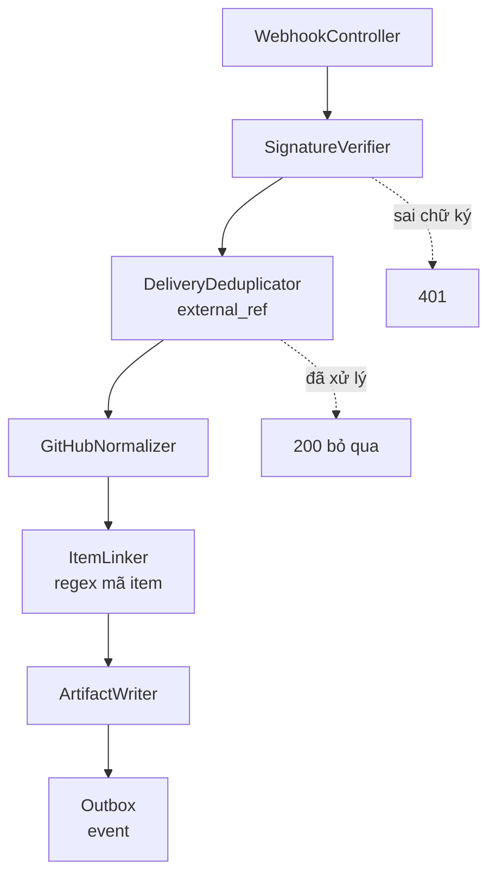

#### L4.2. Đánh giá gate

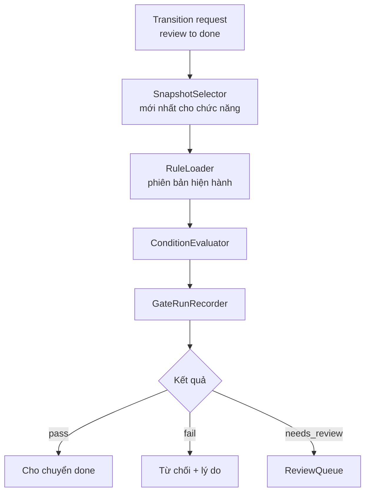

### 8.2. Sơ đồ lớp cốt lõi

#### 1. Work graph và sự kiện

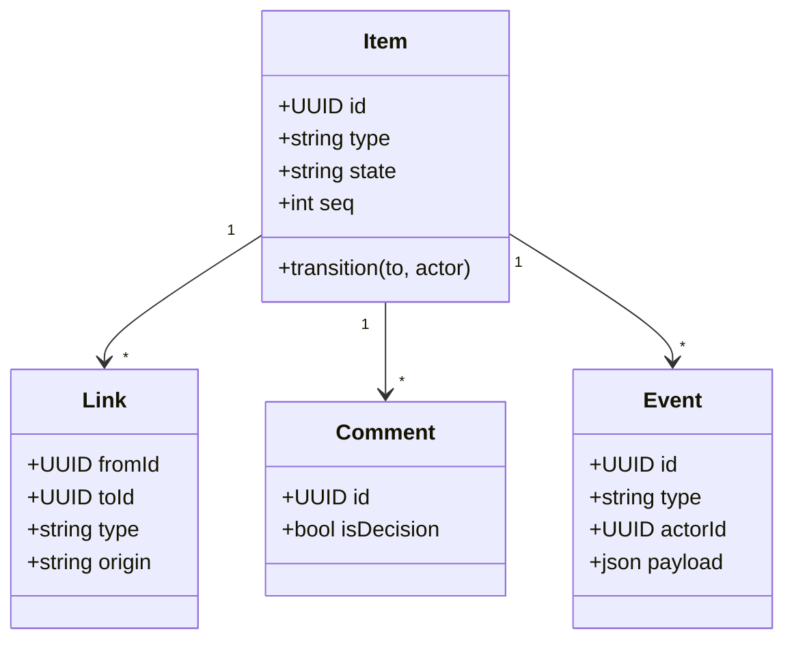

#### 2. Bằng chứng và gate

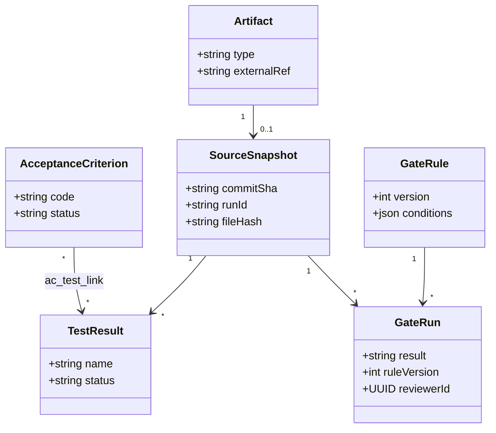

### 8.3. Sơ đồ tuần tự

#### Webhook GitHub, liên kết và timeline (US15, US17 — `POST /webhooks/github`)

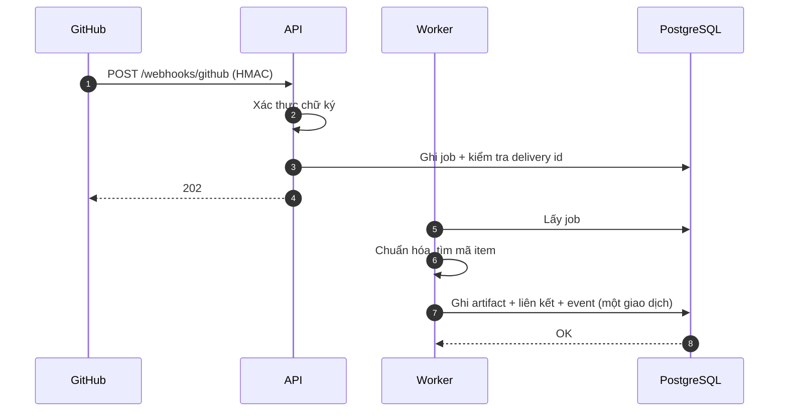

#### Upload JUnit và tạo snapshot (US18 — `POST /projects/{key}/test-reports`)

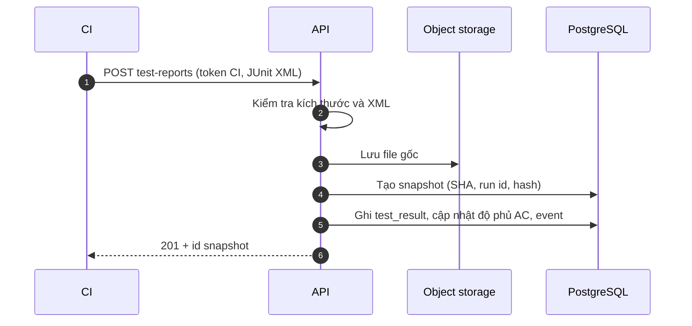

#### Gate và duyệt (US23, US24 — `POST /features/{id}/gate-runs`, `POST /gate-runs/{id}/decision`)

```mermaid
sequenceDiagram
    autonumber
    actor D as Dev
    actor Q as QA
    participant API as API
    participant DB as PostgreSQL
    D->>API: Chuyển chức năng sang done
    API->>DB: Chọn snapshot mới nhất + luật hiện hành
    API->>API: Đánh giá điều kiện
    API->>DB: Lưu gate_run (needs_review)
    API-->>D: Chờ QA duyệt
    Q->>API: POST decision (chấp nhận, lý do)
    API->>DB: Cập nhật gate_run, chuyển done, ghi event
    API-->>Q: 200
```

---

## Tài liệu

- **Sản phẩm**
  - [PRD – Strata MVP](docs/product/PRD_Strata_MVP.md): yêu cầu, tiêu chí chấp nhận, kế hoạch phát hành MVP.
  - [Plan – Strata](docs/product/PLAN_Strata.md): các phase sau MVP (workflow, agent, nghiên cứu, AI/ML…), điều kiện vào/thoát, quyết định cần chốt.
- **Nền tảng và nghiên cứu**
  - [Tổng hợp brainstorm](docs/background/brainstorm-summary.md): tầm nhìn, pain point, mô hình lõi, danh sách chức năng đầy đủ.
  - [Đề xuất kiến trúc hệ thống](docs/background/system-architecture.md): modular monolith, tenancy, bảo mật, spike kiểm chứng.
  - [Báo cáo nghiên cứu khoa học toàn cảnh](docs/background/research-landscape-report.md): bối cảnh cho phase nghiên cứu.
- **Dự kiến (chưa viết)**
  - `docs/api/openapi.yaml`, `src/database/`, `docs/RUNNING.md`.

## Tiến độ dự án

- [x] Brainstorm và tổng hợp ý tưởng ([brainstorm-summary](docs/background/brainstorm-summary.md))
- [x] Chốt tên dự án: Strata
- [x] Nghiên cứu bối cảnh (nghiên cứu khoa học, pain point, công cụ)
- [x] Đề xuất kiến trúc hệ thống
- [x] Slide giới thiệu dự án (9 phần, C4)
- [x] Thu hẹp phạm vi MVP về dự án phần mềm
- [x] Bản nháp PRD, Plan, README (tài liệu này)
- [ ] Phỏng vấn người dùng, xác nhận pain point (P0)
- [ ] Chốt quy mô đội, ngăn xếp, nhóm dùng thử đầu tiên (D-01, D-02, D-03)
- [ ] Spike: RLS, idempotent webhook, tái lập gate (S-01 đến S-03)
- [ ] Đặc tả `docs/api/openapi.yaml` và lược đồ `src/database/`
- [ ] M1 – Lõi, tenancy, vai trò, event
- [ ] M2 – Công việc, cộng tác
- [ ] M3 – Kết nối GitHub
- [ ] M4 – JUnit, snapshot, hồ sơ chức năng, timeline
- [ ] M5 – Gate, truy vết AC, dogfood
- [ ] [LATER] Phase 2–7: workflow, agent, nghiên cứu, AI/ML, coaching (xem Plan)
