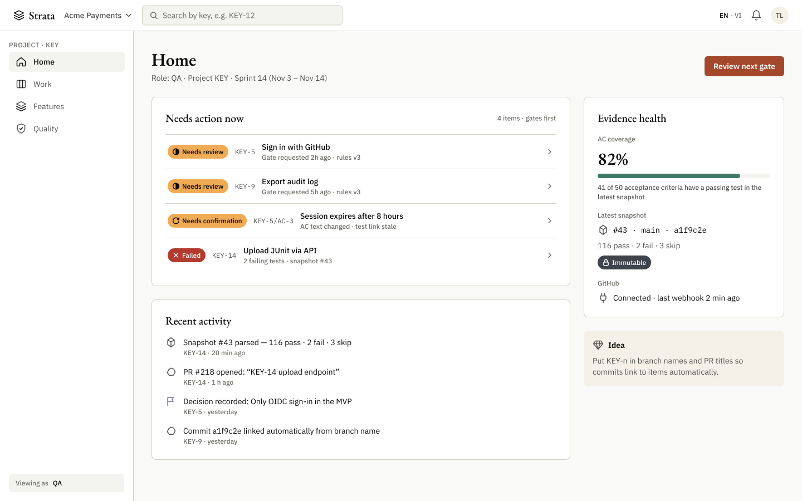
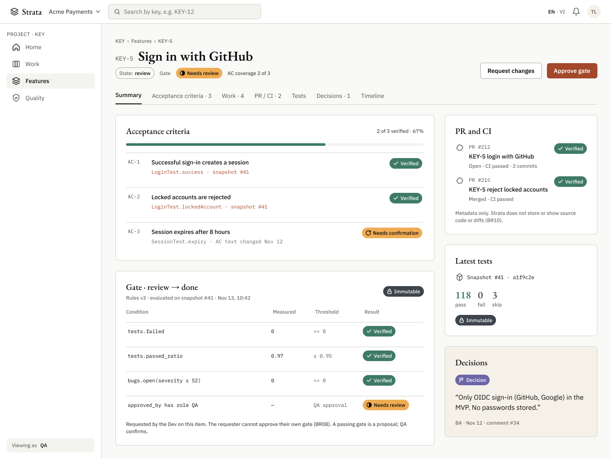
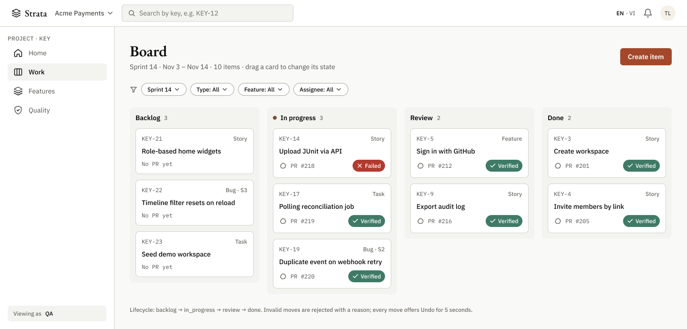
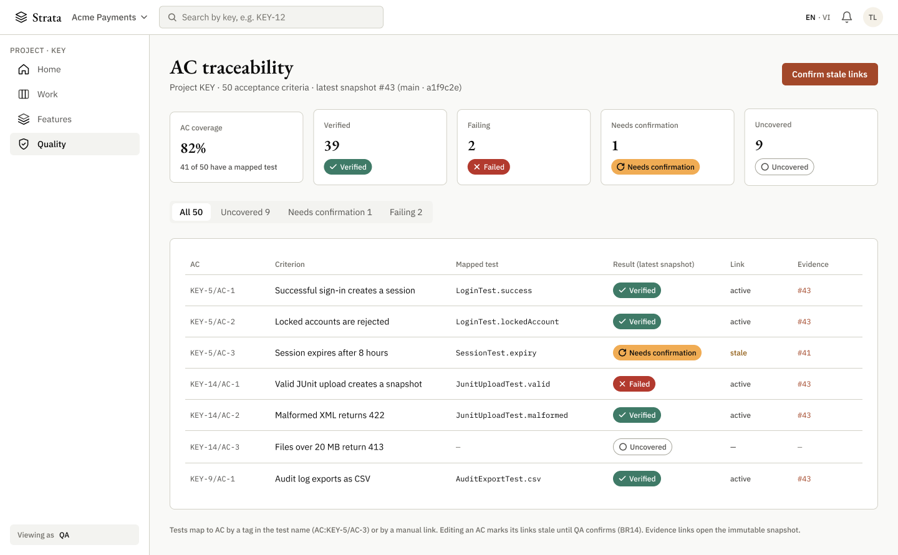
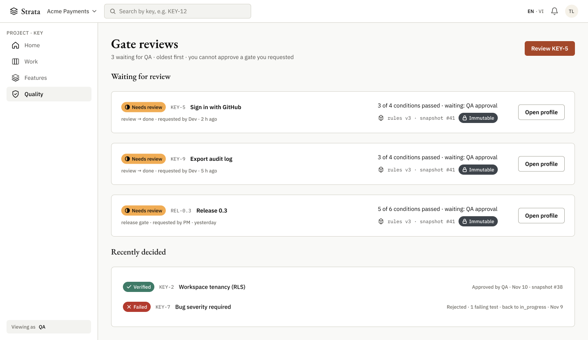
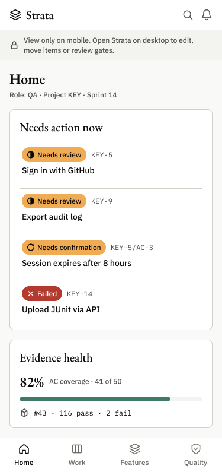
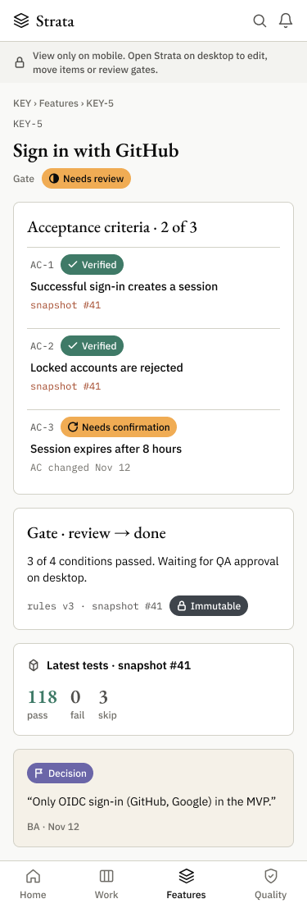

# Strata — Current UI prototype

> Screens exported from the Figma file **[Strata](https://www.figma.com/design/C7cT7HCgPXUpKqZZC5yYPC/Strata)** on 2026-11-03. They show what the main MVP screens look like with the design system in [Strata_UI_UX_Guidelines.md](Strata_UI_UX_Guidelines.md).
> Status: **prototype v0.1**. Content is sample data for the demo project `KEY`; the role shown on desktop screens is **QA**.

---

## 1. What is in the Figma file

| Page | Contents |
|---|---|
| **Components** | Variables (`Primitives`, `Color`, `Color · Dark`, `Dimension`), 10 text styles, 22 line icons (including stone, crystal, gem), `Button`, `Status chip`, `Nav item`, `Item card` |
| **Web — Desktop** | App shell components (`App shell/Top bar`, `App shell/Sidebar`) and screens P02, P10, P06, P12, P14 at 1440 px |
| **Mobile — Read-only** | Home and Feature profile at 375 px, view only |

All fills, strokes, spacing and radii are bound to variables; all text uses the text styles. Screens are built from component instances, so changes to a component update every screen.

**Known limitation:** the Figma Starter plan allows one mode per variable collection, so dark values live in a separate `Color · Dark` collection with the same variable names. The screens use the light collection. Switching themes in Figma needs a plan with multiple modes, or rebinding to `Color · Dark`.

---

## 2. Desktop screens (1440 px)

### P02 — Role-based Home (QA)

- Opens on the role-based Home (UX-Q1). For QA, gates waiting for review are listed first (AC-F10-01).
- "Evidence health" shows project-level numbers only: AC coverage, latest snapshot, GitHub connection. No individual metrics (U4).
- The sidebar shows only the groups the role can use (README 4.2): QA does not see Integrations or Admin.
- The gem icon appears only on the idea/tip card (guidelines 5.1).

### P10 — Feature profile (KEY-5)

- Header: key, title, state, latest gate result and AC coverage. One primary action: **Approve gate**.
- Tabs with deep links: Summary, Acceptance criteria, Work, PR / CI, Tests, Decisions, Timeline.
- Every verified AC links to the snapshot that proves it (U1). AC-3 is `stale` after its text changed (BR14).
- The gate panel explains each condition: measured value, threshold and result (U5), on an immutable snapshot and rule version.
- PR and CI show metadata only; no code or diff (BR10). Stone icon = raw source data.

### P06 — Board (Sprint 14)

- Four columns follow the fixed lifecycle: backlog → in_progress → review → done.
- Cards are instances of `Item card`: key, type, title, linked PR and latest CI chip. Cards without a PR hide the PR and CI parts.
- The umber marker on "In progress" uses the layer meaning "work in progress" (guidelines 2.2).

### P12 — AC traceability matrix

- Summary tiles: coverage, verified, failing, needs confirmation, uncovered. Each count has its status chip.
- The matrix maps each AC to its test, the result on the latest snapshot, the link state (`active` / `stale`) and the evidence snapshot.
- Primary action for QA: **Confirm stale links**.

### P14 — Gate reviews

- Gates waiting for QA, oldest first, each with a condition summary, rule version and immutable snapshot.
- The header states that a requester cannot approve their own gate (BR08).
- "Recently decided" keeps the result and the reason for each decision.

---

## 3. Mobile screens (375 px, read-only)

| Home (QA) | Feature profile (KEY-5) |
|---|---|
|  |  |

- Mobile is view only (UX-Q4): no editing, no drag-and-drop, no gate approval. A notice at the top points to the desktop app.
- The bottom tab bar keeps the same four groups as the QA sidebar.

---

## 4. Design system used

| Element | Values |
|---|---|
| Colors | Tokens from guidelines 2.3, for example `color/layer/terracotta` `#A3482A` (primary action), `color/layer/mineral` `#3F7A67` (verified), `color/layer/ochre` `#F0AC54` (needs review) |
| Status | `Status chip` variants: Verified, Needs review, Needs confirmation, Failed, Uncovered, Immutable, Decision (color + icon + label) |
| Typography | EB Garamond (Display 32, H2 24, H3 20), IBM Plex Sans (Body 16, UI 14, Caption 12), IBM Plex Mono (14, 12) |
| Spacing and radius | 4 px grid (`space/1`–`space/12`), `radius/control` 6, `radius/card` 8, `radius/full` |
| Language | Interface labels in English (default); room is left for Vietnamese labels |

---

## 5. Not yet designed

- Screens P01, P03–P05, P07–P09, P11, P13, P15–P18 from the screen inventory (README 3.4).
- Dark-mode versions of the screens.
- Loading, empty, error and no-permission states (guidelines section 6) as separate frames.
- Item detail drawer and the gate rule editor.

## Updating the images

When the Figma screens change, export them again at 1× (PNG) with the same file names into `docs/design/prototype/`, so the README and this document keep working.
