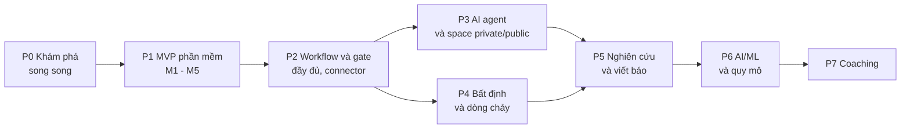

# Plan — Strata: MVP phần mềm và lộ trình các phần còn lại

> Tài liệu ghi lại **dự định**, không phải cam kết. Phần MVP (Phase 1) bám [PRD_Strata_MVP.md](PRD_Strata_MVP.md). Các phase sau (nghiên cứu, viết báo khoa học, AI/ML, AI agent…) chỉ mở khi đạt điều kiện vào. Thứ tự các phase sau MVP là **giả thuyết** và có thể đổi theo kết quả phỏng vấn và số liệu dùng thật.

---

## 0. Thông tin tài liệu

| Field | Value |
|---|---|
| Product | Strata |
| Version | v0.1 |
| Status | Draft |
| Ngày cập nhật | 03/11/2026 |
| Chu kỳ rà soát | Cuối mỗi mốc (M1–M5) và khi quyết định mở phase mới |
| Tài liệu liên quan | [PRD](PRD_Strata_MVP.md) · [README](../../README.md) · [Kiến trúc](../background/system-architecture.md) |

### Change log

| Version | Ngày | Thay đổi |
|---|---|---|
| v0.1 | 03/11/2026 | Bản đầu. MVP thu hẹp còn dự án phần mềm; ghi dự định cho nghiên cứu, viết báo, AI/ML, agent. |

---

## 1. Nguyên tắc lập kế hoạch

1. **Một lát cắt hẹp có dữ liệu tự động trước.** MVP ở giao điểm Git + kết quả test + hồ sơ chức năng, cho một kind (`software`).
2. **Mỗi phase phải tạo ra thứ dùng được**, kiểm chứng bằng người dùng thật, không chỉ hoàn thành tính năng.
3. **Mở phase sau theo điều kiện, không theo lịch.** Mỗi phase có điều kiện vào và tiêu chí thoát (mục 5).
4. **Chuẩn bị chỗ mở rộng ngay trong MVP** (mục 6) nhưng không xây tính năng chưa cần.
5. **Phỏng vấn trước khi xây** cho nghiên cứu và AI/ML: bằng chứng pain point của hai nhóm này hiện chủ yếu từ khảo sát nhà cung cấp và mẫu nhỏ.
6. **Đo quy trình, không đo cá nhân** ở mọi phase.

---

## 2. Bản đồ các phase

| Phase | Tên | Mục tiêu một dòng | Trạng thái |
|---|---|---|---|
| P0 | Khám phá | Xác nhận pain point và chọn nhóm đầu tiên | Chưa bắt đầu |
| P1 | MVP phần mềm | Hồ sơ chức năng + bằng chứng tự động + gate cơ bản | Chưa bắt đầu (đã có PRD) |
| P2 | Workflow và gate đầy đủ | Workflow designer, lịch sử có diff, connector bổ sung | Dự định |
| P3 | AI agent và space | Agent mức 0–1 qua tool gateway; private/public; tìm kiếm có lọc quyền | Dự định |
| P4 | Bất định và dòng chảy | Ước lượng khoảng, sổ rủi ro, cycle time/CFD, phát hiện nghẽn | Dự định |
| P5 | Nghiên cứu và viết báo | Kind `research`, truy vết claim, vòng đời bài báo | Dự định, cần phỏng vấn |
| P6 | AI/ML và quy mô | Kind `ai`, MLflow/W&B, silo DB | Dự định, cần phỏng vấn |
| P7 | Coaching | Gợi ý thực hành có bằng chứng, PDCA, Andon | Dự định |

---

## 3. Phase 0 — Khám phá (song song với M1)

| Việc | Đầu ra | Tiêu chí xong |
|---|---|---|
| Soạn bộ câu hỏi phỏng vấn cho nhóm phần mềm (PO, PM, BA, QA, Dev) | Kịch bản phỏng vấn | Dùng thử với 2 người |
| Phỏng vấn 8–10 người nhóm phần mềm | Ghi chú, bảng pain point xếp hạng | PP-01…PP-07 được xác nhận, bác bỏ hoặc sửa |
| Chọn 1–3 nhóm dùng thử đầu tiên | Danh sách nhóm + cam kết dùng | Mỗi nhóm có CI sinh JUnit và 1 BA/QA |
| Phỏng vấn sớm 4–5 nhà nghiên cứu / trưởng nhóm AI (nhẹ) | Ghi chú xác nhận có nên mở P5/P6 | Quyết định đưa vào đầu vào của mục 7 |
| Spike kỹ thuật (mục 8) | Báo cáo spike | 4 spike đạt hoặc có phương án thay |

---

## 4. Phase 1 — MVP phần mềm

Chi tiết yêu cầu và tiêu chí chấp nhận ở [PRD](PRD_Strata_MVP.md). Thời gian tính theo tuần từ T0, giả định đội 3–4 người (chưa xác nhận).

### 4.1 Luồng công việc và mốc

| Mốc | Tuần | Việc chính | Đầu ra | Tiêu chí hoàn thành (Definition of Done) |
|---|---|---|---|---|
| M1 — Lõi | 1–2 | Khung dự án, PostgreSQL + RLS, `tenant`, đăng nhập OIDC, vai trò nhiều-nhiều, event store (outbox) | F1, F2 | AC-F1, AC-F2; test RLS trong CI; audit đổi quyền |
| M2 — Công việc | 3–4 | Project, item, link, sprint, bug, board Kanban, backlog, bình luận, mention, thông báo | F3, F4 | AC-F3, AC-F4; nhóm dùng nội bộ được |
| M3 — GitHub | 5–6 | GitHub App, webhook idempotent, polling đối soát, tự liên kết mã item | F5 | AC-F5 trên repo thật; webhook trùng/lệch thứ tự an toàn |
| M4 — Test và hồ sơ | 7–8 | Upload JUnit, snapshot bất biến, hồ sơ chức năng, timeline | F6, F7 | AC-F6, AC-F7; demo 1 chức năng từ yêu cầu đến kết quả test |
| M5 — Gate và dogfood | 9–10 | Gate cơ bản, ma trận AC↔test, view theo vai trò (Could), dùng thử với nhóm thật | F8, F9, F10 | AC-F8, AC-F9; ≥ 1 nhóm dùng thử bắt đầu |

### 4.2 Điều kiện vào P1

- Chốt quy mô đội và kỹ năng (PQ-01), ngăn xếp (PQ-05).
- P0 đã xác nhận ít nhất pain point PP-01, PP-03, PP-05 hoặc đã điều chỉnh PRD.
- Có ít nhất 1 nhóm cam kết dùng thử.

### 4.3 Tiêu chí thoát P1 (để mở P2)

- ≥ 3 nhóm dùng thật liên tục 4 tuần, ≥ 60% thành viên hoạt động hằng tuần.
- ≥ 80% liên kết commit/PR với item là tự động.
- ≥ 2 nhóm dùng gate cho phát hành thật.
- 0 rò rỉ chéo tenant trong test và vận hành.
- Có thông tin từ người dùng về việc thiếu gì nhất (đầu vào để xếp lại P2–P4).

### 4.4 Không làm trong P1

Workflow designer, AI agent, space private/public, ước lượng, phân tích nghẽn, kind research/ai, silo DB, GitLab và các connector khác (xem PRD Phụ lục B).

---

## 5. Các phase sau MVP

### 5.1 Phase 2 — Workflow và gate đầy đủ

| Hạng mục | Nội dung |
|---|---|
| Mục tiêu | Cho nhóm tự thiết kế quy trình có cổng kiểm định; tăng độ phủ nguồn bằng chứng. |
| Phạm vi | WF-01 workflow designer (nút source/input/process/switch/gate/output); WF-02 lan truyền stale; HIS-01 lịch sử có diff và version tree; INT-01 GitLab, CI, SonarQube, Figma, Confluence. |
| Điều kiện vào | Tiêu chí thoát P1; người dùng nêu rõ nhu cầu tùy biến quy trình. |
| Tiêu chí thoát | Nhóm tự cấu hình được một workflow phát hành mà không cần hỗ trợ; 0 vòng lặp gate không giới hạn. |
| Phụ thuộc | Mô hình token/dataflow đã thử ở gate cơ bản. |
| Rủi ro | Thành "Jira thứ hai". Giảm thiểu: template mặc định, giới hạn số loại nút. |

### 5.2 Phase 3 — AI agent và space private/public

| Hạng mục | Nội dung |
|---|---|
| Mục tiêu | Agent thực hiện một node (đề xuất), người kiểm soát input và output; không gian riêng tư và công khai với publish tường minh. |
| Phạm vi | AGT-01 node `agent`, input contract, context package, output schema, vùng nháp, bản ghi `agent_run`; AGT-02 guardrail (allowlist công cụ, ngân sách, sandbox, danh tính riêng, nút dừng, leo thang); SPC-01 space + publish; SRC-01 tìm kiếm FTS + vector có lọc quyền; AUTHZ-01 ABAC. Mức tự chủ 0–1 trước; mức 2–3 (AGT-03) chỉ khi có số liệu chấp nhận ổn định. |
| Điều kiện vào | P2 đã có gate đáng tin; chốt D-06 (agent do ứng dụng cung cấp hay khách gắn ngoài); chính sách dữ liệu gửi mô hình ngoài. |
| Tiêu chí thoát | Một luồng agent đầu-cuối từ context package đến changeset được chấp nhận; test chứng minh agent không đọc được space private của người khác; tỷ lệ chấp nhận và mức chỉnh sửa đo được theo node. |
| Rủi ro | Automation bias, prompt injection, rò rỉ dữ liệu ra mô hình ngoài, chi phí kiểm chứng ngang tự làm. Giảm thiểu: xem [brainstorm mục 11](../background/brainstorm-summary.md). |

### 5.3 Phase 4 — Bất định và dòng chảy

| Hạng mục | Nội dung |
|---|---|
| Mục tiêu | Làm độ bất định nhìn thấy được và phát hiện nghẽn của quy trình. |
| Phạm vi | EST-01 ước lượng dạng khoảng, trạng thái "chưa thể ước lượng", spike có thời hạn, sổ rủi ro; FLOW-01 cycle time, WIP, queue time, aging, CFD, quy tắc nghẽn. Rule-based trước, AI sau. |
| Điều kiện vào | Có ≥ 3 tháng dữ liệu event thật từ P1–P2. |
| Tiêu chí thoát | Dự báo bằng Monte Carlo trên thông lượng lịch sử có độ lệch đo được; nhóm dùng phát hiện nghẽn mà không bị xem là giám sát cá nhân. |
| Rủi ro | Goodhart; ước lượng bị dùng đánh giá nhóm. Giảm thiểu: đo cấp quy trình, không bảng xếp hạng cá nhân. |

### 5.4 Phase 5 — Dự án nghiên cứu và viết báo khoa học

| Hạng mục | Nội dung |
|---|---|
| Mục tiêu | Quản lý trọn vòng đời nghiên cứu: giả thuyết → thí nghiệm → số liệu → bản thảo → phản biện → xuất bản, với truy vết từ claim về bằng chứng gốc. |
| Phạm vi | RSC-01 kind `research` (giả thuyết, thí nghiệm, kết quả; vòng đời `proposed → approved → running → analyzing → written → submitted`); ghi nhận thí nghiệm bị hủy và giả thuyết bị bác như dữ liệu; RSC-02 truy vết claim ↔ run/thí nghiệm; RSC-03 Zotero, Overleaf, OSF, ORCID/Crossref; RSC-04 vòng đời viết bài, phản biện, nộp; ý tưởng mặc định private (dùng SPC-01). |
| Điều kiện vào | P3 có space private/public; phỏng vấn ≥ 8 PM nghiên cứu / trưởng lab xác nhận pain point; chọn 1 nhóm nghiên cứu đồng hành. |
| Tiêu chí thoát | Một bài báo đi qua chuỗi truy vết đầu-cuối trong một nhóm thật; nhóm giảm thời gian tổng hợp số liệu cho bản thảo (đo trước/sau). |
| Phụ thuộc | Chính sách AI của nhà xuất bản; chất lượng connector; thói quen ghi chép của nhà nghiên cứu. |
| Rủi ro | Lặp lại thất bại ELN "không ai ghi chép". Giảm thiểu: nguồn tự động (Git, Zotero, run tracking); kiểm chứng trích dẫn do AI sinh ra trước khi dùng. Bối cảnh: [research-landscape-report.md](../background/research-landscape-report.md). |

### 5.5 Phase 6 — Dự án AI/ML và quy mô doanh nghiệp

| Hạng mục | Nội dung |
|---|---|
| Mục tiêu | Theo dõi thí nghiệm ML gắn với giả thuyết, task và tài liệu; sẵn sàng khách lớn. |
| Phạm vi | ML-01 kind `ai` (run, tham số, metric, dataset version, checkpoint); ghi nhận thí nghiệm bị bỏ dở kèm lý do; ML-02 connector MLflow, W&B, DVC, so sánh run, model registry cơ bản; ENT-01 silo DB, vùng dữ liệu, khóa theo tenant. |
| Điều kiện vào | Phỏng vấn ≥ 8 trưởng nhóm AI; ít nhất 1 khách yêu cầu cô lập dữ liệu (cho ENT-01). |
| Tiêu chí thoát | Một nhóm AI dùng Strata cùng MLflow/W&B mà không nhập tay; tenant silo chạy được với cùng code ứng dụng. |
| Rủi ro | Cạnh tranh với W&B/MLflow. Giảm thiểu: là lớp liên kết giả thuyết ↔ run ↔ tài liệu, không thay công cụ tracking. |

### 5.6 Phase 7 — Coaching

| Hạng mục | Nội dung |
|---|---|
| Mục tiêu | Gợi ý thực hành kèm bằng chứng; nhóm quyết định; app tự đánh giá kết quả. |
| Phạm vi | COACH-01 gợi ý thực hành (Theory of Constraints, Kanban/WIP limit, 5 Whys), PDCA tự đánh giá sau thời hạn, Andon (dừng luồng). |
| Điều kiện vào | P4 phát hiện nghẽn tin cậy. |
| Tiêu chí thoát | Gợi ý được chấp nhận và cải thiện chỉ số trong ít nhất 2 nhóm. |

---

## 6. Điểm mở rộng phải có sẵn trong MVP

Để các phase sau không phải viết lại lõi, MVP chuẩn bị (không xây tính năng):

| Điểm mở rộng | Việc làm trong MVP | Phase dùng |
|---|---|---|
| `kind` và item type là dữ liệu | Bảng đăng ký kind/type; `attrs` JSONB có schema đăng ký | P5, P6 |
| Gate là dữ liệu có phiên bản | Luật gate lưu cấu trúc, không phải code | P2, P3 |
| Snapshot bất biến + adapter nguồn | Schema snapshot chung; JUnit và GitHub là 2 adapter đầu | P2, P6 |
| Event store + outbox | Mọi thay đổi ghi event | P4, P7 |
| Bảng `tenant` điều phối | Ánh xạ tenant → nơi chứa dữ liệu | P6 (silo) |
| Policy decision point | Một hàm kiểm quyền dùng chung cho API; có chỗ cho ABAC | P3 |
| Cột hiển thị trên artifact | `visibility` mặc định `project`; chưa mở private/public | P3, P5 |
| Danh tính actor | Bảng actor có loại `user` / `agent` / `integration` | P3 |
| Tool gateway nội bộ | Mọi truy cập dữ liệu qua tầng dịch vụ có xác thực, không đường tắt vào DB | P3 |

---

## 7. Các quyết định cần chốt

| ID | Quyết định | Hạn | Ảnh hưởng | Trạng thái |
|---|---|---|---|---|
| D-01 | Quy mô đội build và ngày T0 | Trước M1 | Lịch toàn bộ | Mở |
| D-02 | Nhóm người dùng đầu tiên | Cuối P0 | Thứ tự tính năng P1 | Mở |
| D-03 | Ngăn xếp công nghệ | Trước M1 | Tốc độ xây | Mở (mặc định TypeScript) |
| D-04 | Xây lõi riêng hay dựng trên Plane/OpenProject | Cuối P0 | Phạm vi code | Mở (nghiêng xây riêng) |
| D-05 | Mô hình kinh doanh | Trước P2 | SaaS/self-host, silo | Mở |
| D-06 | Agent do ứng dụng cung cấp hay gắn ngoài | Trước P3 | Bảo mật, trách nhiệm | Mở |
| D-07 | "Public" nghĩa là trong tổ chức hay ra ngoài | Trước P3 | Mô hình space | Mở |
| D-08 | Có mở P5 trước P3/P4 không | Cuối P1 | Thứ tự phase | Mở, xét theo phỏng vấn |
| D-09 | Iteration = sprint hay chu kỳ gate | Trước P2 | Mô hình spiral | Mở (nghiêng gate) |

---

## 8. Spike kiểm chứng trước khi cam kết

| Spike | Câu hỏi | Tiêu chí đạt | Thuộc |
|---|---|---|---|
| S-01 Rò rỉ chéo tenant | RLS có chặn truy vấn thiếu `tenant_id`, kể cả qua tìm kiếm? | 0 dòng rò rỉ trong bộ test | P0/M1 |
| S-02 Idempotent webhook | Gửi trùng, lệch thứ tự có tạo bản sao? | 1 snapshot cho 1 sự kiện | P0/M3 |
| S-03 Tái lập gate | Chạy lại gate cùng snapshot và luật có cùng kết quả? | 100% giống nhau | P0/M5 |
| S-04 Tải sơ bộ | Số event/ngày cho tenant lớn; khi nào cần tách ingest/queue? | Có ước lượng và ngưỡng | P0 |
| S-05 Luồng agent đầu-cuối (làm ở P3) | Agent đi từ context package đến changeset được chấp nhận? Không đọc được space private của người khác? | Đạt cả hai | P3 |

---

## 9. Rủi ro của kế hoạch

| Rủi ro | Mức | Giảm thiểu |
|---|---|---|
| Phạm vi lan trước khi P1 chứng minh giá trị | Cao | Tiêu chí thoát P1 là cổng bắt buộc |
| Phỏng vấn cho thấy pain point không đau như giả định | Cao | Cập nhật PRD; đổi nhóm đầu tiên; giữ chi phí xây thấp |
| Đội nhỏ, kế hoạch 10 tuần trượt | Trung bình | Cắt F10, F9 trước; giữ F5–F7 |
| Thứ tự phase sai (nghiên cứu cần sớm hơn) | Trung bình | Quyết định D-08 sau P1 dựa trên phỏng vấn |
| Cạnh tranh làm mất khoảng trống | Trung bình | Theo dõi định kỳ; kiểm chứng giá trị sớm |
| Phụ thuộc quá nhiều vào GitHub | Trung bình | Adapter chuẩn hóa; GitLab ở P2 |

---

## 10. Trạng thái hiện tại

| Hạng mục | Trạng thái |
|---|---|
| Brainstorm tổng hợp | Xong ([brainstorm-summary.md](../background/brainstorm-summary.md)) |
| Đề xuất kiến trúc hệ thống | Xong ([system-architecture.md](../background/system-architecture.md)) |
| Báo cáo nghiên cứu bối cảnh | Xong ([research-landscape-report.md](../background/research-landscape-report.md)) |
| Slide giới thiệu Strata | Xong (artifact riêng) |
| PRD MVP phần mềm | Bản nháp v0.1 |
| Plan (tài liệu này) | Bản nháp v0.1 |
| P0 Khám phá | Chưa bắt đầu |
| P1 MVP | Chưa bắt đầu |
