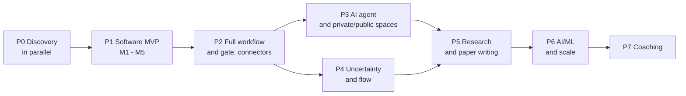

# Plan — Strata: software MVP and roadmap for the rest

> This document records **intentions**, not commitments. The MVP part (Phase 1) follows [PRD_Strata_MVP.md](PRD_Strata_MVP.md). Later phases (research, scientific paper writing, AI/ML, AI agents…) open only when their entry conditions are met. The order of phases after the MVP is a **hypothesis** and may change based on interview results and real usage data.

---

## 0. Document information

| Field | Value |
|---|---|
| Product | Strata |
| Version | v0.1 |
| Status | Draft |
| Last updated | 2026-11-03 |
| Review cycle | At the end of each milestone (M1–M5) and when deciding to open a new phase |
| Related documents | [PRD](PRD_Strata_MVP.md) · [README](../../README.md) · [Architecture](../background/system-architecture.md) |

### Change log

| Version | Date | Change |
|---|---|---|
| v0.1 | 2026-11-03 | First version. MVP narrowed to software projects; intentions recorded for research, paper writing, AI/ML and agents. |

---

## 1. Planning principles

1. **A narrow slice with automatic data first.** The MVP sits at the intersection of Git + test results + feature profile, for one kind (`software`).
2. **Each phase must produce something usable**, validated with real users, not just completed features.
3. **Open later phases based on conditions, not on a schedule.** Each phase has entry conditions and exit criteria (section 5).
4. **Prepare extension points within the MVP** (section 6), but do not build features that are not yet needed.
5. **Interview before building** for research and AI/ML: the evidence for pain points in these two groups currently comes mainly from vendor surveys and small samples.
6. **Measure the process, not individuals** in every phase.

---

## 2. Phase map

| Phase | Name | One-line goal | Status |
|---|---|---|---|
| P0 | Discovery | Confirm pain points and choose the first group | Not started |
| P1 | Software MVP | Feature profile + automatic evidence + basic gate | Not started (PRD ready) |
| P2 | Full workflow and gate | Workflow designer, history with diffs, additional connectors | Planned |
| P3 | AI agent and spaces | Level 0–1 agents through a tool gateway; private/public; permission-filtered search | Planned |
| P4 | Uncertainty and flow | Range estimates, risk register, cycle time/CFD, bottleneck detection | Planned |
| P5 | Research and paper writing | `research` kind, claim traceability, paper lifecycle | Planned, interviews required |
| P6 | AI/ML and scale | `ai` kind, MLflow/W&B, silo DB | Planned, interviews required |
| P7 | Coaching | Practice suggestions with evidence, PDCA, Andon | Planned |

---

## 3. Phase 0 — Discovery (in parallel with M1)

| Task | Output | Done when |
|---|---|---|
| Draft the interview guide for the software group (PO, PM, BA, QA, Dev) | Interview script | Trial run with 2 people |
| Interview 8–10 people from the software group | Notes, ranked pain point table | PP-01…PP-07 confirmed, rejected or revised |
| Choose 1–3 first pilot teams | List of teams + usage commitment | Each team has CI that generates JUnit and 1 BA/QA |
| Light early interviews with 4–5 research leads / AI team leads | Notes confirming whether P5/P6 should be opened | Decision fed into section 7 |
| Technical spikes (section 8) | Spike report | 4 spikes pass or have alternatives |

---

## 4. Phase 1 — Software MVP

Requirements and acceptance criteria are detailed in the [PRD](PRD_Strata_MVP.md). Timing is counted in weeks from T0, assuming a 3–4 person team (not yet confirmed).

### 4.1 Workflow and milestones

| Milestone | Weeks | Main work | Output | Definition of Done |
|---|---|---|---|---|
| M1 — Core | 1–2 | Project setup, PostgreSQL + RLS, `tenant`, OIDC sign-in, many-to-many roles, event store (outbox) | F1, F2 | AC-F1, AC-F2; RLS tests in CI; audit of permission changes |
| M2 — Work | 3–4 | Project, item, link, sprint, bug, Kanban board, backlog, comments, mentions, notifications | F3, F4 | AC-F3, AC-F4; usable internally by a team |
| M3 — GitHub | 5–6 | GitHub App, idempotent webhooks, reconciliation polling, automatic item-code linking | F5 | AC-F5 on a real repo; duplicate or out-of-order webhooks handled safely |
| M4 — Tests and profile | 7–8 | JUnit upload, immutable snapshots, feature profile, timeline | F6, F7 | AC-F6, AC-F7; demo of one feature from requirement to test results |
| M5 — Gate and dogfooding | 9–10 | Basic gate, AC↔test matrix, role-based views (Could), pilot with a real team | F8, F9, F10 | AC-F8, AC-F9; ≥ 1 pilot team starts |

### 4.2 Entry conditions for P1

- Team size and skills confirmed (PQ-01), stack chosen (PQ-05).
- P0 has confirmed at least pain points PP-01, PP-03, PP-05, or the PRD has been revised.
- At least 1 team has committed to a pilot.

### 4.3 Exit criteria for P1 (to open P2)

- ≥ 3 teams using it for real work continuously for 4 weeks; ≥ 60% of members active weekly.
- ≥ 80% of commit/PR–item links are automatic.
- ≥ 2 teams use the gate for real releases.
- 0 cross-tenant leaks in tests and operation.
- Information from users about what is missing most (input for re-prioritizing P2–P4).

### 4.4 Not done in P1

Workflow designer, AI agents, private/public spaces, estimation, bottleneck analysis, research/ai kinds, silo DB, GitLab and other connectors (see PRD Appendix B).

---

## 5. Phases after the MVP

### 5.1 Phase 2 — Full workflow and gate

| Item | Content |
|---|---|
| Goal | Let teams design their own processes with approval gates; increase the coverage of evidence sources. |
| Scope | WF-01 workflow designer (source/input/process/switch/gate/output nodes); WF-02 stale propagation; HIS-01 history with diffs and version tree; INT-01 GitLab, CI, SonarQube, Figma, Confluence. |
| Entry conditions | P1 exit criteria met; users clearly state a need to customize their process. |
| Exit criteria | A team configures a release workflow on its own without support; 0 unbounded gate loops. |
| Dependencies | The token/dataflow model tested in the basic gate. |
| Risks | Becoming "a second Jira". Mitigation: default templates, limit on node types. |

### 5.2 Phase 3 — AI agent and private/public spaces

| Item | Content |
|---|---|
| Goal | An agent performs one node (as a proposal), the person controls input and output; private and public spaces with explicit publishing. |
| Scope | AGT-01 `agent` node, input contract, context package, output schema, draft area, `agent_run` record; AGT-02 guardrails (tool allowlist, budget, sandbox, its own identity, stop button, escalation); SPC-01 spaces + publishing; SRC-01 FTS + vector search with permission filtering; AUTHZ-01 ABAC. Autonomy levels 0–1 first; levels 2–3 (AGT-03) only when acceptance metrics are stable. |
| Entry conditions | P2 has a trustworthy gate; D-06 decided (is the agent provided by the application or plugged in externally); policy on data sent to external models. |
| Exit criteria | An end-to-end agent flow from context package to accepted changeset; a test proves that an agent cannot read another person's private space; acceptance rate and edit level are measured per node. |
| Risks | Automation bias, prompt injection, data leaks to external models, verification cost equal to doing the work yourself. Mitigation: see [brainstorm section 11](../background/brainstorm-summary.md). |

### 5.3 Phase 4 — Uncertainty and flow

| Item | Content |
|---|---|
| Goal | Make uncertainty visible and detect process bottlenecks. |
| Scope | EST-01 range estimates, a "cannot yet estimate" state, time-boxed spikes, risk register; FLOW-01 cycle time, WIP, queue time, aging, CFD, bottleneck rules. Rule-based first, AI later. |
| Entry conditions | At least 3 months of real event data from P1–P2. |
| Exit criteria | Monte Carlo forecasts on historical throughput with measurable deviation; teams use bottleneck detection without it being seen as individual monitoring. |
| Risks | Goodhart effect; estimates used to evaluate teams. Mitigation: measure at process level, no individual leaderboards. |

### 5.4 Phase 5 — Research projects and scientific paper writing

| Item | Content |
|---|---|
| Goal | Manage the full research lifecycle: hypothesis → experiment → data → manuscript → review → publication, with traceability from claims to the original evidence. |
| Scope | RSC-01 `research` kind (hypotheses, experiments, results; lifecycle `proposed → approved → running → analyzing → written → submitted`); record cancelled experiments and rejected hypotheses as data; RSC-02 trace claim ↔ run/experiment; RSC-03 Zotero, Overleaf, OSF, ORCID/Crossref; RSC-04 paper writing, review and submission lifecycle; ideas are private by default (using SPC-01). |
| Entry conditions | P3 has private/public spaces; interviews with ≥ 8 research PMs/lab leads confirm the pain point; one research group selected as a partner. |
| Exit criteria | One paper passes through the end-to-end traceability chain in a real group; the group reduces the time spent compiling data for the manuscript (measured before/after). |
| Dependencies | Publisher AI policies; connector quality; researchers' record-keeping habits. |
| Risks | Repeating the failure of ELNs where "nobody records anything". Mitigation: automatic sources (Git, Zotero, run tracking); verify AI-generated citations before use. Background: [research-landscape-report.md](../background/research-landscape-report.md). |

### 5.5 Phase 6 — AI/ML projects and enterprise scale

| Item | Content |
|---|---|
| Goal | Track ML experiments linked to hypotheses, tasks and documents; be ready for large customers. |
| Scope | ML-01 `ai` kind (runs, parameters, metrics, dataset versions, checkpoints); record abandoned experiments with reasons; ML-02 connectors for MLflow, W&B, DVC, run comparison, basic model registry; ENT-01 silo DB, data regions, tenant-based keys. |
| Entry conditions | Interviews with ≥ 8 AI team leads; at least 1 customer requires data isolation (for ENT-01). |
| Exit criteria | An AI team uses Strata alongside MLflow/W&B without manual entry; a silo tenant runs with the same application code. |
| Risks | Competition with W&B/MLflow. Mitigation: act as the linking layer hypothesis ↔ run ↔ document, not replace tracking tools. |

### 5.6 Phase 7 — Coaching

| Item | Content |
|---|---|
| Goal | Suggest practices with evidence; the team decides; the app evaluates the results itself. |
| Scope | COACH-01 practice suggestions (Theory of Constraints, Kanban/WIP limits, 5 Whys), self-evaluating PDCA after a deadline, Andon (stop the flow). |
| Entry conditions | P4 has reliable bottleneck detection. |
| Exit criteria | Suggestions are accepted and improve metrics in at least 2 teams. |

---

## 6. Extension points that must exist in the MVP

So that later phases do not have to rewrite the core, the MVP prepares the following (without building features):

| Extension point | What to do in the MVP | Used in phase |
|---|---|---|
| `kind` and item type are data | Kind/type registry table; `attrs` JSONB with a registered schema | P5, P6 |
| Gate is versioned data | Gate rules stored as structure, not code | P2, P3 |
| Immutable snapshots + source adapters | Common snapshot schema; JUnit and GitHub are the first 2 adapters | P2, P6 |
| Event store + outbox | Every change writes an event | P4, P7 |
| `tenant` routing table | Maps tenant → data location | P6 (silo) |
| Policy decision point | One shared permission function for the API; room for ABAC | P3 |
| Visibility column on artifacts | `visibility` defaults to `project`; private/public not yet opened | P3, P5 |
| Actor identity | Actor table with type `user` / `agent` / `integration` | P3 |
| Internal tool gateway | All data access through the authorized service layer, no shortcut to the DB | P3 |

---

## 7. Decisions to make

| ID | Decision | Deadline | Impact | Status |
|---|---|---|---|---|
| D-01 | Build team size and T0 date | Before M1 | Whole schedule | Open |
| D-02 | First user group | End of P0 | Feature order in P1 | Open |
| D-03 | Technology stack | Before M1 | Build speed | Open (default TypeScript) |
| D-04 | Build the core ourselves or base it on Plane/OpenProject | End of P0 | Amount of code | Open (leaning toward building our own) |
| D-05 | Business model | Before P2 | SaaS/self-host, silo | Open |
| D-06 | Agent provided by the application or plugged in externally | Before P3 | Security, responsibility | Open |
| D-07 | Does "public" mean inside the organization or outside | Before P3 | Space model | Open |
| D-08 | Open P5 before P3/P4? | End of P1 | Phase order | Open, to be decided based on interviews |
| D-09 | Is an iteration a sprint or a gate cycle | Before P2 | Spiral model | Open (leaning toward gate) |

---

## 8. Validation spikes before committing

| Spike | Question | Pass criteria | Belongs to |
|---|---|---|---|
| S-01 Cross-tenant leak | Does RLS block queries missing `tenant_id`, including through search? | 0 leaking rows in the test suite | P0/M1 |
| S-02 Idempotent webhooks | Do duplicate or out-of-order deliveries create copies? | 1 snapshot per event | P0/M3 |
| S-03 Gate reproducibility | Does re-running the gate on the same snapshot and rules give the same result? | 100% identical | P0/M5 |
| S-04 Rough load | Number of events per day for a large tenant; when is it necessary to split ingest/queue? | An estimate and thresholds exist | P0 |
| S-05 End-to-end agent flow (done in P3) | Does an agent go from context package to an accepted changeset? Can it avoid reading another person's private space? | Both pass | P3 |

---

## 9. Plan risks

| Risk | Level | Mitigation |
|---|---|---|
| Scope spreads before P1 proves its value | High | P1 exit criteria are a mandatory gate |
| Interviews show pain points are not as painful as assumed | High | Update the PRD; change the first group; keep build cost low |
| Small team, the 10-week plan slips | Medium | Cut F10 and F9 first; keep F5–F7 |
| Wrong phase order (research is needed sooner) | Medium | Decide D-08 after P1, based on interviews |
| Competition takes the gap | Medium | Track periodically; validate value early |
| Too much dependence on GitHub | Medium | Normalizing adapters; GitLab in P2 |

---

## 10. Current status

| Item | Status |
|---|---|
| Synthesized brainstorm | Done ([brainstorm-summary.md](../background/brainstorm-summary.md)) |
| System architecture proposal | Done ([system-architecture.md](../background/system-architecture.md)) |
| Context research report | Done ([research-landscape-report.md](../background/research-landscape-report.md)) |
| Strata introduction slides | Done (separate artifact) |
| Software MVP PRD | Draft v0.1 |
| Plan (this document) | Draft v0.1 |
| P0 Discovery | Not started |
| P1 MVP | Not started |
